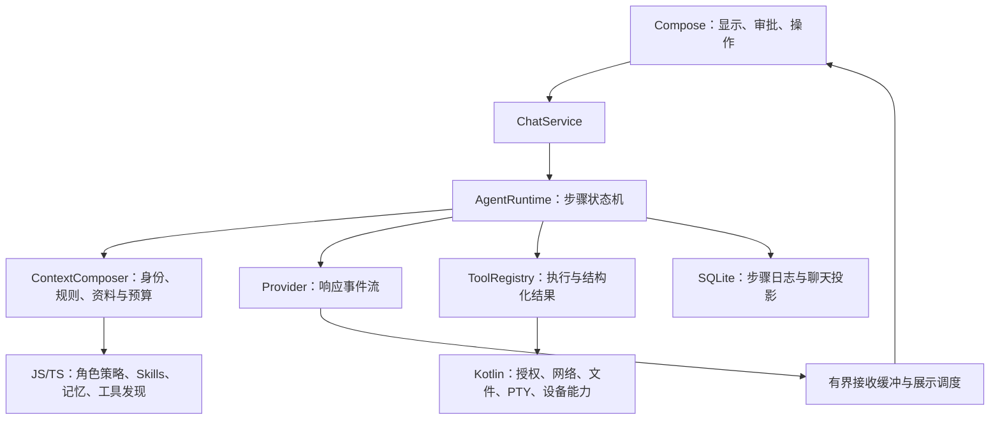

# Solvit 后续方向：先打通执行链，再扩展能力

## 当前交付顺序（2026-10-17）

[0.43.10/build100已验证候选](release-0.43.10.md)统一图片/文本/PDF预览工具栏，长标题单行显示，完整文件信息可查看和选择复制；系统返回先关闭信息并保留预览。完整Android39077647058通过628单元、Lint、117设备与15独立恢复；共享预览定向两轮覆盖浅/深色、150%字体和实际返回，最终APK与定向生产包逐字节一致，原始报告/签名/资源和实际截图已核对。保留build99草稿/输入同步/终端及更早聊天和插件改进。此前偶发请求0、附件导入、Compose销毁根因未证明，证据保留。正式Release仍0.43.9，公开市场部署和严格live门禁尚未完成；真实模型凭据仍未配置，真实任务/账号、真机及下方完整路线继续保留。

本轮继续按用户反馈打磨UI及交互逻辑。[0.43.9](release-0.43.9.md)的Linux环境状态、安装/日志层级与终端会话管理已正式交付，真实退出码丢失修复、旧包升级保持设置和公开APK核对通过。此前[0.43.8](release-0.43.8.md)工作目录导航、操作分组和Git共用组件，以及[0.43.6](release-0.43.6.md)设置、插件、授权与队列调整保留。继续围绕实际任务打磨聊天、插件页面与工作区交互；真实模型任务、Linux兼容及完整插件协议的范围和下列验收要求继续保留。0.43.4、0.43.5、0.43.7未发布的历史记录与标签不改。

此前[0.43.3](release-0.43.3.md)基线：更新Compose生命周期依赖及备份按钮状态，并完成排队界面测试的完整回归；原0.43.2插件文档所有权修复继续保留。Skills1.2.0已打通资源准备与实际Ubuntu Python/Node执行，旧用户需明确更新、审阅新增workspace权限。以下早期研究与阶段复核按时间保留，不代表所有差距仍未实现。Linux开发环境已经发布，Python、Node/npm、Java与共享工作区的实际验证和限制见[环境指南](linux-environment.md)。无需重新实现一套虚拟环境。

此前交付基线：[0.39.0](release-0.39.0.md)已完成文件导入进度、取消恢复、登记暂存清理、持久事务及进程死亡恢复；正式Actions及公开APK字节核对通过。候选WebView原生崩溃未复现且根因未定，保留诊断记录。[完整证据](workspace-import-transfer-stage.md)。

1. 工作区可靠性已推进到[0.41.0](release-0.41.0.md)：Git克隆中断可审阅、明确继续/重新下载或只关闭私有暂存；并发Shell冲突保留文件，已发布后不重置后续修改。正式586单元/82常规设备/15场独立强杀通过，公开APK与源码字节已核对。0.40.0备份管理、导入容量准入与持久替换继续保留。后续围绕实际项目任务反馈改善，不能自动重放外部写入。
2. 验收实际Agent任务：角色切换/新对话、网络接收与可见流式、搜索正文与引用、Linux工作区建项目→运行失败→修复→再验证，以及真实GitHub账号读写。原生和模拟模型测试不能替代这些验收；不得使用历史暴露的API密钥。
3. 继续Linux运行环境与插件组合：ARM64真机及旧内核兼容、本地stdio MCP进程生命周期与取消、第三方Skills依赖及脚本执行体验；保留完整JS Agent/Provider替换协议作为独立阶段。QuickJS与Ubuntu中的Node仍是两种运行环境。

本地stdio的原生管道、API30授权桥、多连接HTML页面及JS协议/Agent路由已合入main。实际Ubuntu Python/Node调用、页面确认、取消/崩溃、聊天隔离和API26/35宿主SIGKILL清理已远程通过，[证据及边界](local-stdio-mcp-stage.md)。[0.42.3](release-0.42.3.md)已正式发布，600单元、96常规设备、15场恢复检查和stdio宿主实际强杀通过，原始XML及公开资产摘要已核对。0.42.0源码下载失败、0.42.1掩盖UI失败和0.42.2附件超时的记录均保留；0.42.1仍标预发布，修正后的独立报告门禁已启用。真实模型、ARM64真机、第三方服务、Skills运行环境和完整JS Agent/Provider协议继续保留。

0.43.1的正式远程检查通过611单元、完整设备/恢复/覆盖升级、实际Ubuntu脚本及市场兼容。实际QuickJS→原生授权→Ubuntu→失败修复→共享文件由确定性Provider驱动，不能替代真实模型验收；首轮系统WebView原生崩溃仍未定位，后续24次重建与完整回归未复现，详见[Skills阶段记录](skills-runtime-stage.md)。下一步保留ARM64/旧内核、第三方依赖、真实模型与账号任务，以及完整JS Agent/Provider协议，不能因本次发布视为全部完成。

0.43.2完整发布门禁及97常规设备通过，文档替换缺陷由原APK失败到同断言通过。但额外压力在旧版第33次操作期间复现原生SIGSEGV；新版完成59次后由另一个Compose SnapshotStateObserver跨线程异常中断，不能写成240次全部通过。继续定位指定的另一线程与原生时序，保持[失败证据](webview-lifecycle-stage.md)，不因正式流水线绿色而结束排查。

2026-10-16在正式0.43.3 APK上移除Compose测试规则、用真实Activity/系统触摸执行的压力再次复现相同WebView124原生SIGSEGV：完整30次＋第二轮20次，第51次未完成。不能将该原生问题归为默认测试调度或宣称已根治。独立原生WebView对照已实际完成240次且零崩溃；产品宿主＋最小HTML完成8次后在第9次期间复现相同原生签名，证明终端业务脚本不是必要条件；原生容器保留桥/资源的对照亦完成240次零崩溃。外层FrameLayout候选在同一最小宿主压力中完成27次后、第28次仍复现相同原生崩溃，已停止其剩余回归且不合入；临时阶段日志在实际完成19次后、第20次复现：所有已记录释放调用均返回，1.175秒后原生崩溃；最后实例在宿主收到ready前已提交状态脚本。现已新增延迟ready的真实页面回归，并提交只在ready后下发最新状态的独立候选，旧APK延迟ready断言已实际失败（预期0次状态，实际1次），候选远程build通过611单元；候选同断言已通过，但原最小宿主仅完成1次，第2次仍以同一原生签名崩溃，且该实例没有状态脚本执行。就绪门禁不足以根治；无日志协议分支已完整通过611单元/99常规设备/15恢复及实际stdio强杀。省略提前移除消息监听的单变量对照已在同WebView124完成240次最小宿主压力，真实工作区亦已完成240次且零崩溃（两者仍带日志）；Chromium同版本源码显示工厂删除与首次在途消息存在吻合的生命周期风险。已提交无日志生命周期候选、正常整页销毁统一回收桥，无日志最小宿主已完成240次、零原生崩溃/临时日志；真实工作区完成17次后在第18次绑定界面断言超时，零Fatal，不能计作通过或直接归为测试问题。已仅新增失败现场记录，用同一APK重放。无日志完整常规101项有3项界面失败（角色侧栏关闭、PDF发送结算、API9表单保存），新增三个生命周期方法及15恢复通过，最后stdio强杀未执行，不计整套通过。角色改等实际关闭、其余增加仅失败现场，继续同APK逐项定位；等待真实路径与完整发布门禁。协议修正与原生范围分别验收。最终须清除诊断日志，再验证无日志的真实工作区路径及完整发布门禁。两种负载不同，不能据此证明根因或宣称已修复。正式主线代码未改，见[实际证据与对照边界](webview-user-lifecycle-stage.md)。本日重新核对secret元数据，`SOLVIT_MODEL_API_KEY`仍未配置，真实模型验收保持未完成。

2026-10-15再次核对实际GitHub Actions secret元数据，尚未配置 `SOLVIT_MODEL_API_KEY`；没有启动必然因缺少凭据而失败的真实模型任务，也不使用历史暴露的密钥。真实模型工作流补齐与正式APK相同的锁定PRoot/loader源码构建，避免将不含Linux可执行程序的诊断包当作完整生产环境验收。凭据配置与实际模型任务仍未完成。

附件、插件HTML页面、记忆关系图、多MCP、真实PTY、Git文件预览和界面设置继续保留回归。屏幕操控按用户后续要求暂缓，不因下面早期顺序提到手机操作而重新启动。上述范围不因本次导入版本通过而视为全部完成。

研究日期：2026-10-12。初审基线为 `2d40d9c` / 0.15.1；本次复核基线为 `ae49c7e` / 0.15.3 发布提交。本文是源码审查与实施决策，不能当作真实模型、真机验收结果。

## 结论

继续保留 Kotlin / Compose / SQLite / QuickJS。产品定位为能聊天、理解工作区并实际完成任务的 Android Agent，主要扩展由 JS/TS 插件提供。

前面的交付偏重功能入口、插件数量和编译验证。下一阶段的重点是让角色、上下文、模型响应、工具结果、记忆和展示形成可检查的执行链。先完成普通聊天、联网问答两个可靠场景，再完成工作区任务；随后推进手机操作。更多模型协议不作为当前优先事项。

## 上游实际提供了什么

| 来源 | 实际审查范围 | Solvit 采用的方向 | 移植边界 |
| --- | --- | --- | --- |
| DSH | `d743267388641bc76f17c45ce8b4c231aed1d32c` 的 Prompt 注册、Agent 循环、持久化与压缩契约 | 有名称/顺序/作用域的提示段；每个模型步骤重新组装；可替换服务；步骤日志；工具结果裁剪与摘要 | MIT；可优先抽取独立 TS 类型、算法及相关测试。Cordis、Node 服务和桌面入口需要适配，不能把完整项目直接放进 QuickJS |
| Operit | `dbf71916fae9750cfdc9f9a774f5a0fee56633fb` 的 ConversationService、EnhancedAIService、流式渲染、记忆调度和搜索脚本 | Android 角色和工具范围一起组装；资料进入上下文；流解析与刷新分离；自动记忆候选；网页访问和正文提取 | 仓库 LGPL-3.0，直接复用前核对具体文件及依赖许可、署名与分发要求。已有成熟部件应评估抽取复用，不能把每个功能都重新简写一次 |
| Claude Code | 官方执行、记忆和插件文档及仓库许可证 | 获取上下文→执行→验证；项目规则、自动记忆、按需加载 Skills；上下文预算；中断和恢复体验 | 完整核心不是该仓库公开提供的开源实现；按官方文档设计兼容行为，不使用泄露实现 |
| 智谱 Open-AutoGLM | `86f55382982fb054e8fc98ca80609dff8a2cdc3c` 的 phone_agent、模型请求和动作处理 | 每一步先观察手机，再生成动作、执行，下步重新观察；明确完成、接管及步骤上限 | Apache-2.0；Python 外部设备控制不是 Android 应用内运行时，需要设备能力适配和能看图的模型 |
| 智谱 ZCode 插件仓库 | 当日官方 README、插件分类和发布入口 | 插件包组合 Skills、Hooks 和 MCP；复用领域知识与工作流，减少孤立的工具菜单 | 仓库 Apache-2.0，具体包仍需检查许可。它是插件市场源码，不能据此宣称完整 ZCode Agent 内核开源；部分能力依赖宿主账号、订阅和 CLI |

“智谱的”在此分别按手机 Agent 与编码插件生态研究。模型权重仓库不等同于一个可直接复用的 Agent 产品。

## 已确认的 Solvit 差距

以下事实来自本仓库代码；体验影响属于据此作出的工程判断，不能替代实际网络请求诊断。

1. **角色需要实际模型验收。** 初审发现重复身份注入；0.15.2 已改为带名称和来源的提示段，身份只贡献一次。0.15.3 记录实际 Provider 请求的角色与上下文来源元数据。配置进入请求的回归已通过，但尚不能证明用户网关及真实模型遵守角色；默认、自定义、切换和重开对话仍需同一模型验收。
2. **流式体验需要区分接收与显示。** 初审发现 `collect` 内逐字符等待阻塞接收；0.15.2 已改成独立有界队列与按帧显示，0.15.3 分开记录收到解析事件和显示完成的耗时。回归已通过，网关是否缓冲仍待实际请求检查；解析事件时间也不是网络首字节时间。
3. **上下文管理缺位。** `DefaultChatService` 汇总完整有效历史；0.17.0 源码已将 `ToolAgentRuntime` 改为每步刷新工具和 Hook。没有明确 Token 预算、自动摘要和工具结果压缩。单个工具结果的 256 KiB 限制不是上下文预算。
4. **插件能力还不等于 DSH 的可替换内核。** TS SDK 提供工具、启停和只读 `beforeModel`。第三方 JS 还不能替换 Agent、模型 Provider、上下文策略或聊天存储。原生 Kotlin 服务接口可替换是另一层机制。
5. **记忆有存储工具，缺少自动使用链。** 0.17.0 源码已为记忆 1.1.0 接入自动检索 Hook 和原生开关；旧 1.0.0 需用户更新并重新启用。回复后的自动提取仍未实现，自动检索不等于后台自动学习。
6. **搜索验收只证明返回来源。** 默认 Bing RSS 免密钥，已有可用性和格式检查；没有搜索相关性、时效性、页面正文和最终回答引用的完整验收。Operit 的脚本调用网页访问能力，支持多个引擎及进一步读取页面，能力链更完整。
7. **执行失败信息太粗。** Agent 将一般工具异常统一转换为一句失败提示。需要脱敏后的错误类型、步骤、可恢复建议和 UI 详情，才能让模型及用户正确处理失败。
8. **执行记录到回合结算才持久化。** 当前结束、异常或取消会统一保存；进程被杀不是正常取消，不能保证中间工具执行事实已保存。需要步骤日志，并区分可恢复状态与不能自动重放的外部操作。

单元和模拟器测试通过证明了受测行为，不能据此承诺真实模型稳定遵守角色、正确选择工具或搜索回答准确。

## 本次方向复核：按可完成的任务交付

主参考分工保持明确：Operit 对照 Android 产品体验及宿主能力；DSH 对照可组合的提示、服务、生命周期和每步执行；Claude Code 对照“获取上下文→行动→验证”的任务流程；Open-AutoGLM 对照手机观察与动作闭环；智谱编码插件仓库对照 Skills/Hooks/MCP 组合包。Claude Code 的公开仓库不包含完整核心，ZCode 插件仓库也不等于其宿主内核。

主分支已合入 0.17.0 的每步工具/Hook 刷新和已保存记忆自动检索，163 个单元与 29 个模拟器测试通过；回合结束自动抽取仍未实现，`DefaultChatService` 仍加载完整有效历史。下一项明确落点是全请求预算与可查看摘要。搜索浏览器桥及 TS 策略已合入主分支并发布 0.16.0，公网来源/正文及官方版本时效检查通过；真实模型最终引用、真机网络和更广泛问题集仍待验收。

每阶段至少用一个真实任务验收：

- 聊天：选择一个明确角色，切换并新建/重开对话，检查实际请求来源和回答；连续流式与整块回复分别计时，停止后及时结束。
- 搜索：中文、英文及近期事实问题，检查搜索结果相关性，读取正文，再核对回答中的引用是否支持结论；引擎拒绝或失败必须明确呈现。
- 记忆：明确保存偏好，另一会话自动检索并使用，展示来源；删除或停用后不再注入。长历史压缩后保留身份、任务状态及工具调用配对。
- 工作区：创建或修改一个小项目，运行命令，检查退出码和差异，失败后修复再验证；不能把写入文件或命令启动当作任务完成。
- 手机：先观察当前界面再操作，操作后重新观察；受控真机任务验证完成和接管，不以模拟器工具入口代替。

先保留 Kotlin 的授权、平台能力和执行状态机，通过 JS/TS 提供搜索、Skills、记忆与上下文策略。把整个 Agent 搬到 JS 需要模型流、事件持久化、取消和资源预算协议；应在上述任务稳定后单独实施。当前停止增加模型协议和孤立插件入口，按聊天→搜索→记忆/预算→工作区→手机的顺序推进。

## 本次源码复核后的具体决策

本次核对发布主分支 `61ad091`，并确认六个参考 checkout 与锁定版本一致。每步刷新 Hook、已保存记忆的自动检索与公开布尔设置已合入主分支；[远程运行 38167002200](https://github.com/veryy/Solvit/actions/runs/38167002200) 通过 163 个单元及 29 个模拟器测试。[0.17.0 标签发布](https://github.com/veryy/Solvit/actions/runs/38167779375) 也已通过；自动检索不能称为后台自动学习。

1. **以 Operit 为 Android 主参考，以 DSH 为执行架构主参考。** 保留原生聊天、SQLite、PTY 与 QuickJS；JS/TS 承载搜索、记忆、Skills、工具和上下文策略。权限、凭据、取消和资源限制继续由宿主强制执行。第三方 JS 可替换完整 Agent/Provider 是后续独立协议工作。
2. **先验收用户已经报错的场景。** 角色应用后、新建和重开聊天必须检查实际请求与真实回答；流式必须同时测接收和可见输出，不能用动画掩盖网关整块返回。搜索必须读正文并验证回答引用。当前远程回归通过的部分与真实模型尚未验收的部分分别标记。
3. **下一项机制交付是上下文与记忆。** 先完成候选分支的远程验收，再加入整个请求的预算：身份、规则、工具 schema、记忆、历史、工具结果以及输出预留一起计算。DSH `compaction-basic/src/config.ts` 区分输出预留和压缩余量；`region.ts` 保留工具调用/结果配对，并检查摘要替换边界。采用这些约束，不能用单段字符上限替代全局预算。
4. **随后交付一个完整工作区任务。** 工具返回退出码、输出、工作目录和变更证据；失败细节脱敏后同时供模型与用户查看。参考 DSH `agent-loop/src/agent.ts` 的步骤事件和异常恢复结果记录，执行过程中保存日志；恢复只展示已经执行的事实，不自动重放命令。以“建文件→运行→失败→修复→再运行”作为验收任务。
5. **后台记忆与手机操作分别交付。** Operit `MemoryAutoSaveScheduler.kt` 使用资料空间分组、候选状态、批次上限和单任务运行保护；Solvit 应有明确开关、来源、失败状态和删除入口，再接回复后的抽取。Open-AutoGLM `phone_agent/agent.py` 在每一步重新截图、执行动作并检查结束/步骤上限；手机能力必须采用这样的观察闭环。

Claude Code 的官方执行文档用于对照“获取上下文→行动→验证”；公开仓库不提供完整核心。智谱编码插件中的 Skills 是任务说明与脚本的组合，例如 `glm-plan-bug/skills/case-feedback-skill/SKILL.md` 依赖 Node 脚本。Android QuickJS 不提供 Node 的进程、文件与模块环境，导入文本不等于脚本可执行；适配应显式声明宿主能力与运行环境，禁止默默宣称兼容。

直接复用的选择顺序是：检查许可与运行环境 → 抽取可独立使用的组件及测试 → 用 Kotlin 宿主适配平台接口 → 用相同任务验证行为。复用完整 Operit 会扩大 Android 能力和产品范围；复用完整 DSH 则需要其 Cordis/Node 环境。当前选择渐进适配现有 Solvit，不重开一个功能更多但链路同样未验收的项目。

每个功能版本的验收都包含：实际任务结果、错误与取消、旧数据及签名兼容、远程构建和可下载 APK。测试数量是证据的一部分，不能代替任务结果。本次仅更新研究和实施方向，不新增 APK 版本。

## 最小架构调整

`ContextComposer` 提示段建议为 `identity`、`user-rules`、`workspace`、`skills-index`、`memory`、`tool-guidance`；段带来源、作用域和预算。规则和身份与外部资料分开，工具权限由宿主强制执行。执行中按步骤刷新允许变化的上下文，不把插件返回文本直接当成更高优先级规则。

逐字显示由独立展示调度控制。Provider 和 Agent 及时收集原始事件；Compose 按帧批量刷新，可保留平滑逐字观感。记录请求开始、首个网络内容、首个可见文字和完成时间，区分模型思考、网关缓冲、解析等待和渲染排队。缓冲必须有界，停止操作同时取消网络、工具和展示队列。

TS 插件接口按阶段增加提示段贡献、受限的 `afterTurn`、工具筛选和上下文压缩策略，保留旧插件兼容。自动写记忆采用明确开关、授权、来源和可删除记录。新 Hook 不得绕过宿主权限或在失败后循环重试。

第一阶段保留 Kotlin 步骤状态机，让 JS/TS 提供策略和能力。若后续需要 JS 替换整个 Agent，再增加受限的模型流 RPC、持久事件协议和资源预算；这一步复杂度高，应独立交付，不能仅在清单上新增一个“agent”字段就声称完成。

## 实施顺序与验收

| 阶段 | 具体交付 | 验收依据 |
| --- | --- | --- |
| P0 聊天稳定性 | 上下文组装与脱敏诊断；角色统一来源；接收/展示分离；保留错误细节；暂停更多协议 | 真实模型测试默认/自定义/切换角色、重开/新对话、长历史；覆盖连续 SSE、整块 JSON、长思考、工具和停止。诊断能显示最终角色与上下文来源，密钥不输出 |
| P1 搜索闭环 | 免配置引擎适配、失败回退、网页正文提取、来源展示 | 固定中文/英文与时效问题集，人工核验前列结果相关性、正文和回答引用；失败明确说明。返回三个 URL 不算搜索质量验收 |
| P2 上下文与记忆 | Token 估计和预算、工具结果裁剪、可查看摘要；自动检索注入、授权的后台记忆候选与删除 | 跨会话记住明确偏好，检索带来源；未启用不读取；删除后不再注入；摘要保留角色、未完成任务与工具调用配对。估计值与 Provider 实测 usage 分开标注 |
| P3 工作区任务 | 项目规则、可靠读写、差异审阅、Shell 输出、执行后验证、步骤日志 | 实际完成创建/修改/运行/修复一个小项目；确认退出码和文件差异；恢复后展示已执行事实，不自动重放有副作用的操作 |
| P4 手机操作 | 截图/界面观察、可授权动作、操作后重新观察、失败与接管 | 参考 AutoGLM 的闭环，在真机受控任务中逐步验证；模型能力和 Android 实际权限满足后交付 |

难度判断：复用当前服务做 P0/P1 属于局部到中等改造；P2/P3 涉及跨模块协议和数据迁移，难度较高；完整 DSH 式 JS 内核替换和手机控制为独立的大改造。此判断不是工期承诺。

每个阶段及时提交，功能修改通过 GitHub Actions 远程测试、Lint、稳定签名 APK，再发布。新增验收覆盖用户实际任务；不再以入口存在或测试数量代替可用性。文档研究本身不修改 APK 版本。

## 可核对来源

- DSH：[架构](https://github.com/deepseek-ai/deepseek-harness/blob/master/docs/architecture.md)、[Prompt 契约](https://github.com/deepseek-ai/deepseek-harness/blob/d743267388641bc76f17c45ce8b4c231aed1d32c/docs/subsystems/system-prompt.md)、[步骤实现](https://github.com/deepseek-ai/deepseek-harness/blob/d743267388641bc76f17c45ce8b4c231aed1d32c/packages/core/agent-loop/src/agent.ts)、[持久化](https://github.com/deepseek-ai/deepseek-harness/blob/master/docs/subsystems/persistence.md)、[压缩](https://github.com/deepseek-ai/deepseek-harness/blob/master/docs/subsystems/compaction.md)、[MIT](https://github.com/deepseek-ai/deepseek-harness/blob/master/LICENSE)。
- Operit：[上下文与角色组装](https://github.com/AAswordman/Operit/blob/dbf71916fae9750cfdc9f9a774f5a0fee56633fb/app/src/main/java/com/ai/assistance/operit/api/chat/enhance/ConversationService.kt)、[记忆候选调度](https://github.com/AAswordman/Operit/blob/main/app/src/main/java/com/ai/assistance/operit/api/chat/library/MemoryAutoSaveScheduler.kt)、[渲染刷新协调器](https://github.com/AAswordman/Operit/blob/main/app/src/main/java/com/ai/assistance/operit/ui/common/markdown/RenderBatchCoordinator.kt)、[搜索脚本](https://github.com/AAswordman/Operit/blob/main/examples/various_search.ts)、[许可证](https://github.com/AAswordman/Operit/blob/main/LICENSE)。
- Claude Code：[执行方式](https://code.claude.com/docs/en/how-claude-code-works)、[项目规则与自动记忆](https://code.claude.com/docs/en/memory)、[插件](https://code.claude.com/docs/en/plugins)、[仓库许可证](https://github.com/anthropics/claude-code/blob/main/LICENSE.md)。
- 智谱：[Open-AutoGLM 步骤实现](https://github.com/zai-org/Open-AutoGLM/blob/86f55382982fb054e8fc98ca80609dff8a2cdc3c/phone_agent/agent.py)、[ZCode 插件市场](https://github.com/zai-org/zcode-plugins)、[官方编码插件](https://github.com/zai-org/zai-coding-plugins)。

## 0.18.0 后的实施落点

全请求预算和持久摘要已发布，证据见 [上下文阶段](context-budget-stage.md)。估计仍非 Provider 实测 usage，真实模型摘要质量未验收。下一步按 Operit 的持久候选、资料空间分组、受限批次与失败状态推进后台长期记忆；按 DSH 的步骤记录补齐工作区执行证据及进程中断后的状态。仍保留真实模型角色/流式、搜索回答引用和真机任务验收，不以这次门禁代替。完整动态 Hook 与 Claude 原生签名前缀的组合需要单独回归，不宣称现有预算保护已解决这项问题。

## 当前代码复核：避免继续交付孤立入口

本次复核主分支 `4954005` 与自动记忆候选 `b2fa948`，再次核验六个参考 checkout 的锁定提交。读取 DSH 的 `system-prompt/src/index.ts`、`agent-loop/src/agent.ts` 与 `system-prompt-projection.spec.ts`，Operit 的 `ConversationService.kt`、`MemoryAutoSaveScheduler.kt` 与 `RenderBatchCoordinatorTest.kt`，Open-AutoGLM 的 `phone_agent/agent.py`，并核对 Claude Code 官方执行和记忆文档。保留上述参考分工和实施顺序。

当前状态不能沿用初审中的“没有预算/没有自动检索”：0.18.0 已发布预算和摘要；候选分支已有受限后台抽取、来源、人工编辑删除及任务清理，尚未发布。候选状态以 [自动记忆阶段记录](automatic-memory-stage.md) 为准，真实模型质量与真机验收仍待进行。

仍可从代码确认的重点差距：

- `ToolAgentRuntime` 每步重新构造系统上下文；动态 Hook 与原生签名转录需要组合回归和协议适配，不能照搬 DSH 的消息投影到所有 Provider。
- 一般工具异常仍归为统一失败文本，模型缺少退出码、错误分类和可恢复信息。新增结构化结果时同时保留脱敏 UI 详情。
- 当前工具循环提供调用与回传，但没有通用的任务完成验证要求；工作区必须以文件差异、命令退出码及实际验证结果作为完成证据。
- TS 工具及 Hook 不等于可替换的 JS Agent 内核；QuickJS 也不自动提供 Node 进程和模块环境。Skills、MCP 和宿主能力要分别声明。

下一项交付先完成自动记忆候选的远程门禁和协议组合，再以一个完整工作区任务补齐执行、错误修复、验证和持久步骤记录。已有角色、流式和搜索的真实模型验收继续保留，不因机制测试通过而取消。手机控制随后按 AutoGLM 每步观察、动作、再观察的方式推进。

复用要求具体落实到组件及测试：适合移植的 TS 算法和协议优先抽取；Android 权限、PTY、凭据与生命周期由宿主适配。不能把挂上同名插件视为实现上游能力，也不能把安装插件视为模型已经会用。此修改只确定方向，不发布 APK。

用户随后明确要求插件可以自带业务界面，记忆系统参考 Operit。当前管理页仍是 Kotlin 页面，不满足这项要求。自动记忆版本交付后，优先实现 [JS/TS 页面声明、事件与记忆示例](plugin-ui-plan.md)，再继续工作区执行链；原搜索/聊天真实验收、工作区与手机路线保留。页面接口不是仅增加配置字段，须能查看、搜索、编辑和导航插件数据，并验证主题、语言、关闭清理和权限。

## 插件页面候选通过后的顺序

0.19.0 自动记忆已正式发布；API 9 插件界面候选 `a59a4e4` 已通过236个单元、39个模拟器测试和Lint/APK，0.20.0正式标签门禁进行中。设置的记忆/任务入口已运行TS，不再沿用“当前管理页仅Kotlin”的旧状态；公开APK、市场与真实验收以阶段最新记录为准。下一机制阶段继续P3工作区执行→错误修复→实际验证→持久步骤记录，不跳过未完成的真实模型角色/流式/搜索与真机验收。

为下一阶段再次读取DSH `workspace-changes/src/recorder.ts` 与 `tests/capture.spec.ts`：采用每轮快照、写前捕获、串行记录、超限/二进制明确分类与取消清理原则；失败快照不能伪装成“无变化”。读取DSH `agent-loop/src/agent.ts` 的持久 `step/start` 边界，Operit `StandardTerminalCommandExecutor.kt` 的会话查找、结束输出/退出码与取消结算。当前Solvit仍主要在轮次结算保存工具记录，尚未交付进程中断后的逐步事实恢复，也未实现该工作区完整验收；仅阅读源码不计作功能完成。

0.20.0正式标签门禁现已全成功并发布：[Actions 38201381181](https://github.com/veryy/Solvit/actions/runs/38201381181)、[Release](https://github.com/veryy/Solvit/releases/tag/v0.20.0)。插件页面机制交付完成，继续以上P3顺序；真实模型/真机验收仍未完成。

## 新增交付要求：角色与队列后接本地Git/GitHub插件

用户要求修复新对话默认角色、角色名展示、对话内工具授权、生成中继续提交消息并展示等待队列，以及逐条直接发送打断。此项在独立`feat/chat-role-queue`推进，不能被当前文件差异阶段替代。随后添加本地Git与GitHub JS/TS插件：工作区Changes查看Git工作树/暂存区差异、状态、选择暂存、提交和历史；远程绑定、拉取/推送和GitHub提交浏览与代码上传。插件自带HTML界面，AI通过已发现的工具操作，沿用对话内授权及凭据加密。不能将当前历史执行副本页冒称Git状态/工作树差异。

已实际阅读锁定Operit `examples/github/src/github/contents.ts` 与 `src/local/terminal.ts`：远程上传使用GitHub Contents API的SHA前置条件，本地执行经宿主Terminal会话；这两个机制不等同，不能把REST上传作为本地Git实现。进一步核对原子多文件提交、冲突/非快进处理、Android Git执行环境与插件生命周期，再提交实现及真实工作区任务门禁。此段是需求和研究证据，尚无Git/GitHub插件发布。

## 0.39.0 已发布：进程死亡恢复

[正式版本](release-0.39.0.md)已交付文件替换事务恢复、插件HTML结果页与保留文件的提示关闭。537单元、79常规设备、5外部强杀恢复和3独立Linux用例通过，公开APK/源码字节已核对。下一步继续容量/备份管理及Git克隆中断恢复；角色/流式/搜索/完整项目任务的真实模型验收、真实GitHub账号写入、ARM64真机、stdio MCP、Skills运行环境及完整JS Agent/Provider协议继续保留。屏幕操控暂缓。
