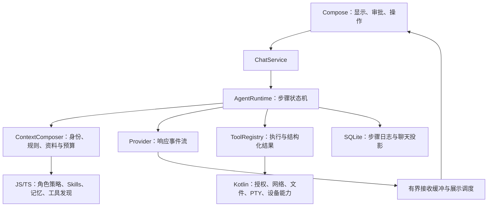

# Solvit 后续方向：先打通执行链，再扩展能力

研究日期：2026-10-12。Solvit 基线：`2d40d9c` / 已发布 0.15.1。本文是源码审查与实施决策，不能当作真实模型、真机验收结果。

## 结论

继续保留 Kotlin / Compose / SQLite / QuickJS。产品定位为能聊天、理解工作区并实际完成任务的 Android Agent，主要扩展由 JS/TS 插件提供。

前面的交付偏重功能入口、插件数量和编译验证。下一阶段的重点是让角色、上下文、模型响应、工具结果、记忆和展示形成可检查的执行链。先完成普通聊天、联网问答两个可靠场景，再完成工作区任务；随后推进手机操作。更多模型协议不作为当前优先事项。

## 上游实际提供了什么

| 来源 | 实际审查范围 | Solvit 采用的方向 | 移植边界 |
| --- | --- | --- | --- |
| DSH | `d743267388641bc76f17c45ce8b4c231aed1d32c` 的 Prompt 注册、Agent 循环、持久化与压缩契约 | 有名称/顺序/作用域的提示段；每个模型步骤重新组装；可替换服务；步骤日志；工具结果裁剪与摘要 | MIT；可优先抽取独立 TS 类型、算法及相关测试。Cordis、Node 服务和桌面入口需要适配，不能把完整项目直接放进 QuickJS |
| Operit | `dbf71916fae9750cfdc9f9a774f5a0fee56633fb` 的 ConversationService、EnhancedAIService、流式渲染、记忆调度和搜索脚本 | Android 角色和工具范围一起组装；资料进入上下文；流解析与刷新分离；自动记忆候选；网页访问和正文提取 | 仓库 LGPL-3.0，直接复用前核对具体文件及依赖许可、署名与分发要求。已有成熟部件应评估抽取复用，不能把每个功能都重新简写一次 |
| Claude Code | 官方执行、记忆和插件文档及仓库许可证 | 获取上下文→执行→验证；项目规则、自动记忆、按需加载 Skills；上下文预算；中断和恢复体验 | 完整核心不是该仓库公开提供的开源实现；按官方文档设计兼容行为，不使用泄露实现 |
| 智谱 Open-AutoGLM | `86f55382982fb054e8fc98ca80609dff8a2cdc3c` 的 phone_agent、模型请求和动作处理 | 每一步先观察手机，再生成动作、执行，下步重新观察；明确完成、接管及步骤上限 | Apache-2.0；Python 外部设备控制不是 Android 应用内运行时，需要设备能力适配和能看图的模型 |
| 智谱 ZCode 插件仓库 | 当日官方 README、插件分类和发布入口 | 插件包组合 Skills、Hooks 和 MCP；复用领域知识与工作流，减少孤立的工具菜单 | 仓库 Apache-2.0，具体包仍需检查许可。它是插件市场源码，不能据此宣称完整 ZCode Agent 内核开源；部分能力依赖宿主账号、订阅和 CLI |

“智谱的”在此分别按手机 Agent 与编码插件生态研究。模型权重仓库不等同于一个可直接复用的 Agent 产品。

## 已确认的 Solvit 差距

以下事实来自本仓库代码；体验影响属于据此作出的工程判断，不能替代实际网络请求诊断。

1. **角色仍是字符串补丁。** `ChatPlugins.kt` 将 `identity` 放在全局提示词前后各一次。虽然每轮读取当前角色，仍缺少提示段的来源、优先级和最终请求预览。不能用重复强调身份代替检查模型实际收到的配置、历史和角色。
2. **网络接收与打字显示耦合。** `ChatViewModel.kt` 在 `collect` 内逐 Unicode 字符追加并 `delay(4)`。一个 5,000 字符片段仅等待就约 20 秒，后续事件也要等收集器继续。此机制能逐渐展示整块回复，但无法让被服务端缓冲的回复变成真正的网络流。
3. **上下文管理缺位。** `DefaultChatService` 汇总完整有效历史；`ToolAgentRuntime` 在执行开始时一次组装系统提示、工具和 Hook。没有明确 Token 预算、自动摘要和工具结果压缩。单个工具结果的 256 KiB 限制不是上下文预算。
4. **插件能力还不等于 DSH 的可替换内核。** TS SDK 提供工具、启停和只读 `beforeModel`。第三方 JS 还不能替换 Agent、模型 Provider、上下文策略或聊天存储。原生 Kotlin 服务接口可替换是另一层机制。
5. **记忆有存储工具，缺少自动使用链。** 当前 TS 记忆实现了事实、画像和 BM25 等，尚未注册自动检索 Hook 或回复后的自动提取。启用插件不代表每轮会使用相关记忆。
6. **搜索验收只证明返回来源。** 默认 Bing RSS 免密钥，已有可用性和格式检查；没有搜索相关性、时效性、页面正文和最终回答引用的完整验收。Operit 的脚本调用网页访问能力，支持多个引擎及进一步读取页面，能力链更完整。
7. **执行失败信息太粗。** Agent 将一般工具异常统一转换为一句失败提示。需要脱敏后的错误类型、步骤、可恢复建议和 UI 详情，才能让模型及用户正确处理失败。
8. **执行记录到回合结算才持久化。** 当前结束、异常或取消会统一保存；进程被杀不是正常取消，不能保证中间工具执行事实已保存。需要步骤日志，并区分可恢复状态与不能自动重放的外部操作。

单元和模拟器测试通过证明了受测行为，不能据此承诺真实模型稳定遵守角色、正确选择工具或搜索回答准确。

## 最小架构调整

`ContextComposer` 提示段建议为 `identity`、`user-rules`、`workspace`、`skills-index`、`memory`、`tool-guidance`；段带来源、作用域和预算。规则和身份与外部资料分开，工具权限由宿主强制执行。执行中按步骤刷新允许变化的上下文，不把插件返回文本直接当成更高优先级规则。

逐字显示由独立展示调度控制。Provider 和 Agent 及时收集原始事件；Compose 按帧批量刷新，可保留平滑逐字观感。记录请求开始、首个网络内容、首个可见文字和完成时间，区分模型思考、网关缓冲、解析等待和渲染排队。缓冲必须有界，停止操作同时取消网络、工具和展示队列。

TS 插件接口按阶段增加提示段贡献、受限的 `afterTurn`、工具筛选和上下文压缩策略，保留旧插件兼容。自动写记忆采用明确开关、授权、来源和可删除记录。新 Hook 不得绕过宿主权限或在失败后循环重试。

第一阶段保留 Kotlin 步骤状态机，让 JS/TS 提供策略和能力。若后续需要 JS 替换整个 Agent，再增加受限的模型流 RPC、持久事件协议和资源预算；这一步复杂度高，应独立交付，不能仅在清单上新增一个“agent”字段就声称完成。

## 实施顺序与验收

| 阶段 | 具体交付 | 验收依据 |
| --- | --- | --- |
| P0 聊天稳定性 | 上下文组装与脱敏诊断；角色统一来源；接收/展示分离；保留错误细节；暂停更多协议 | 真实模型测试默认/自定义/切换角色、重开/新对话、长历史；覆盖连续 SSE、整块 JSON、长思考、工具和停止。诊断能显示最终角色与上下文来源，密钥不输出 |
| P1 搜索闭环 | 免配置引擎适配、失败回退、网页正文提取、来源展示 | 固定中文/英文与时效问题集，人工核验前列结果相关性、正文和回答引用；失败明确说明。返回三个 URL 不算搜索质量验收 |
| P2 上下文与记忆 | Token 估计和预算、工具结果裁剪、可查看摘要；自动检索注入、授权的后台记忆候选与删除 | 跨会话记住明确偏好，检索带来源；未启用不读取；删除后不再注入；摘要保留角色、未完成任务与工具调用配对。估计值与 Provider 实测 usage 分开标注 |
| P3 工作区任务 | 项目规则、可靠读写、差异审阅、Shell 输出、执行后验证、步骤日志 | 实际完成创建/修改/运行/修复一个小项目；确认退出码和文件差异；恢复后展示已执行事实，不自动重放有副作用的操作 |
| P4 手机操作 | 截图/界面观察、可授权动作、操作后重新观察、失败与接管 | 参考 AutoGLM 的闭环，在真机受控任务中逐步验证；模型能力和 Android 实际权限满足后交付 |

难度判断：复用当前服务做 P0/P1 属于局部到中等改造；P2/P3 涉及跨模块协议和数据迁移，难度较高；完整 DSH 式 JS 内核替换和手机控制为独立的大改造。此判断不是工期承诺。

每个阶段及时提交，功能修改通过 GitHub Actions 远程测试、Lint、稳定签名 APK，再发布。新增验收覆盖用户实际任务；不再以入口存在或测试数量代替可用性。文档研究本身不修改 APK 版本。

## 可核对来源

- DSH：[架构](https://github.com/deepseek-ai/deepseek-harness/blob/master/docs/architecture.md)、[Prompt 契约](https://github.com/deepseek-ai/deepseek-harness/blob/d743267388641bc76f17c45ce8b4c231aed1d32c/docs/subsystems/system-prompt.md)、[步骤实现](https://github.com/deepseek-ai/deepseek-harness/blob/d743267388641bc76f17c45ce8b4c231aed1d32c/packages/core/agent-loop/src/agent.ts)、[持久化](https://github.com/deepseek-ai/deepseek-harness/blob/master/docs/subsystems/persistence.md)、[压缩](https://github.com/deepseek-ai/deepseek-harness/blob/master/docs/subsystems/compaction.md)、[MIT](https://github.com/deepseek-ai/deepseek-harness/blob/master/LICENSE)。
- Operit：[上下文与角色组装](https://github.com/AAswordman/Operit/blob/dbf71916fae9750cfdc9f9a774f5a0fee56633fb/app/src/main/java/com/ai/assistance/operit/api/chat/enhance/ConversationService.kt)、[记忆候选调度](https://github.com/AAswordman/Operit/blob/main/app/src/main/java/com/ai/assistance/operit/api/chat/library/MemoryAutoSaveScheduler.kt)、[渲染刷新协调器](https://github.com/AAswordman/Operit/blob/main/app/src/main/java/com/ai/assistance/operit/ui/common/markdown/RenderBatchCoordinator.kt)、[搜索脚本](https://github.com/AAswordman/Operit/blob/main/examples/various_search.ts)、[许可证](https://github.com/AAswordman/Operit/blob/main/LICENSE)。
- Claude Code：[执行方式](https://code.claude.com/docs/en/how-claude-code-works)、[项目规则与自动记忆](https://code.claude.com/docs/en/memory)、[插件](https://code.claude.com/docs/en/plugins)、[仓库许可证](https://github.com/anthropics/claude-code/blob/main/LICENSE.md)。
- 智谱：[Open-AutoGLM 步骤实现](https://github.com/zai-org/Open-AutoGLM/blob/86f55382982fb054e8fc98ca80609dff8a2cdc3c/phone_agent/agent.py)、[ZCode 插件市场](https://github.com/zai-org/zcode-plugins)、[官方编码插件](https://github.com/zai-org/zai-coding-plugins)。
