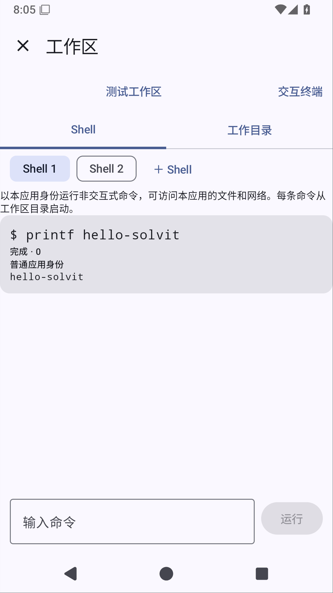

# 可安装的 JS/TS Agent 驱动（0.23.1 候选）

API14 新增 `agent` 权限、默认关闭的 `agentEnabledSetting` 声明，以及独立 `solvitPlugin.agent({maxRounds}, context)` 入口。普通插件包可提供步骤驱动，注册到 `agent.drivers` 服务；Android 的既有 Agent 使用该服务选择策略。安装/授权不自动接管聊天，需明确打开宿主配置中的接管开关，插件页面不能自行写入这个开关；当前是全会话策略，非按角色或会话选择。没有选中时使用既有包内JS，多个策略同时选中时明确报错，不按注册顺序悄悄覆盖。

TS `AgentContext` 只提供单个 `model(round)`、`tool(index)`、`settle(round)`、`finish(round)` 命令。宿主仍核验顺序、工具权限、执行事实与预算；脚本不能更改协议转录或绕过工具确认。每轮独立实例，8 MiB 内存、256 KiB 栈，第三方脚本评估期限10分钟；正常工具实例的activate/deactivate与Agent实例不共享状态。Agent实例没有工具/网络/存储的通用桥接或API Key、提示词、工具原始结果；这些宿主能力尚未开放为JS消息投影/Provider/存储替换协议。

服务注册拥有运行中的完整轮次作用域，包括驱动返回后宿主仍需完成的资源清理；等待边界不是仅等待QuickJS结束。停用、替换、卸载撤销入口并取消、等待其轮次清理；失效注册的旧清理函数不影响新版本。已执行文件修改等副作用不能自动回滚。按现有配置管理规则，修改配置前须停用插件；停用会取消它正在执行的轮次。聊天停止也会取消当前轮次。

示例 `plugin-examples/agent` 提供真实TS步骤循环，构建为 `example.agent.solvit.json`，作为可安装示例而非自动内置。市场仅向hostApi14以上列出它。通过“插件 → 安装示例 → 配置并打开接管所有会话 → 授权并启用”使用；恢复默认驱动请关闭该配置或停用示例。第三方脚本仍须经过普通包校验、权限和启停管理。

## 上游依据与边界

读取锁定 DSH `d743267388641bc76f17c45ce8b4c231aed1d32c`（MIT）`agent-loop/src/index.ts` FactoryOwnership 的登记、拒绝新工作、撤销/等待链，以及 `tests/scope-lifecycle.spec.ts` `handle.dispose() during owner unload still awaits true quiescence`；采用拥有作用域和等待清理的原则，Android用Coroutine Job而非Cordis Fiber实现。另读 `tests/loop.spec.ts` 的实时chunk/持久结果与更新参考契约，保留原宿主转录和上下文刷新。

读取锁定 Operit `dbf71916fae9750cfdc9f9a774f5a0fee56633fb`（LGPL-3.0）`ConversationService.kt` 的beforeContext及角色系统消息组装，继续保留宿主负责角色和协议投影。没有复制上述源码，也没有引入TS/Cordis运行时。QuickJS版本仍1.0.15，使用已有评估期限接口及父协程取消；参考[官方取消说明](https://github.com/dokar3/quickjs-kt#async)。

此阶段开放有界步骤策略，不等于完整DSH、JS消息投影/模型流RPC、Provider/存储插件替换、复杂Agent循环或真实模型任务验收完成。[完整路线](product-roadmap.md)继续保留。

## 验证

源码已新增注册选择/冲突、取消与完整宿主清理等待、旧注销句柄、清单门禁、真实QuickJS隔离实例、启用/停用和TS包构建回归。远程335单元、Lint、固定签名及APK在38363432662通过，XML实际取回核对；模拟器47/48通过，原工作区终端用例在创建入口等不到表单，失败先于Shell执行。原辅助方法只等待文字存在即可点击，未等待按钮启用；已改为等待/选择启用入口，原创建/真实Shell/文件页断言保留，完整运行38365614238已成功，实际48模拟器均0失败/错误/跳过。原工作区终端用例9.934s通过，创建/真实Shell输出/文件页断言保留；已查看取回的真实Shell截图。此结果支持入口就绪竞争的修正，不证明排除其他全部UI时序风险。

首轮38361720244新Robolectric市场测试缺少Android Keystore实现，按既有测试注入AES fixture修正；38362375620发现Robolectric Application访问方法无类型参数，已按实际API修正。中间推送导致旧构建取消，取消不算通过。没有本地构建或测试。

## 市场部署

远程TS任务 [38361158771](https://github.com/veryy/Solvit/actions/runs/38361158771) 成功：typecheck、84 SDK测试、2市场测试与所有生成包和源码一致性通过。生成任务38360885820取回示例包，2271 bytes，SHA-256 `8b90af409ab889496a3c568d29a6a29be56cb203733c5544ad2c534ae88c7925`；其他包逐个字节比较一致，未改旧版本。

市场已部署新的API14过滤和示例包，回滚备份 `/opt/solvit-market/.backup-agent-api14-1791876340413`。实际公网HTTPS读取hostApi1..14：旧API1..13目录与部署前完全相同；仅14显示Agent示例，下载字节、长度和SHA-256与提交包一致。服务active及health通过。首次部署使用服务器不支持的curl重试参数，已按失败路径回滚；修正普通健康请求后部署成功，没有跳过健康或TLS校验。市场网页仍展示正式版支持的API，无改为候选下载诱导。

## 最终候选验证

功能与测试源码 [90ec20d](https://github.com/veryy/Solvit/commit/90ec20dba7fc8ec923554c22c7cb30f0c5ef097a)，0.23.1/build46/API14。[完整Android Actions](https://github.com/veryy/Solvit/actions/runs/38365614238)成功。实际XML335单元/48模拟器全部0失败/错误/跳过，Lint、固定签名APK、旧正式版覆盖升级配置/聊天保留通过；335中新增6个单元用例，现有HTTP工具回传改为注册插件提供Agent。

[APK产物](https://github.com/veryy/Solvit/actions/runs/38365614238/artifacts/11796937877)需登录GitHub。23,522,373 bytes；SHA-256 `143fb7472787526d0d6f498c4fbb7e85ccc31beefa7dfc177e80b715a04efe7a`。下载分段一次提前断连，仅重取失败分段后ZIP/APK CRC通过；8个内置插件和包内Agent驱动与源码字节一致。固定证书 `f076abf86de542063f8655abf9021cb88b642ab9b664cafc46c0f16b4303bcc3`。

实际市场回归使用远程生成的TS包+真实QuickJS+加密fixture存储；HTTP模型服务仍受控，未进行真实模型或真机验证。GitHub Secrets元数据中仍缺SOLVIT_MODEL_API_KEY，既有真实模型入口尚不能运行。公网搜索质量发布门禁未通过，因此只交付候选，完整产品路线保持。
