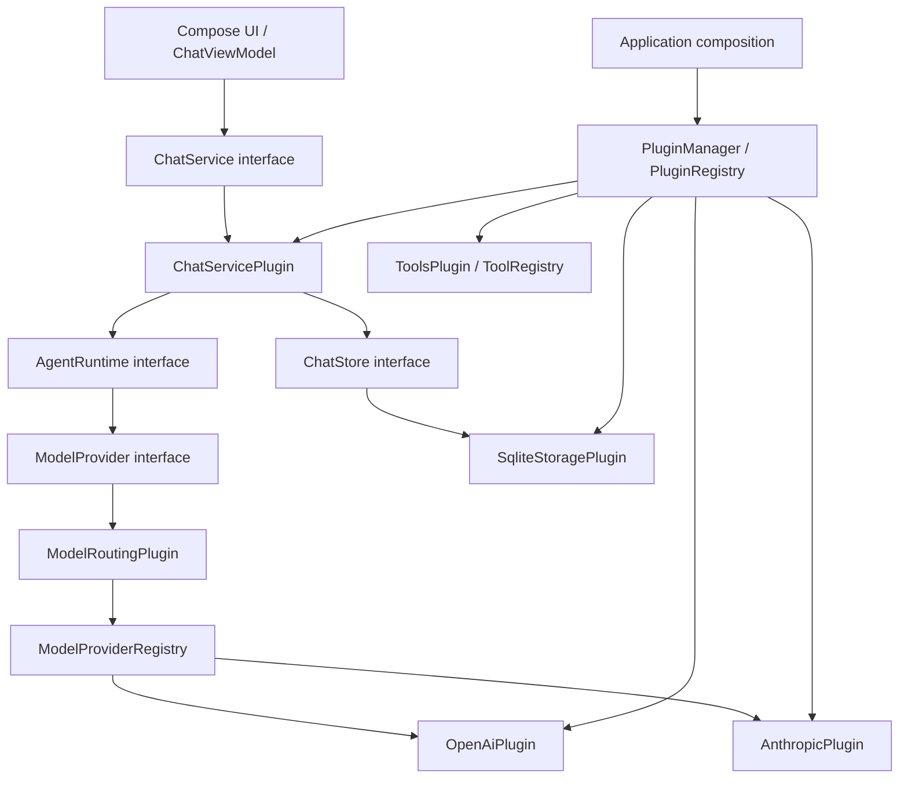

# Solvit 第一阶段架构

## 参考研究与取舍

2026-10-10 读取以下官方文档和源码。仅借鉴设计，Solvit 代码独立实现，不复制 Operit 或 Cordis 运行时。

| 参考 | 最值得借鉴的设计 | Solvit 的落点 |
| --- | --- | --- |
| [Operit AIService](https://github.com/AAswordman/Operit/blob/main/app/src/main/java/com/ai/assistance/operit/api/chat/llmprovider/AIService.kt) | 统一模型接口、流式回复、取消与资源释放 | 不含 Android Context 的 ModelProvider + Flow；Coroutine 取消连接 |
| [Operit AIServiceFactory](https://github.com/AAswordman/Operit/blob/main/app/src/main/java/com/ai/assistance/operit/api/chat/llmprovider/AIServiceFactory.kt) | Provider 创建与网络连接管理集中化 | 网络封装在独立 Provider 插件，通过注册表路由，UI 不选具体实现 |
| [Operit ChatViewModel](https://github.com/AAswordman/Operit/blob/main/app/src/main/java/com/ai/assistance/operit/ui/features/chat/viewmodel/ChatViewModel.kt) | ViewModel、Coroutine、Flow、聊天及工具体验 | 保留原生流式聊天与多会话；避免第一版引入复杂服务与工具依赖 |
| [Operit AndroidPermissionLevel](https://github.com/AAswordman/Operit/blob/main/app/src/main/java/com/ai/assistance/operit/core/tools/system/AndroidPermissionLevel.kt) | 基础、无障碍、调试、管理员、Root 能力分层 | ToolDescriptor 声明权限及敏感确认；授权接口默认必须显式允许 |
| [DSH Architecture](https://github.com/deepseek-ai/deepseek-harness/blob/master/docs/architecture.md) | Everything is a Plugin；Definition / Provider / Consumer 能力缝隙；组合启动 | Core 只有契约和注册机制，模型、存储、Agent 和聊天服务都由插件提供 |
| [DSH Cordis Primer](https://github.com/deepseek-ai/deepseek-harness/blob/master/docs/cordis-primer.md) | inject 声明依赖，Context 查服务，注册是可撤销 effect | requires / provides、PluginContext、逆序 disposer 与 SupervisorJob |
| [DSH Tools](https://github.com/deepseek-ai/deepseek-harness/blob/master/docs/subsystems/tools.md) | 发现与执行用同一注册表，执行前权限门禁，模型 schema 与 host 回调分离 | ToolRegistry.descriptors / execute；ToolDescriptor 不暴露执行函数 |

DSH 的完整配置覆盖、作用域树、waterfall 中间件和持久事件日志值得长期研究，但不属于第一版需要的最小机制。Solvit 通过 ModelProfilesService 管理多配置和任务选择，当前 Provider 支持 OpenAI 兼容与 Claude 原生协议。Gemini 和本地推理仍待实现；事件用于进程内观察。

## 模块关系



`app` 是唯一组合根，可以引用具体插件；聊天 ViewModel 和 UI 只消费核心 ChatService、ModelConfig 和 SettingsStore 契约。Core 无 Android、HTTP 或 SQLite 依赖，不承担实际推理。

## 插件和依赖

插件声明稳定 id、requires 服务集合、provides 服务集合。`load` 只登记插件，`enableAll` 反复选择已满足依赖的插件，首次执行 initialize 后调用 enable。加载顺序不决定执行顺序；缺失或循环依赖会给出明确错误，并回滚本轮已启用的插件。重复插件或服务键被拒绝。V1 未自动等待外部插件，也不替换已激活的单例服务。

Context 只允许消费已声明依赖及注册已声明服务。注册、监听、工具和网络资源须交给 `own`。停用时先运行 disable 钩子，再取消并等待插件协程，最后逆序清理效果。全部清理会继续执行并合并异常。启用失败同样回收 Context。

状态为 LOADED → INITIALIZED → ENABLED → DISABLED → UNLOADED，停用后可以 enableAll 重新激活。仍被启用插件依赖的服务不能停用；shutdown 自动先关闭消费者再关闭提供者。资源不要在 initialize 中获取，否则无法由激活 Context 管理。

启动组合内置 Kotlin 服务插件以及已安装并启用的 JS 插件。第三方 JS 通过 QuickJS、受限宿主接口和权限门禁执行；HTTPS 插件市场、安装/启停与配置已实现，见插件 SDK。原生服务和凭据留在宿主，不能将 Kotlin 模块化视为第三方代码的隔离边界。

## 最小扩展示例

```kotlin
interface Greeting { fun greet(): String }
val greeting = ServiceKey("example.greeting", Greeting::class)
class GreetingPlugin : SolvitPlugin {
    override val id = "example.greeting"
    override val provides = setOf(greeting)
    override suspend fun enable(context: PluginContext) {
        context.register(greeting, object : Greeting {
            override fun greet() = "Hello, Solvit"
        })
    }
}
```

消费者在 requires 中声明 greeting，在 enable 中调用 context.require(greeting)。`PluginManagerTest` 实际演示逆序加载、禁止停用依赖、卸载撤销注册、失败回滚与协程取消。要替换存储或模型，在组合根加载另一个提供同一 Services.Storage / Services.Model 的插件，不同时加载两个相同服务提供者。`ChatServiceTest` 使用 MemoryStore 验证聊天运行时不依赖 SQLite。

## 消息、事件与取消

ChatService 在请求前持久化用户消息，通过 ChatStore 历史组装模型请求。一次 turn 调用 AgentRuntime；默认 ToolAgentRuntime 向模型提供已启用插件的工具描述，组装完整工具调用后，逐次请求用户确认，再由 ToolRegistry 执行并回传结果。每轮最多 16 个调用，整次最多 8 轮、16 次执行；达到上限明确终止。回复片段是瞬态 Flow，调用记录、工具结果和最终回复在 Done 时通过 SQLite 事务统一写入；异常或取消也保留已有记录并标记状态。没有 Done、网络失败、额度截断、取消分别结算为失败或中断；部分助手回复不会进入下一次上下文。

SQLite 将消息插入与会话标题/时间更新放进同一事务；参数绑定避免 SQL 拼接。会话删除通过外键级联。可观察 StateFlow 触发查询。CoreEvent 是尽力而为的进程内通知，不是消息持久化依据，不用它做授权决策或重放。UI 使用 ChatStore 的 Flow 获取记录。

同一 ChatService 只允许一个进行中的 turn；删除在 turn 期间被拒绝。ViewModel 生存期拥有生成 Job，停止按钮及 ViewModel 销毁都取消它；取消通过 OkHttp Call.cancel 中断 SSE 读取，结算使用 NonCancellable 确保资源和状态收尾。启动组合使用 Application Scope，配置变更不会重新创建插件。

## 工具与权限

ToolRegistry 提供描述、JSON 输入 schema、权限集合与确认要求。执行前必须通过 ToolAuthorization，再检查取消与注册有效性。授权拒绝不调用工具实现；卸载 disposer 撤销能力。当前聊天使用有界工具循环；时间、记忆、MCP、Skills、工作区、终端、插件开发和联网搜索可由独立 JS/TS 插件提供。工具执行同时受角色白名单、确认/持久策略、宿主能力权限及实际 App/Root 身份检查限制。

后续 Android 授权适配器要同时检查运行时权限、无障碍/调试等特殊授权、每次敏感动作确认和作用域策略。用户确认不能替代系统权限，也不能仅凭声明就认为能力已经授权。同进程插件仍可绕过接口访问 Android API；真正第三方隔离需独立进程或受限协议。

## 演进方向

1. 多 Provider 注册与用户 profile，独立工具/模型选择，持久化组合配置。
2. 工具循环已接入；后续完善角色工具范围、任务预算和后台执行策略。
3. Skills、MCP、Memory 作为服务提供者；扩展工具 schema 加入模型上下文。
4. 注册 UI 设置卡片和能力展示，逐步增加 scoped registration。
5. 需要重放和恢复时引入版本化持久事件日志，区分事实与瞬态流。

模型设置通过独立 ModelProfilesService 保存多组连接、协议参数和任务绑定。聊天首轮使用聊天配置，模型提出工具调用后，后续轮次可使用另外的模型配置并接收完整上下文。工具后续配置在每次 Agent 执行开始时取快照。配置与任务绑定加密后一次提交，旧单模型配置可读取迁移；完整备份包含所有配置。其他协议、摘要模型、嵌入模型和本地推理继续沿着服务接口扩展，避免将 Provider 逻辑放入聊天 UI。

## 原生协议转录

`ModelConfig.providerId` 与 `providerOptions` 纳入加密配置和备份，旧配置默认 OpenAI 兼容。Provider 独立注册模型目录与声明式选项；路由插件按任务配置选择实现。`ProviderTranscript` 保存来源、原始块、发起参数和前缀摘要，贯穿 Agent、SQLite v5、重开和分支，展示层不输出原始 JSON。Claude 的流式、签名与工具回传边界见 [原生 Provider](anthropic-provider.md)。JS 模型扩展、Gemini 与本地推理仍待实现。
