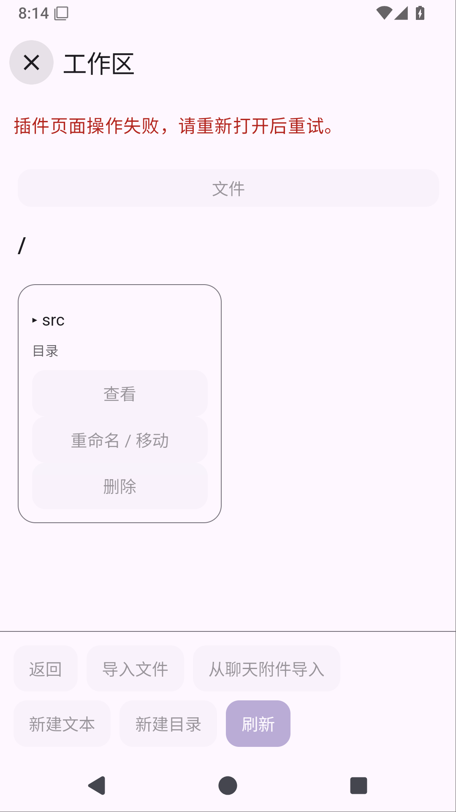

# 已保存聊天附件导入工作区

目标：在工作区插件自己的HTML/JS页面选择当前对话已保存的附件，显示来源消息、名称、类型、完整大小/SHA和目标路径。图片/PDF/代码均保留完整原字节，先预览、再明确确认，文件树、Git和Shell共用同一文件。0.35.0的系统文件导入/PDF预览已发布；此阶段尚未发布，完整文件联动仍包括带版本覆盖、进度取消及异常暂存回收。

## 参考与边界

核验九个锁定upstream。实际读取Operit dbf71916的AttachmentSelector.kt::getAttachmentSource（保留content URI/file来源）、AttachmentInfo.kt和AttachmentInfoTest.kt（名称、MIME、大小与inline content分开）；WorkspaceAttachmentProcessor.kt只生成工作区上下文描述，不是附件原文件导入实现。DSH d743267的packages/api/workspace-files/src/index.ts及tests/read-bytes.spec.ts区分会话作用域、原始字节/UTF8、读取限额与版本，包含NUL/无效UTF8仍按原字节读取的断言；没有现成聊天附件上传API。仅采用来源/原字节/作用域原则，自行适配已有SQLite和AttachmentFiles，不复制LGPL源码，不新增依赖。

## 原生来源检查点

SavedChatAttachmentSource捕获当前对话，只接受来源消息ID、附件ID和预期SHA。它从持久ChatStore重新找到当前对话的用户消息和附件元信息，经现有ChatAttachmentStore读取完整原文件，再核对来源仍存在、大小与SHA。授权/取消/切换前后检查；临时读取副本在成功或失败后擦除，返回的PageBinaryDocument独立持有副本并由调用方关闭。PDF选择页范围/OCR文字不替换原文件；不将URI/路径交给JS，不删除持久原附件。

四个真实SQLite/AttachmentFiles回归覆盖重开PDF完整原字节及页范围、跨对话/错消息/旧SHA在读文件前拒绝、读后来源删除与副本擦除、读后取消/撤权保留持久文件。尚待远程编译执行，不能把源码或native helper当作用户可用功能。后续仍须接宿主页面声明和确认控件、分页选择与来源展示、系统选择/PDF/图像共用预览、真实HTML/Git/Shell设备任务、旧插件升级/市场兼容及正式APK发布。

## 宿主页面桥检查点

原生来源提供最新消息优先的20条元信息分页，不读取blob或消息正文。WorkspacePageBridge新增chatAttachments查询与经显示控件确认的selectChatAttachment，选择成功只创建临时选择并附来源消息/附件ID，不写工作区；现有文本/图像/PDF预览继续复用，确认importFile前重新验证保存来源。失败保持旧选择，删除来源后确认拒绝，切换到系统选择清掉来源标记，关闭清理临时选择且不删除原附件。

ScriptPageExecutionContext对新查询/选择强制API24和workspace.files声明，原23及更早无法调用；当前manifest最高仍23，API24生成包/客户端市场尚未开放。新增SQLite元信息分页、生产桥完整二进制导入/删除来源拒绝/系统来源替换、API门禁及一次确认只能消费一次测试。宿主服务尚未接正式应用和HTML页面，不宣称可以由用户使用。原生源63404c0的38623041850仍在构建，此检查点在独立分支保留它的运行；继续远程验证新桥，再做完整页面与发布。

## 插件页面接入检查点

API24候选workspace1.7.0添加六语言聊天附件入口、20条分页、消息来源/文件MIME和大小。选择是单独原生确认控件，不写文件；选择后沿用文本/图片/PDF分页预览和完整原文件确认，返回选择列表与取消保留旧选择路径。正式应用从服务注册表提供ChatStore/ChatAttachmentStore，当前对话由WorkspaceViewModel捕获，业务JS不获得历史正文或私有路径。

Git因共用页面源码升1.2.3/API20。已保留workspace1.6.0和Git1.2.2公开原字节，新的1.7原包恢复只匹配确切已公开1.6 SHA；用户修改、停用、卸载与权限保留规则继续。应用候选0.36.0/build70，客户端市场仍hostApi23。新增SDK流程覆盖分页/来源、取消、文本/图片/PDF复用和另行确认，新增API23旧包迁移用例。生成包仍旧版本，下一步必须远程TS生成同步、生产HTML/SQLite/Git/Shell设备测试与市场兼容后再正式发布。

UI源1432382的远程TypeScript38624452027全部通过，实际完整任务日志为119 SDK/5市场零失败及公开搜索/MCP/Skills通过。实际下载artifact11923576120并核对ZIP CRC，仅同步新workspace/Git两包；workspace1.7.0/API24为763192字节/SHA3ea4c9bf2e2f8f038b9ebf54d921ea4a0b40b5f99ff8d288928cc7b07c954e7a，Git1.2.3/API20为745980字节/SHA521a4a95fb571db7bda40afe23097b877521bf66106a8d09ac3f7e0034f36679。其他生成包字节保持。

原生源63404c0的Android38623041850 build已成功，device仍运行；桥源e71547d的38623768561实际失败于跨模块测试读取SqliteChatStore内部attachmentFiles字段，生产编译未报错。修复测试使用公开AttachmentFiles组件并指向同一chat-attachments目录，保留真实SQLite/删除/二进制断言，不扩大生产字段可见性。新增真实app HTML设备用例走已保存PDF来源→原页文字/蓝色像素→取消选择/确认→完整原PDF导入→Git untracked→Shell sha256→原聊天附件保留；未启动系统文件选择器，PDF聊天选页不影响完整原文件。修复和完整设备链待远程执行，尚未发布。

已实际下载原生源63404c0的unit11923985486并核对完整ZIP CRC/XML：494单元零失败/错误/跳过，其中SavedChatAttachmentSourceTest四项全部通过（读后取消/撤权擦除、重开PDF全原字节、跨对话/旧SHA读前拒绝、来源删除后拒绝）。其设备任务116058561050仍在运行。候选UI源c5d9b4b的Android38624928283已开始整包验证，包括修复的跨模块真实存储桥、分页/API24/1.6升级和新增HTML→Git/Shell设备用例。当前市场仍hostApi23且未部署API24，公开APK仍0.35.0；不能提前宣称新功能交付。

原生源63404c0的38623041850设备任务116058561050已实际成功；本次只查询任务状态，尚未下载该设备归档核对XML。完整UI候选c5d9b4b的TS38624928274与市场38624928388均成功，Android build仍在执行。API24市场在私有before/next快照完成实际Node兼容验证：API1..19目录完全一致，API20..23仅采用兼容Git1.2.3，工作区分别继续选择原1.4/1.5/1.6，42个历史版本的HTTP原字节完全保留。新workspace1.7/API24和Git1.2.3的下载哈希与生成包一致；脚本为scripts/verify-market-api24.mjs，验证运行在服务器私有监听端口，未切换公网或客户端hostApi。

UI候选c5d9b4b的38624928283整轮失败。实际UI11924566682完整ZIP CRC/XML为76设备、1失败、零错误/跳过；新增保存附件PDF/HTML/Git/Shell链通过且实际截图正常，失败发生于原WorkspaceHtmlPageTest保存后点击file_0等待进入src目录（原行86）；此前误读为IME断言，经独立诊断日志和源行号已纠正。没有生产编辑器修改可解释其根因，不能以新链通过或以前同用例通过替代本轮失败。保留原断言与10秒限制，以WORKSPACE_IME_DIAG只记录测试fixture的光标/组合/marker位置和失败截图；新增手动诊断workflow复用已验证相同生产源码的c5 APK、只远程编译instrumentation APK，连续执行原场景首失败即停，不做本地构建或盲目重跑至成功。继续诊断，市场未发布API24。

独立诊断38628307407源2ebf1f2第一轮复现同一导航失败，11925321495完整ZIP CRC核对。IME前长度69044、光标69044；输入完成长度69052，marker位于69044，随后完整原文件保存断言通过，排除本轮IME失败。堆栈对应当前104行、原86行，是file_0进入src的断言。新增WORKSPACE_PAGE_DIAG只捕获fixture页的当前目录/首条文件、按钮busy/disabled、最新token/原生回复，并在任意DOM等待失败保存截图；透明包装页面回调仅观察状态，不改变请求或授权。按首条文件不符、树自动查询忙态/过期token、目录动作处理三个假设继续复现，不以IME成功或重跑替代导航修复。

第二次隔离诊断38629699357源e72166e再次首轮复现，11925553028完整ZIP CRC核对。WORKSPACE_PAGE_DIAG在点击前记录directory=/、首项▸ src、busy=false且file_0启用，排除首项不是src；失败时仍为相同token/目录、所有按钮禁用。实际查看workspace-navigation-failed.png，原生外层明确显示“插件页面操作失败，请重新打开后重试。”，不是仅DOM断言或IME失效。下一步用仅测试包装的ExtensionPageSession.dispatch/PageWorkspaceAccess.query记录异常类型及代码位置（不输出消息/表单值）定位当前会话分发异常。源cc33bea的第三次独立诊断38631097327已实际启动；复用同一c5生产APK，不改变生产实现或授权判断。完整499单元及新附件HTML任务证据保持，但整版仍不能发布，API24仍未上线。

## 目录导航根因与修复

第三次隔离诊断38631097327（源cc33bea）首轮仍失败；11925259683完整ZIP CRC核对。测试包装捕获java.lang.IllegalArgumentException，栈顶ScriptPageView.parse第141行，正是footer最多6个且必须为button的宿主契约；PageWorkspaceAccess.query未抛异常。新聊天附件入口使列表根目录已有6个底部按钮，子目录增加parent后变为7个，分页还会继续增加。并非IME、文件保存或目录查询失败。

先提交SDK回归9bcb67f，远程TypeScript38632760735实际失败，复现生成包超过Android footer限制。新增工作区与Git Files的85项嵌套目录场景，覆盖中间页同时存在上一页、下一页、上级目录、刷新、返回；各页都检查宿主6按钮契约，Git还保留Changes。修复把导入/聊天附件/新文件/新目录移至列表上方的可换行操作栏，底部只留导航（工作区最多5个、Git加Changes最多6个），不放宽宿主限制、不删除操作或缩短分页。工作区与Git的HTML样式同步支持row换行。

移除临时WORKSPACE_IME_DIAG/WORKSPACE_PAGE_DIAG测试包装和截图探针，恢复c5原WorkspaceHtmlPageTest全部断言、真实输入/大文件保存/冲突/目录/Shell流程及10秒限制；新增聊天附件HTML链保留。沿用已研究DSH workspace-files作用域和原字节契约，复读其read-bytes.spec.ts；本次仅修Solvit自有页面组合，不复制upstream UI或新增依赖。修复后的生成包、真实Android页面与正式发布仍待远程验证，API24市场尚未上线。

修复源60496d6的远程TypeScript38632968075实际成功；下载11927260967并核对完整ZIP CRC，完整任务日志为121 SDK/5市场零失败（含新增两条嵌套分页回归）。新生成workspace1.7.0/API24为763358字节/SHA d212d6741bde9a5db30a9d307c506389343d9c705f66011d4c0a50e54c041360；Git1.2.3/API20为746146字节/SHA f35a229cf891a942e6e099a4fd13cacc7367c09c0ce2f77e0fa1c293249a9e65。替换仅这两份当前候选包及相同APK资产，已公开历史包保持。接下来运行完整Android原场景验证，先前私有API24快照为旧候选哈希，必须用本次包重新暂存验证后才能发布。
