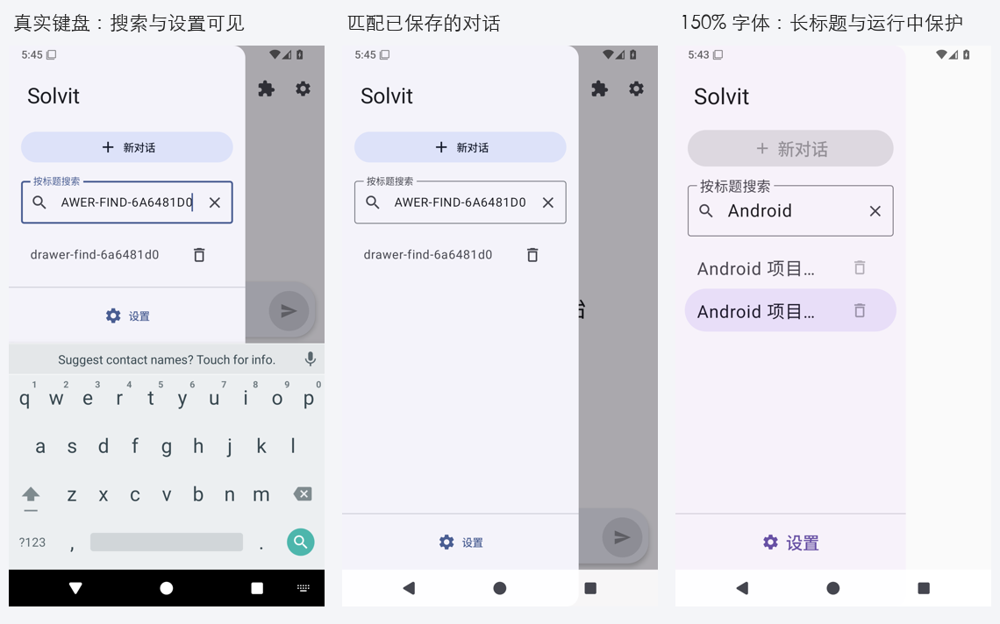

# 聊天侧栏标题搜索（2026-10-17）

承接0.43.10/build95，继续优化会话较多时的查找和长标题显示。侧栏原先只有全量列表，标题仅maxLines=1、没有Ellipsis；本轮增加明确命名的“按标题搜索”、清空、无结果提示，保留原生会话ID、排序、选择和删除确认。主界面继续使用75%屏宽，底部设置保持固定位置。build96现已完成远程完整检查并提供候选APK，验证细节与实际截图见下文；尚未正式发布。

## 参考实现与取舍

已实际阅读锁定Operit dbf71916的 `app/src/main/java/com/ai/assistance/operit/ui/features/chat/components/ChatHistorySelector.kt:567–614`：修剪查询、标题/分组忽略大小写、空查询恢复全部，额外正文检索通过单独仓库执行并有防抖。本轮只过滤已载入的会话标题，UI明确写出搜索范围，不接入其分组、正文库或400ms延迟。其 `app/src/test/java/com/ai/assistance/operit/data/model/ChatHistoryTest.kt` 实际覆盖标题、消息和顺序字段，不是搜索UI证明，未找到直接对应标题输入清空设备测试。

DSH d7432673 `packages/client/ui-workspace/src/client/rows/Rows.tsx` 的SearchResultItem及标题裁切行为、`tests/rows.client.spec.tsx:104–128` 验证选中结果与点击只打开对应session；作为稳定ID和相同标题不可串会话的验收参考，未复制桌面hover/marquee。两库LICENSE分别LGPL-3.0/MIT，实际查阅；本轮仅适配行为，使用现有Compose/Material3，没有复制上游代码或引入依赖。`scripts/fetch-upstreams.py --verify-only` 用于核对固定checkout，不运行上游应用。

## Android实现与验证范围

侧栏内容抽出ChatHistoryDrawerContent，查询状态由Compose保存；关闭侧栏即重置，避免新建/重开时继续隐藏会话。搜索忽略大小写和首尾空格；清空保留输入焦点以便重输，整个侧栏随真实IME缩小，列表与底部设置保持在键盘上方；搜索键收起键盘，选择/删除/设置/新建前收起键盘。长标题显式省略，删除仍经原确认弹窗，运行中操作保护保持。6语言文案覆盖。没有存储/迁移/签名/插件格式变化。

新增设备覆盖：150%字体、两个完全同标题的独立ID、实际选择/删除回调、busy保护、空结果及清空恢复；真实App/SQLite插入独立会话，打开真实OS键盘并核对列表和设置的可见几何，用实际侧栏输入选中并核对原生session和消息，关闭重开后恢复全量列表。独立报告门禁必需这两个用例，App最低84增至86，既有流式/角色和其他必需回归保留。截图取自实际设备，等待完整GitHub Actions后再记录成功、产物与限制。没有本地Android/TS构建或测试。

正式Release/线上市场仍沿用此前实际状态，市场部署认证受阻不影响本轮原生UI继续优化；不因源码提交宣称已正式发布。真实模型/真机任务和完整路线继续保留。

## 第一轮完整设备失败与定位（2026-10-18）

39047145389在首提交上因后续IME适配提交由Actions自动取消，不能作为完整通过。实际64b4aef9的39047773141构建、626单元、Lint和既定签名通过，设备完整执行86+3+26后失败6项；未交付该失败APK。原始UI artifact12106743699（10997929字节，SHA256 1b0a9fc1c13a6e70bdea26fa552c7c14d17bd5c01ada02468bf9ef5dbea0e2ad）已核对大小、整包摘要/CRC和原始XML。

5项既有聊天/附件/PDF用例报相同的两个SetText节点歧义：chat_input在可见聊天区，history_search在负x坐标的关闭侧栏。启动焦点日志中chat_input实际Focused=true，不能把定位歧义称为焦点/角色/流式生产回归。永久测试改为定位既有chat_input标签，保留原发送、身份请求、流式和附件断言；没有隐藏或删除搜索框来让唯一性假设继续成立。

新增大字体用例在清空后直接assertExists第三条会话失败。针对“查询未清空”与“LazyColumn未组合屏外行”的区分，追加真实EditableText为空断言，再通过真实列表滚动到目标并断言显示，保留同名会话ID、selected、busy及删除回调断言。不是增加等待或重试点击；下一次远程结果将验证这一判断。

原始XML确认真实SQLite标题搜索→打开目标→关闭重开重置、以及原生角色继承用例通过，实际搜索键盘/匹配结果PNG已审阅：列表与设置在键盘上方，筛选目标正常展示。仍不把部分通过当作完整门禁成功；修正测试后重新执行完整Android检查，无本地Android/TS构建或测试。

## 第二轮完整回归与环境页定向诊断（2026-10-18）

修正测试后的dfdd6098 / Android39050077984构建、626单元、Lint和固定签名再次通过。UI artifact12108067541（12077728字节，SHA256 2b4da09c383f6d1b0d39127b0378e77636fefdb3017f7188374e34b44a30ed13）已核对整包摘要/CRC和全部115项原始XML：之前6项失败全部通过，唯一新失败为LinuxEnvironmentHtmlTest.environmentWorkbenchKeepsDisclosureLogAndHonestProgressWithoutInstallingOnRefresh。没有交付本次失败的APK，尽管生产APK与64b4aef9相同。

实际大字体截图已审阅，同名长标题省略与选中保持正常；孤立组件测试原来用普通Box，没有生产ModalDrawerSheet消费系统栏，截图里底部设置落入导航栏。测试宿主改用与应用相同的ModalDrawerSheet，并追加设置可见断言；生产侧栏原来就使用该组件，不据此宣称修复生产系统栏缺陷。需定向重新查看截图。

环境页失败在phase=failed的refresh()等待真实trusted click，日志已是FAILED metadata且按钮enabled；实际失败截图已显示失败摘要与展开日志，不是Ubuntu下载失败或环境状态未到达。排查顺序：状态/自动轮询更新在触摸中替换按钮DOM；重新布局让触点偏移；scrollIntoView/原生触摸时序。保留原一次实际触摸、isTrusted要求、10000ms以及进度/失败/无安装全部断言，只加入临时非消费的document输入事件与solvitPageUpdate前后采样，输出受控夹具stage、busy、disabled、按钮几何与目标ID，不输出程序日志、密钥或token。成功刷新留正对照，失败留相同trace，诊断结束移除探针。

复读原环境阶段所引用DSH d7432673 terminal-card-model.ts及terminal-card.client.spec.tsx的真实运行/失败状态区分；原生/JS仍以各自实际状态为准。沿用既有HTML页面和真实屏幕触摸桥，不改安装器/PTY或重写渲染器。正式diagnostic复用已完成成功build任务的同生产APK/native资源，仅远程编译当前测试包，源码差异门禁继续限制为测试/工作流/脚本/文档。新增environment-ui和history-search两个定向入口，首失败停止，既有完整Android门禁不减。

## 定向采样结果及探针清理

8989612b的environment-ui复用dfdd生产APK，39053033448成功8轮；artifact12108840510（1181227字节，SHA256 6194cd14c29cb7bb024f7e13af8687932486bb93c24ffd8cb6cffdde82071acc）整包摘要/CRC核对，8份独立runner均OK(2 tests)，48次正刷新trace具有真实trusted pointer/click。FAILED步骤的成功对照有“触摸时仍INITIALIZING，点击后渲染FAILED”的顺序；未捕获原失败，不足以证明DOM替换或其他假设是根因，生产页面/宿主不作猜测性修改。

同提交history-search39053064460失败，artifact12108756540（692807字节，SHA256 21b6091718529e8df93ef4d598498a97f580eaf60c9a434be5b1b82f4e1b93c9）原始结果与摘要/CRC核对：真实App搜索通过，150%组件在对第二条同名记录注入删除触摸时节点未组合。改用LazyColumn真实滚动使每个被选或删除的目标进入视野，再进行原一次触摸，绝不重试删除；busy和同名ID回调不变。新增设置底边不超过原生系统导航栏顶边的几何断言，避免只凭assertIsDisplayed接受部分遮挡。

现在移除全部ENVIRONMENT_REFRESH_DIAG的document事件/solvitPageUpdate包装、成功日志和trace字段；原环境UI流程、一次真实刷新、isTrusted/10000ms/进度/失败/无安装断言均恢复，只在既有失败上下文里补refreshClicked布尔值，便于区分点击未到与宿主未结束。下一轮定向以无探针版本复查，最终仍须完整Android原始报告与APK；原环境触摸根因明确保持未定，不能写成“已修复Ubuntu/环境下载问题”。

## 最终无探针验证与候选交付（2026-10-18）

源码a1408f66的[完整Android任务39053920487](https://github.com/veryy/Solvit/actions/runs/39053920487)成功。核对原始626项单元、Lint、App86/Web3/terminal26共115项设备XML、必需角色/流式/搜索用例与15场独立进程死亡runner/PID；升级seed、旧设置保留、1.5倍完整聊天、测试运行器恢复和stdio宿主强杀后的4个进程gone均保留。设备artifact12109486750，sha256:6251b4add43a8943f07edad02179b444eddb54d6e6ab87df596cde9cac96e82e，整包大小、摘要与CRC已核对。

[真实历史搜索定向39054210302](https://github.com/veryy/Solvit/actions/runs/39054210302)实际OK (2 tests)，artifact12108599335，sha256:b58cb32a084a7359685d61e49fb5e1b925adfe8be1c86d8be984afe2b5f62da3；真实ModalDrawerSheet的150%字体下每次先滚动目标再执行一次选择/删除，且设置底边不超过真实系统导航栏上缘。[无探针环境定向39054207846](https://github.com/veryy/Solvit/actions/runs/39054207846)8轮各OK (2 tests)，artifact12108694127，sha256:c2d2b0ba95159be3f8a98390beb5622c4499330e41d4478d017edf2140c32b6c。原环境刷新超时未再次出现，仍未证明根因；没有修改环境生产逻辑，也没有宣称修复下载失败。临时事件采样全部移除。

已逐张查看最终完整报告中的搜索/真实键盘、筛选持久会话、150%长标题截图；列表与设置在键盘上方，大字设置不进入系统导航栏，同名行仍有独立选中态与ID。组合图仅缩放拼接原始PNG：

APK为dev.solvit.app、0.43.10/build96，59659415字节，SHA256 1a7a311979d3434c8f9bb43586586690b6e224e3731eb495ac1ea6ce809e678a；签名保持f076abf86de542063f8655abf9021cb88b642ab9b664cafc46c0f16b4303bcc3。14个内置包和6语言目录逐字匹配源码。对应Linux源码内层ZIP 1072711字节，SHA256 3ef1f98bab68f62281bc2e196f2017b1bb2539e3760fcafcf5295f7172497c2f，14个文件及内外CRC核对。实际APK、Linux源码与核对回执保存为独立build96文件，不覆盖历史候选。

本轮未运行本地Android/TS构建或测试。正式Release仍为0.43.9；市场部署认证受阻的既有事实保留，不降低正式标签的市场/Linux/搜索/插件门禁。真机、真实模型/账号任务、ARM64及更广第三方兼容未因此验收。继续沿用完整路线，不把标题搜索或测试数量当作整体UI完成。
