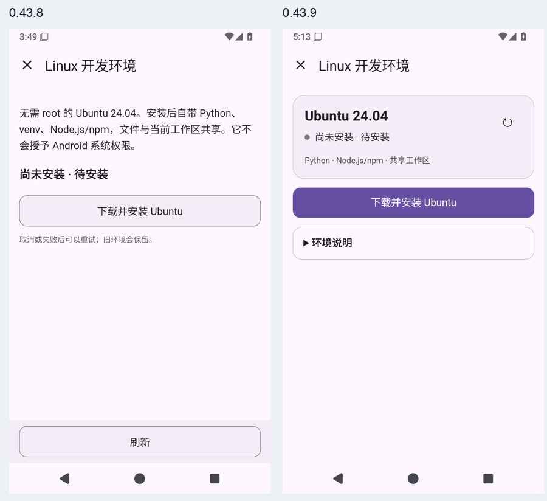
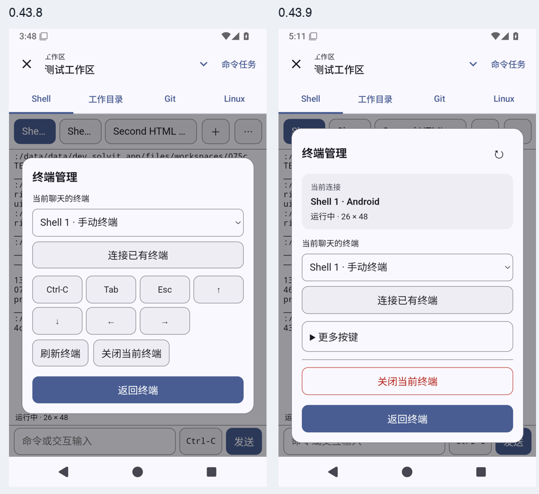

# Linux环境与终端管理交互打磨（0.43.9已交付）

基线为已正式发布的0.43.8；本阶段已通过完整远程门禁并交付0.43.9；以下过程按发生顺序保留。重新检查Git工作树及公开版正式设备归档，实际查看linux-plugin-before-install与workspace-terminal-session-manager截图。环境页说明、状态和操作为同权重的纵向堆叠；管理页把会话选择、快捷键与关闭放在一起。继续使用插件自己的HTML/JS和原生权限/确认桥，不重写PTY或安装器。

## 上游依据

2026-10-17执行fetch-upstreams.py --verify-only，全部锁定checkout一致。Operit dbf71916fae9750cfdc9f9a774f5a0fee56633fb的ui/features/demo/wizards/OperitTerminalWizardCard.kt将环境状态作为摘要、展开后才呈现配置；TerminalCore 045868988e4091d613cb34b2941057703899b96e的terminal/ui/SetupScreen.kt按软件分类折叠、保留独立安装操作。没有找到对应独立Setup/Wizard UI测试，不声称上游已验证Solvit流程。

DSH d743267388641bc76f17c45ce8b4c231aed1d32c的packages/client/ui-tool/src/client/tool/models/terminal-card-model.ts及tests/terminal-card.client.spec.tsx实际区分运行中、已退出及失败；摘要也必须保留失败状态，展开内容不能改变原状态。采用状态/细节分层及原始输出保留的原则，适配Android WebView、原生确认与已有事件标识。已读DSH MIT、Operit/TerminalCore LGPL-3.0根许可证；不复制组件实现、不添加依赖；现有xterm离线分发和许可证保留。

## 实施与验收

环境页突出当前状态及对应操作，按需展开软件、说明和日志；真实下载量可计算时才显示百分比，未知总量不伪造进度。刷新保持阅读位置和展开状态，失败摘要保持可见；打开折叠区不发安装指令，安装与软件操作仍由原生确认。终端管理优先会话和当前连接，快捷键折叠；真实PTY、模型终端接管确认及关闭语义保留。

保留原版官方插件包，核对摘要并验证升级保持设置/授权/停用、修改包及卸载选择。GitHub Actions生成插件，检查真实HTML触摸、主题/大字/键盘、原生确认及实际PTY流程，然后完整单元/Lint/设备/恢复/Linux门禁和固定签名APK发布。真实模型、ARM64真机及完整路线继续按agent-direction.md保留。

终端状态缺陷假设（修复前）：choose()用exitCode:null合成更新，可能覆盖最后真实退出码；备选为宿主未返回状态、PTY末次状态尚未收齐。已在原完整真实PTY流程末尾增加Second HTML Shell执行exit 7，先核对原生真实exitCode与当前显示，再切走/返回检查仍为7。保持原接管/输入/中断/关闭断言。先用旧正式插件包远程复现，不先改状态逻辑或放宽等待。

环境插件1.0.3源码与页面已写入：真实状态卡、刷新入口、当前主要操作、软件/日志/说明折叠；原始按钮沿用宿主动作。忙碌刷新保持展开状态、目录主滚动及日志内滚动，失败首次进入时展开日志但允许用户收起。仅下载且总量已知时显示确定进度，初始化不沿用100%下载百分比。新设备用例通过控制Linux状态检验真实打包TS→原生桥→WebView，不声称状态夹具替代实际Linux安装。原始1.0.2包SHA256 e0e2c433cde60f34147178c50e9c51748a6ff445c067dcd1753e861621e43783保留legacy，加入原包安全升级名单及保留授权/停用/修改/卸载回归。尚待远程生成与实际设备验证。

真实终端回归39001277399在原包失败：原生已退出且exitCode=7、第一次可见状态为7，切走/回来后原始日志状态为已关闭·—，ComparisonFailure命中新增断言，排除宿主缺码与尚未结算。choose()不再伪造新的结果，只呈现缓存的实际exitCode/failure；轮询/响应继续负责真实状态更新。临时诊断未加入。终端1.1.4将当前连接/实际环境/真实状态与连接选择、关闭分开，快捷键默认折叠；新增真实触摸展开及所有原按钮逐个可见/命中检查，保留完整PTY/模型接管/键盘流程。原1.1.3包SHA256 a92b18a94aa53900d8a7dc3cca6ea61b7a9cecf8771f8583a3bbc0e12ad1b37d已保留legacy，加入安全升级与原状态保留回归。修复与页面仍待同原断言远程复核。

首轮环境39001575704：原有安装前检查因诊断工作流未打包x86_64 Linux程序失败（正式构建有原生步骤）；补齐相同锁定源码构建，不删除可执行检查。新状态流程已走过软件确认拒绝和日志刷新，停在已知下载50%断言。按优先级检查：上一次刷新未结束时再次触摸被禁用按钮；新token未重组页面；原生progress数值/最大值异常。先增加失败时仅采集状态metadata、按钮disabled与progress值的探针，不记录输出或凭据，也不放宽原等待。SDK145通过；终端新版生成39001869597在市场最新版本仍期待1.1.3而失败，校正为当前1.1.4并保留兼容性其他断言。

历史包复核发现环境插件原先从未加入seed原包自动升级名单，早期安装用户可能一直保留1.0.0/1.0.1。已从真实Git提交12d2efed/7922231c保留这两份原字节包，SHA256分别4d5d07cc8c8ed309ccc918b05cf3517a82c76bc80d3febce4506958d4c6f01b7、1856e4c2391b9d589b31095b5c8dae64d9e75311590d62b278c2419ba8c2d5f0；核对权限和nativeServices与新包一致。补齐精确摘要升级与两个独立原状态保留用例；修改包及卸载选择仍不恢复。终端红色归档12089775550 SHA256 1292c2b6abf398dfffc164d810d2422e7036309f54aacc305bc72f9ee9b5ed06的CRC、原始runner及指定ComparisonFailure已核对。

终端新布局39001867708停在新增原控件逐个真实边界/命中检查，之前真实输入/中断完成。原始日志定位ChatLayoutTest:1204，尚未到原退出码回归。优先检查返回按钮继承40px最小高度与44px目标冲突，其次dialog内滚动边界和遮挡命中。增加失败时的原按钮几何/命中及当前selector采样，不删原控件检查，不加重试。

进度采样39002136326：原安装前原生可执行检查通过；新流程已知下载阶段超时，失败仅有READY metadata（busy=false/bytes=0/total=null），没有progress，而夹具已是DOWNLOADING。上次刷新在测试仅检查旧日志状态时尚未结束，再次触摸禁用按钮未发送事件。测试refresh现在先等可用，观察一次isTrusted真实触摸（排除自动轮询click），再等宿主/渲染完成后进入下一状态；保留原10000ms及50%/未知总量/初始化/无安装断言。页面计算不作回避性修改。

终端控件采样39002444616 artifact12089832313（4633257字节，SHA256 8ced037b3438b2081de2bf969086d0edb895434e20ed509f884f2453195a9787）摘要/CRC/原始logcat核对：精确失败selector=#dismiss，高42.7619px且hit=true；其余原控件均44px且命中。将返回按钮最小高度补为44px，保留原断言，临时全部按钮日志探针已移除，仅失败上下文保留selector。实际截图亦已查看。

插件宿主原theme只提供六个颜色键，插件已有var(--error)无法解析，导致错误/关闭动作视觉无区分。新增Material语义色error/onError/errorContainer/onErrorContainer/onSurfaceVariant，属于兼容的主题字段补充；实际环境大字深色用例核对收到原生darkColorScheme的error值。没有新增权限或改变安装器/PTY。环境源码生成39002134288的SDK145/市场7通过，artifact12089357683 SHA256 dddda680d0468ff398aca44eb90b08024c2be952a1f759baaaa55693971c2c3e、CRC通过；只两个目标包变化，等待最终样式核验再导入。

生成39003072846的市场门禁捕获重复版本：原市场已以environment-api21-v1.0.0/1.0.1名称保留同两份原字节包，本阶段新增命名副本导致Duplicate plugin version。核对两份各自逐字节一致后移除本阶段重复副本，升级回归改为引用现有不可变legacy文件，精确摘要白名单不变。保留市场拒绝重复版本的门禁，重新生成验证。

终端复核39003071203通过，完整原流程及exit7切换回归均保留。最终生成39003291670通过SDK145/市场7，artifact12089878361 SHA256 573e5c83c7af32b34d4a696748e211bd7c9be04d386cf33a2029a1e88848ee1e、CRC核对，仅环境与终端变化；已将这两份远程包导入市场和Android资源，其他包字节保持一致。进入0.43.9/build92候选，当前公开版仍为0.43.8，等待最终环境颜色/设备、升级与完整门禁，不以本说明声称发布。

定向复核完成：最终环境HTML/主题39003099870通过2项，artifact12089298682（949730字节，SHA256 9d40da74314bbd449a7c44123e33ee5e052f5ce50ac670092d6f5ef76b7926e3）摘要、CRC及原始OK(2 tests)核对，实际查看安装前、就绪折叠、未知总量与深色1.5倍字号失败记录四张截图。终端39003071203的artifact12089503004（1311425字节，SHA256 e16bcd5458784f918bd57201605e7224c9883ee120665f9845a2b7e99f9df5e8）摘要/CRC/原始完整通过核对；实际查看管理默认折叠、真实exit7关闭状态与键盘返回截图。日志示例为测试夹具，不表示真实Ubuntu安装任务。

导入后源码一致性39003637158通过SDK145及市场7，无生成差异；升级定向39003575279成功，覆盖现有升级回归与四个新增旧包保持状态用例。gradlew仍为100755。准备合入并在不可变v0.43.9标签上执行完整远程发布门禁；目前公开交付仍为0.43.8。

## 0.43.9正式交付

[完整39004170518](https://github.com/veryy/Solvit/actions/runs/39004170518)全部门禁及发布成功。设备artifact12090543766 sha256:dbecfc11e764fd7e008ed0b9b3389e378a4a248a67f9fbf4a8ac0171c89a8ac6、CRC及原始XML核对：App83/Web3/终端25，零失败/错误/跳过，必需回归完整；15场恢复的原始runner为OK、实际PID先存在后消失。旧版seed、覆盖升级、1.5倍字体完整聊天、测试包重新安装及stdio真实host/supervisor/worker/descendant全部gone通过。623项单元包含四个真实旧官方包保持状态升级，SDK145/市场7通过。完整Linux用例独立运行，环境HTML夹具不是实际安装替代。

已实际查看本次正式环境安装前、就绪、未知总量、深色大字失败记录与终端管理/exit7/键盘返回截图，并生成同场景0.43.8→0.43.9对比。公开release415598425非草稿、非预发布，APK及源码匿名下载与正式产物逐字节一致、摘要和CRC通过。APK SHA256 76f71d9492b244f87bcce0ccfa7af9e99eab41f1db712417454ce91b42ea7633，固定签名与标签不变。真实模型/账号任务、ARM64、第三方依赖及完整路线仍保留。

## build98再次捕获刷新丢失，先加强实际触摸反馈

完整39063571454/source3dfced5d中原环境用例phase=failed等待trusted click失败，metadata已经FAILED、刷新启用且refreshClicked=false，实际PNG显示失败摘要和日志；安装服务调用计数原断言保留。与build96前曾出现的相同现象一致，不宣称是Ubuntu安装器失败。其余草稿/终端真实用例已完成，整套仍未通过。

实际重读DSH固定d7432673 ui-tool/src/client/tool/models/terminal-card-model.ts的terminalFailed与tests/terminal-card.client.spec.tsx对应运行/失败/完成断言，保留显示状态和实际执行事实分离；这些测试不验证Android trusted touch。其MIT许可已查阅，无复制/新依赖。同时读取本项目environment/ui/main.mjs、workbench.mjs、SDK browser-page.mjs和HtmlPageProbe：状态版本变化会重建DOM，原测试用即时down/up，尚不能确定丢失在更新、坐标还是原生窗口。

排序假设：1）更新在真实按下/抬起间替换或禁用按钮，预期down/up之间出现update、click缺失或目标改变；2）滚动/重排改变坐标，预期实际hit和按钮几何不匹配；3）原生窗口/焦点拦截，预期DOM根本没有pointer事件。仅environmentTrace=true诊断记录受控fixture阶段、按钮几何/启用、trusted输入及更新前后事件，不输出日志正文、凭据或page token。该诊断使一次真实按压维持80ms以提高时序问题复现率，不重试点击、不改10000ms和原业务断言；普通完整模式仍使用原即时触摸。复用已完成成功build的相同生产APK远程运行，未改生产环境/SDK。临时[DEBUG-solvit-env-touch]完成诊断后删除。

### 80ms定向八轮通过，完整前序诊断继续

2810ceae的39065852369实际8轮各OK(2 tests)，每轮14.683–15.153秒；artifact12113546856（1216225字节，sha256:95520183d27c245fae785a76a0ea104e56f48eaa513d92704fc0cdd9a503d08e）大小/摘要/CRC和八份runner核对。八份成功trace均被Android截为4100字符，无法作为完整事件顺序证明；现在逐条记录受控事件，增加仅内存序号标识按钮对象而不记录page token。之前整条日志的采集设计不充分，已修正，未把这次不复现称为根因解决。

新增environment-ui-sequence，精确保留失败XML中前48项（到环境workbench），沿用同一按压/trace和生产APK。此前这48项原始耗时合计353.559秒，因此该诊断有单次600秒上限和期望48项；只执行一轮，原每条件10秒/一次真实触摸/业务断言不变。与八轮独立新仪器调用相比，改变的是实际前序与进程环境，观察完整回归上下文是否提高复现率。该定向仍不替代最终628单元、116完整设备及15恢复和无探针交付。没有生产代码、权限、数据库或签名改变。

### 前48项通过，下一步保留完整UTP/种子上下文

2d51d6b9的39066509827实际321.082秒OK(48 tests)；artifact12113068716（7624752字节，sha256:8c6f43ada201bd2a1917e37557941eae40c9590df6e26f0525fa8b120cd09593）大小/摘要/CRC和完整runner核对，打印类顺序与原前48项对应。60条trace全部可解析，每条最长296字符，六次真实刷新down/up约78–103ms、按钮对象未变且期间无update，均到达trusted click。这只能证明当前成功对照没有触摸中更新，不能排除原失败的更新/布局或窗口假设，也不证明原失败已修复。

直接am instrument前序仍未重现，下一次完整Android仅手动environment-touch-trace保留原旧包种子、15恢复、UTP和全116用例，启用同一80ms受控fixture探针。只流式采集ENVIRONMENT_TOUCH_DIAG标签，避免后续用例覆盖logcat环形缓冲；记录子进程必须存活至采集结束且文件非空，不能采集失败却视为成功。普通none模式不启用参数/流。15分钟常规预算来自前轮实际进展，25分钟emulator/45分钟job和业务10秒等待不变。生产APK、签名、插件资源及版本不变，诊断通过仍须清理临时探针并再跑完整无探针门禁；不因继续不复现猜测性重写页面。

## 同生产实现的无探针交付分支准备

完整诊断39067425677/source246194cf仍在运行时，从同一提交隔离准备ui/chat-terminal-polish分支。删除本轮environmentTrace、[DEBUG-solvit-env-touch]、80ms按压助手、临时48项前序选择和完整流式采样；原始环境页单次真实触摸/10秒/isTrusted/进度/失败/无安装等断言完整恢复，正式草稿和三终端回归保留。源码逐文件对比确认生产实现、APK版本98、签名/迁移/内置插件和语言资源与145fdcd4一致，所有Android测试与3dfced5d的无探针版本一致；保留有实际时长依据的15分钟常规预算，报告/恢复/大字体/stdio门禁不减。

两个分支可分别运行完整流程，减少等待；交付前仍需核对两边原始结果和真实截图。当前仅准备和提交候选，不把独立8轮或48项成功当成原环境失败已修复，尚无新APK交付，不修改main或正式标签。若完整诊断发现需要业务修正，先修正后再验证交付分支。
## build98 完整诊断的前置恢复崩溃（尚未定位）

诊断 Actions `39067425677` attempt 1 的 build 成功；设备任务 `117499535932` 在首个 `backup-cleanup-process-death-PREPARED` 恢复验证中崩溃，尚未启动完整套件及环境点击探针。原始归档 `12113613449`（148760 字节）已核对服务器摘要和 ZIP CRC，保留独立 attempt1 副本。不能将这轮归为环境刷新点击失败或完整设备通过。

实际堆栈为 Activity 销毁时 `SlotWriter.moveSlotGapTo → removeSlots → CompositionImpl.dispose → LayoutNodeSubcompositionsState.onRelease`，`ArrayIndexOutOfBoundsException: length=320; index=-131`。现有证据没有证明它由本轮草稿或终端改动引起，也没有证明只影响测试。按顺序待区分：测试结束仍有组合更新、桥接清理与页面销毁交错、Compose 自身销毁缺陷。未据此改产品或升级依赖。

已阅读本项目 `WorkspaceBackupCleanupProcessDeathTest.kt` 的真实文件/状态断言、`WorkspacePageBridge.close()` 和 `verify-workspace-backup-cleanup-process-death.sh` 的外部强杀/重启流程；重放必须保留这些动作和成功 runner，不使用新建界面的浅层检查替代。参考 Operit `dbf71916` 的 `ui/main/MainActivity.kt`（`setAppContent`、`onDestroy`）与 `ThemeScopeMigrationPolicyTest.kt`：前者说明实际页面生命周期，后者只验证主题迁移，不能证明此销毁问题。已核对 LGPL-3.0，本阶段无代码复制、无新增依赖。

仅对失败任务发起一次原源码 `246194cf` 的 attempt 2，实际 GitHub 元数据确认已启动；普通无探针 `39067827303` 同时经过相同恢复流程。两边均待设备结果。若重跑通过，仍保留首次崩溃及根因未定，不写成修复。普通构建的 628 单元、Lint、版本98/固定签名、14内置包/语言资源与 APK 全字节已核对；它们不替代设备门禁。

公开市场只读核对时间 `2026-10-17T20:48:51Z`：Skills 仍1.2.0（候选1.2.1），终端仍1.1.3（候选1.1.5），版本与摘要不一致。此读取没有部署任何内容；原严格 live 门禁和正式发布边界继续保留。
