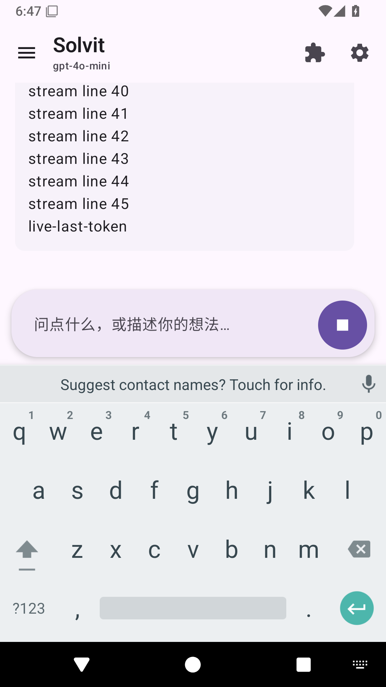

# Android 聊天的 JavaScript 步骤驱动（0.23.0 候选）

## 当前实际变化

应用加载包内 `agent/chat-driver.js` 并注册 `builtin.agent.javascript` 服务；Android 的 `ChatAgentPlugin(requireDriver=true)` 声明对此服务的依赖。JS实际发起模型步骤、按模型返回的工具数量逐个请求执行、结算步骤并发起下一次模型请求；无工具调用时请求最终结算。原 Kotlin `for` 循环已经移到驱动契约之外，宿主转为命令状态机。不是 JS 调用一个执行完整循环的 Kotlin Agent。

每个聊天轮次有独立 QuickJS，异步宿主操作显式继承这轮协程，流式文本和思考通过有背压的 `channelFlow` 实时发给 UI，不等待 JS 整轮返回。取消时关闭 JS 实例和登记资源。JS服务缺失时Android启动依赖失败，JS异常时本轮报错，不悄悄回退到原生循环。JVM消费者仍可显式使用参考NativeAgentDriver，已有非Android回归继续覆盖宿主状态机。

宿主校验模型步骤单调顺序、工具索引、完整工具结算、已完成状态、允许工具/重复调用ID与总步骤/调用限制。命令串行化；JS跳过模型直接执行工具、跳过结果结算、提前返回或结束后追加命令均失败。角色、权限、用户确认、登记资源、工具超时/结果大小和持久执行记录仍走现有宿主服务。

JS只接收操作返回的工具数量和序号，没有API Key、提示词、工具原始结果或签名转录的副本。模型流由宿主收集并直接展示，原生转录对象不跨JSON/JS边界。每个模型步骤继续重新组装角色、最新Hook参考、工具声明及预算，后续轮次沿用已有任务模型路由。

## 与最终 JS 插件方向的距离

此阶段只把聊天步骤调度作为可替换服务由包内JS提供。仍是受信任的内置脚本，不是可下载第三方Agent插件；清单API仍13，普通插件不能请求这个宿主命令入口。JS尚未读取或自行投影消息，也不能自行替换Provider或存储、改变工具调度策略。不能把这个阶段宣称完整DSH/Cordis、完整JS内核或第三方Agent扩展完成。

后续应继续建立带声明/授权的Agent扩展协议与TS契约，把脚本策略、可撤销服务注册和配置组合接入插件管理；协议签名、存储一致性、权限与资源所有权必须保持宿主可核验。真实模型、搜索引用、完整实际任务和真机验收继续保留，范围见 [产品路线](product-roadmap.md)。

## 上游阅读与适配

读取锁定DSH `d743267388641bc76f17c45ce8b4c231aed1d32c`（MIT）`agent-loop/src/agent.ts` 实际prepareRequest、每步上下文投影、stream/live attempt与结算；`tests/loop.spec.ts` live attempt用例的即时chunk与持久消息一致性；`src/tool-calls.ts` 及其failure-quiescence测试的结果结算边界。采用步骤驱动与平台能力分开、实时输出不等待最终消息、已执行事实不能伪造的原则。本阶段无DSH源码拷贝，没有把TS/Cordis运行时引入Android。

读取锁定Operit `dbf71916fae9750cfdc9f9a774f5a0fee56633fb`（LGPL-3.0）`ConversationService.kt` 的beforeContext、角色卡与系统上下文组装。角色与协议投影保留在宿主，不在JS复制另一套身份或序列化原生签名。无Operit源码拷贝。

QuickJS继续使用已锁定的 `quickjs-kt 1.0.15`，无依赖升级。参考[官方异步与取消说明](https://github.com/dokar3/quickjs-kt#async)，同时沿项目已有方式显式父子绑定异步宿主工作，不仅依赖JS Promise取消的推断。每轮内存上限8MiB、栈256KiB；脚本受信任且不可通过市场修改，不把它当作一般不可信Agent代码的完整沙箱契约。

## 验证状态

候选build45/0.23.0，功能源码 [01e481a](https://github.com/veryy/Solvit/commit/01e481a0e16896d08fa2abe926342ac412094fc0)。[完整Android运行38357742717](https://github.com/veryy/Solvit/actions/runs/38357742717) 已成功。实际下载XML：329单元、48模拟器测试，均0失败/错误/跳过；Lint、APK、固定证书和旧正式版覆盖升级配置/聊天保留通过。没有本地构建或测试。

新增5个真实QuickJS回归覆盖步骤顺序、可见流式/工具回传、非法跳步、取消及原生转录/新参考；原有真实HTTP→QuickJS工具和创建/执行失败/修复/验证/SQLite重开证据测试已切到JS驱动。Android真实聊天UI使用同一脚本驱动，`actualChatShowsPartialTokensBeforeCompletionAndFollowsLongReplyAboveKeyboard` 通过（10.178s），Provider完成之前仍可看到文本，长回复末尾和输入框位于键盘之上；截图实际取回并查看。所有Provider仍为测试服务或受控fixture，不等于真实模型响应速度、质量或工具选择验收。

首轮远程38356453889因驱动表达式返回类型`Nothing?`编译失败，改为显式Unit；38356917123发现新参考断言未包含既有来源标签，按真实上下文契约修正。当前成功运行覆盖全部修改，没有把失败或未运行的测试算作通过。

[APK产物11794325405](https://github.com/veryy/Solvit/actions/runs/38357742717/artifacts/11794325405) 需登录GitHub；23,522,373 bytes，SHA-256 `b52fa0c3fece0b3a3186c8c03e15ae8d23af5ae8174c8c686fb5bca64dde3403`。下载ZIP/APK CRC通过，8个内置插件资产及`agent/chat-driver.js`与当前源码字节一致。固定证书 `f076abf86de542063f8655abf9021cb88b642ab9b664cafc46c0f16b4303bcc3`；仅候选，公网搜索门禁未通过，真实模型密钥/验收与真机仍缺。
