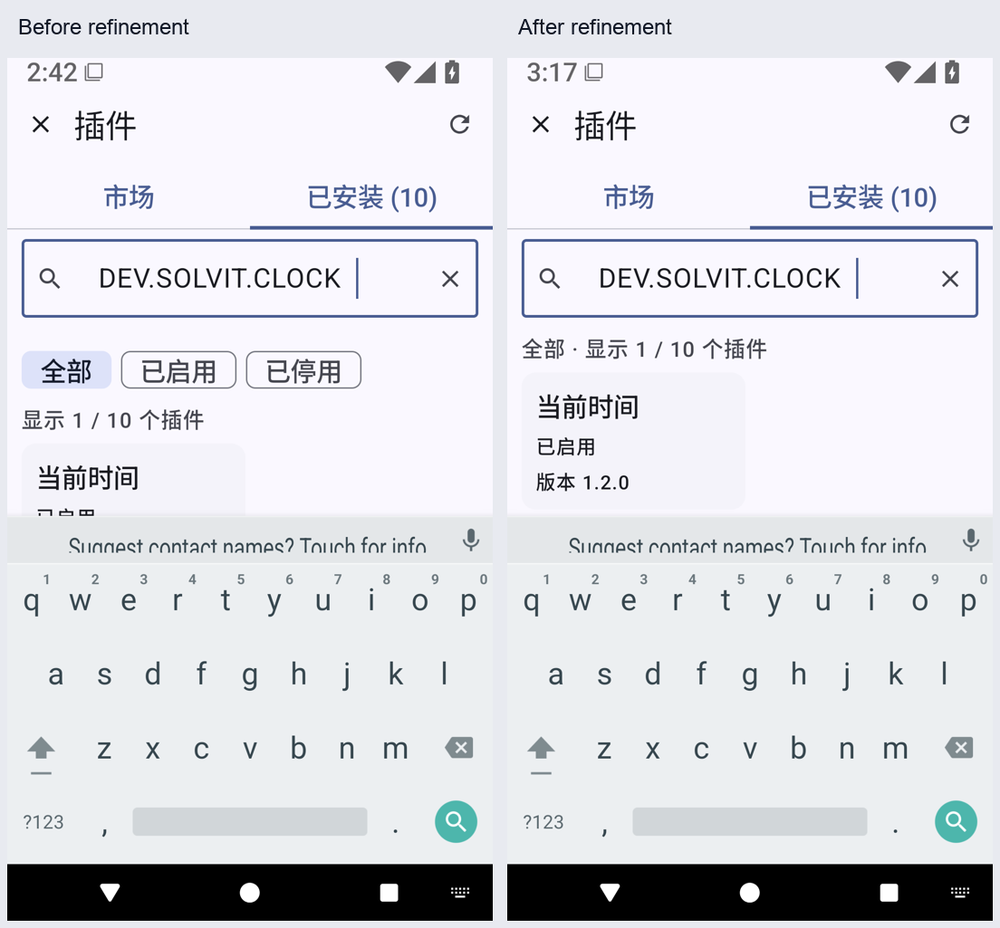

# 插件查找与返回位置

从已交付 build102 / `087d835ba4ac67a529c23617c440f1678a129ac7` 继续，主题候选仍不合入。此阶段改善插件管理的日常查找和导航，不新增插件执行或下载协议。

## 实际参考

已运行 `python3 scripts/fetch-upstreams.py --verify-only`，九个参考 checkout 与锁定版本一致。读取 Operit `dbf71916fae9750cfdc9f9a774f5a0fee56633fb`：

- `app/src/main/java/com/ai/assistance/operit/ui/features/packages/screens/PackageManagerScreen.kt`：各分类使用独立的 `rememberSaveable` 搜索输入/查询，按当前分类绑定搜索栏。
- 同目录 `PackageSearch.kt`：名称、ID、说明及能力元数据使用不区分大小写的包含匹配。
- `app/src/test/java/com/ai/assistance/operit/core/tools/packTool/ToolPkgManifestSelectionTest.kt` 实际验证包清单选择，不是查找 UI 测试；检索 test/androidTest 未找到上述查询函数或页面的直接回归，不能借用其测试数量作为本项目验收。

只阅读 LGPL-3.0 上游，不复制实现、不引入新依赖。Solvit 安装包较少，本地直接过滤，无需照搬面向大目录的延迟查询。插件业务界面仍由插件 HTML/JS 提供；这里是原生宿主的安装和权限管理。

## 行为与适配

源码确认此前只有网格和市场/已安装页签，没有搜索或状态筛选，而且两个分类使用同一个隐式滚动状态。本轮：

- 市场按名称、ID、说明查找；已安装按名称、ID、工具说明和页面标题查找，忽略首尾空格和大小写。
- 已安装可筛选全部、已启用、已停用；显示匹配/总数，无匹配可清除筛选，区别于没有安装任何插件。
- 两页签分别保存查询及滚动位置；修改查询/筛选回到结果开头，切换页签及关闭详情继续原位置。打开详情、切换页签及键盘搜索动作收起键盘。
- 从市场明确安装/更新时清除已安装页的旧查询与筛选，避免新增包被旧条件隐藏；普通切换仍保留各自状态。
- 查询与筛选可恢复 Activity 重建；不将用户模型配置或凭据加入搜索和日志。六语言标签补齐，仍用原有插件安装/升级/授权/页面流程。

实际 MainActivity 回归覆盖真实已安装插件、系统150%字号与IME、状态筛选、无结果恢复、详情返回、Activity重建和两分类的查询/位置隔离。市场目录使用固定元数据夹具，不执行下载，不能证明公网市场部署或安装服务可用。已安装侧使用真实服务和内置时钟插件，临时启用后恢复原状态。

候选版本 0.43.10/build103，远程验证尚未完成；不得以代码存在声称交付。真实模型、ARM64真机、导航栏对比及正式市场/live发布门禁继续保留。

同APK39090777618原两项通过，但实际150%/IME截图中结果卡片仅部分可见，不能据此验收布局。已补强真实布局坐标与网格可视区域的完整高度断言，先对当前12ccd24d生产APK执行。优先假设是筛选行占用结果空间；重复IME边距应产生异常空白，而截图未见；旧滚动位置应在回到首项后改变症状，但截图已位于首项。按该顺序验证，不减弱断言。

增强断言在同生产APK的39091241780实际失败：结果top=858、完整高度305、网格底部1019（下缘1163已越界），另一条分类/位置回归通过。归档12123285849（978517字节）大小/摘要/CRC和原始runner已核对。只调整布局：输入时暂收筛选按钮，保留当前条件与数量的一行摘要，键盘收起后恢复按钮；原几何断言与全部旧操作保留，并等待实际IME消失及按钮恢复，避免在键盘动画中点击。最终修正仍待远程验证，不能交付原12ccd24d包。

收起筛选行的同APK39091919545仍被完整高度断言拒绝：top721、高305、底边1026，实际网格底部1019，差7像素。归档12123311916（995216字节）大小/摘要/CRC及原始runner已核对，实际截图已查看，另一项分类返回仍通过。不放宽断言；仅在IME可见时把网格垂直留白12dp改为4dp，保留水平留白与正常浏览间距，继续远程验证。

最终生产 f0821a8e 的同APK定向39092809353已通过，原始runner为 `OK (2 tests)`（21.656秒）。归档12123333036（1081007字节）大小/摘要/CRC已核对；四张实际截图已查看。真实150%/IME下整张时钟卡片连同底边可见，关闭IME恢复筛选、无结果恢复、返回详情与分类位置以及Activity重建断言全部保留并通过。完整远程回归仍待完成，此时不宣称已交付。

完整39092306285的App实际92项中，仅旧 `pluginPageCanReachBottomAndReturnToChat` 失败，位置是最后插件可见断言；归档12123816312（13948763字节）的大小/摘要/CRC和原始XML已核对。新增浏览器两项及其他89项App通过，但后续Web/terminal与完整stdio门禁不能计作通过。该旧用例把纯插件数组下标用作包含新增头部项的网格下标。改为按最后插件ID执行语义滚动，保留名称可见、详情卸载入口、无试运行、返回聊天的所有原断言；生产代码不改。增加三用例组合定向，和完整流程重新验证，不能只重跑后忽略旧失败。

e373同APK组合39094357176中，浏览器两项已结束，旧底部方法仅出现开始记录，未输出断言或结束；120秒runner以124退出。归档12124147535（1069620字节）的大小/摘要/CRC、runner及TestRunner日志已核对，未找到Fatal/ANR，不能据此断言已修复底部路径。优先验证 `performScrollToNode` 的逐屏ScrollBy循环与该旧类StandardTestDispatcher排队的交互；其次检查跨类规则切换，最后检查真实末项不可达。读取AndroidX `compose/ui/ui-test/src/commonMain/kotlin/androidx/compose/ui/test/Actions.kt`（202b4bda8adfeb303ac30e359e8436a3752fe2b0）和 `actions/ScrollToKeyTest.kt`（c467614eb3fd738f1579b79011ba7c1c16e027b4）的实际实现/测试：公开按key动作通过IndexForKey调用ScrollToIndex，避免逐屏循环。只阅读Apache-2.0源码，不复制。改为现有插件ID的公开key动作，按本项目QueuedScroll.kt既有方式推进一帧，再有界等待真实节点可见，保留全部旧断言并记录前后截图。先对同一生产APK定向验证，再完整回归；不增加超时或改生产UI。

完整39095347399的构建阶段通过628单元/Lint/固定签名，APK与三项39095031412定向用包大小及SHA-256一致。但全套在外部克隆CONFLICT恢复阶段发生SnapshotStateObserver跨线程崩溃，尚未执行常规模拟器套件；不得算全套通过或交付。失败UI归档12125015705（675177字节）的大小/摘要/CRC和原始runner/logcat已核对。日志明确记录DefaultDispatcher-worker-4经ApplyingContinuationInterceptor → TestMonotonicFrameClock → Recomposer → AndroidView更新 → PluginWebPage.kt:221调用WebView.evaluateJavascript，随后main绘制与前一线程49竞争。这是默认Unconfined测试调度的直接调用证据，不能推断普通生产环境同样使用该测试调度器。

读取官方ui-test-android1.8.3 sources中ComposeUiTest.android.kt（225–262行）及AndroidX c500530fe429fb363e2aed6741a67c938b6f6891的CustomEffectContextTest.kt：默认TestDispatcher为Unconfined；明确提供StandardTestDispatcher时由MainTestClock驱动，官方测试保留实际帧推进。只阅读Apache-2.0源码，不复制。按本项目既有ChatLayoutTest/PdfChatDeviceTest模式，仅对有直接竞争证据的WorkspaceCloneProcessDeathTest排队组合效果；HTML等待同步推进一帧。原六场实际外部force-stop、PID、数据/目录inode、Shell、请求数、拒绝及显式恢复断言全部保留。新增同APK克隆六场定向入口，先验证这一实际失败链再完整回归；不改生产线程、依赖或恢复实现，也不吞掉异常。

单独39096525292在prepare阶段因测试APK缺少git-fixture.crt失败，尚未验证六场恢复。新增诊断流程把生成测试证书的步骤误放在测试APK编译之后；已按完整Android流程调整为先生成夹具再编译。保留失败，不将它归为生产或调度补丁的结果；同一APK、原测试及所有断言重验。
