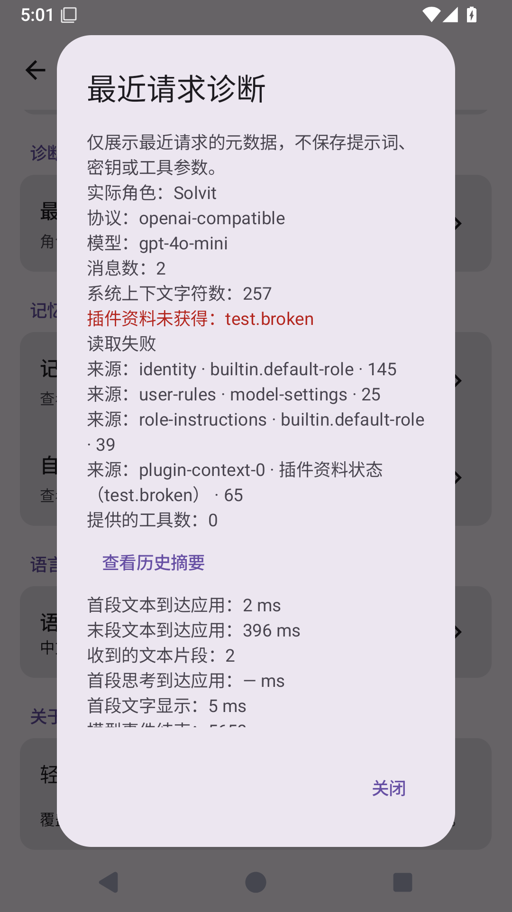

# 真实模型验收与流式诊断（0.22.6 候选）

本阶段仍属于聊天内核验收。插件 HTML/JS 页面、记忆关系图、多 MCP 和工作目录/PTY 的现状与边界见 [HTML 阶段](plugin-html-stage.md)、[终端页面](plugin-terminal-pages.md)；完整未完成事项保留在 [产品进度](product-roadmap.md)。不以新增验收入口宣称真实模型可用。

## 执行入口

GitHub Actions 的 `Real model acceptance` 手动工作流接收 HTTPS 基础地址、模型名称和已有 Provider ID；API Key 只从仓库 Secret `SOLVIT_MODEL_API_KEY` 获取。缺少凭据立即失败，不跳过后记作通过，也不使用历史聊天里暴露过的 Key。常规 Android 工作流仍编译验收代码，但明确排除这一个需真实凭据的测试类；其余原有测试照常运行。

验收在一次性 Android 35 模拟器中安装实际签名 APK 和 instrumentation APK，使用实际 SQLite ChatService、原生角色设置、现有 Provider、QuickJS 插件与授权页面。不会替换模型为假响应。覆盖：

1. 默认角色、从设置应用自定义角色、切换角色、新建对话继承、重新选择已有对话。
2. Compose 流式正文在 Provider 完成前确实可见，且收到至少两个非空文本段。
3. 安装临时 JS 工具，模型请求它，用户一次性允许，SQLite 记录执行成功；工具生成的随机验收码不在模型请求中，最终回答必须含实际回传的验收码。

配置通过 adb 标准输入写入应用私有文件，权限 600，不进入命令参数、源码或 APK。角色和模型配置临时替换后恢复，临时对话/插件清理；执行器最终清空一次性模拟器应用数据，处理进程异常退出后的残留。只上传脱敏 JSON 和限定文件名的截图，不上传输入配置、数据库、原始 instrumentation 输出或 logcat。工作流有时间上限，失败保留当前阶段，不把未执行用例视为通过。

“重新选择已有对话”不等于进程重启，长历史、长思考、停止、联网搜索引用、完整工作区任务和真机仍需另外验收。模型及网关必须支持现有协议的流式和工具调用；失败应读取实际结果，不能以动画或工具按钮存在代替。

## 接收与显示分别记录

最近请求诊断新增非空文本段数量和最后文本段到达时间。时间是聊天发送后的相对毫秒，由 `ChatViewModel` 收到解析后的 `ModelChunk.Text` 时记录。逐字显示动画不增加段数；现有整块文本回归测试同时断言只有一个接收段。

验收记录首个解析文本、首个可见状态、Provider 解析完成、显示完成及接收段数，并直接查询 Compose 正文是否显示。它们不是网络 TCP 首字节或服务端生成时间；不能单凭字段判断服务端缓冲。只有整块返回后前端动画的回答，会因段数条件未满足而失败。截图拍摄发生在观察之后，时间判断依据实际 UI 查询和 Provider 完成状态，不能依据静态截图推断。

## 已读取的对应上游

- DSH `d743267388641bc76f17c45ce8b4c231aed1d32c`（MIT）：`packages/core/system-prompt/src/index.ts`、`packages/core/agent-loop/src/agent.ts`、`src/assistant-stream.ts` 与 `tests/loop.spec.ts` 的 live attempt 用例。采用请求上下文、即时分段事件与持久消息结算分开的验收原则；不把最终消息作为流式证据。
- Operit `dbf71916fae9750cfdc9f9a774f5a0fee56633fb`（LGPL-3.0）：`api/chat/enhance/ConversationService.kt` 的角色卡上下文组装，以及 `ui/common/markdown/RenderBatchCoordinator.kt`、`StreamMarkdownRenderer.kt` 和 `RenderBatchCoordinatorTest.kt`。角色从实际设置进入请求，渲染刷新与收到模型内容分别观察。本阶段未复制上游代码或增加上游运行时依赖。
- 终端回归另读同一 Operit 的 `StandardTerminalCommandExecutor.kt` 输入提交契约，并复核本项目真实 PTY 测试。文档提交的常规门禁 `38345491632` 失败在 Ctrl+C 用例：写入 `sleep` 后立即中断，没有确认前台任务启动；输出仍停在 `sleep 30`。测试改为等待子进程启动标记、点击真实 HTML Ctrl+C，并等 shell 提示符返回后提交下一条命令，避免中断输入队列与前台切换竞态。保留真实长命令、中断和后续执行断言；不延长超时、不移除断言。此前另有全门禁成功，不能据此忽略这次失败。

## 验证状态

源码 `e040b04edf518ceb0d495ebfee2e70562bfd9ad3` 的 [完整 Android 门禁](https://github.com/veryy/Solvit/actions/runs/38348358741) 成功。实际 XML：317 单元、48 模拟器测试，均为 0 失败/错误/跳过。Lint、真实验收类编译、固定签名及 APK 成功；终端 HTML 输入/中断、角色设置、可见分段与覆盖升级保留配置/聊天通过受控验收。`gradlew` 仍为 100755。

已查看本次诊断截图：收到两段文本，最后一段到达 396ms，首个可见状态 5ms，关闭按钮可见。这是测试 fixture 的受控时间，不是实际模型响应速度。原一整块文本测试断言接收段数为 1，显示动画不会增加计数。

真实模型验收尚未运行：当前仓库只有签名 Secret，缺少新的模型 Key、验收地址和模型名称。不能声称角色回答、真实网关流式或工具回传已经通过；当前增加的是可执行验收与接收诊断。该段记录此前候选阶段；0.23.4已通过公开搜索及完整门禁并正式发布。真实模型验收仍待新的凭据与实际运行，不能以发布结果替代。

