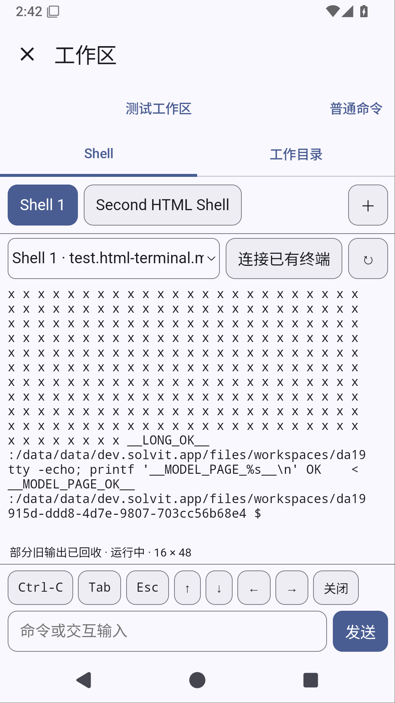

# 0.22.3 候选：插件交互终端

源码 `0498389bcc10d24aa435dcb93ab138f55da29fcc`，build39 / host API13。
[完整 Android 验证](https://github.com/veryy/Solvit/actions/runs/38337675616)成功，实际 XML：306 单元、48 模拟器测试，0失败/错误/跳过；Lint、APK构建、固定签名检查成功。[下载候选APK](https://github.com/veryy/Solvit/actions/runs/38337675616/artifacts/11785434578)（需登录GitHub）。[独立HTML终端验证](https://github.com/veryy/Solvit/actions/runs/38337818231)也通过。

终端页面现在在JS插件内，离线使用xterm.js；原生提供PTY、权限与生命周期桥接。实际测试包括拒绝/允许、环境保留、原始输入、Ctrl-C、多Shell、AI会话连接确认、跨聊天隔离、窗口尺寸、大段Unicode与截断回放。升级匹配旧包保留启用/授权，修改包和卸载状态保留。普通有限命令历史仍是原生兼容页。

APK 23,504,996 bytes，SHA-256 `c768f1c08b6337eb6a18cb9761c243c53d0d4dcacab8660ad1954264939352d9`；ZIP CRC通过，APK内terminal包与市场源字节相同。CI证书 `f076abf86de542063f8655abf9021cb88b642ab9b664cafc46c0f16b4303bcc3`。

HTTPS市场API1–13目录及19个选中版本下载实际校验长度/哈希通过。API13终端1.1.0，API5–12终端1.0.0；其他已上线包保留。部署前保留API12完整备份。

这不是正式Release：公网搜索发布门禁仍未通过，releases/latest仍指向0.21.3。真实模型角色回答、网关可见流式与工具选择、记忆质量、真机输入法/安装和全屏TUI未验收，聊天内核完整插件生命周期替换也未完成。截图中的长路径提示和控件密度仍需收整；不把设置PS1当作Android mksh短提示已验证。

