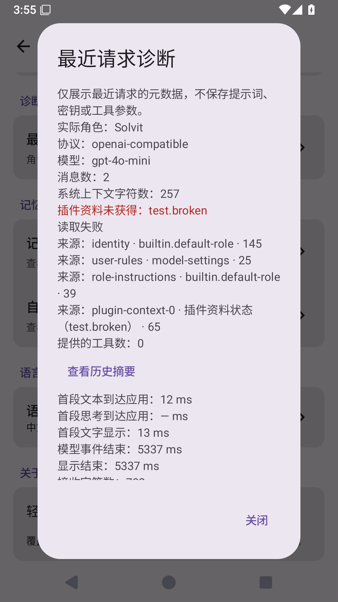

# 0.22.5 候选：可选插件资料失败隔离

源码 `1b385f27fd6bd4e98e518bbce4e1143dfda6334c`，build41 / host API13。不是正式Release；releases/latest仍为0.21.3，公开搜索发布门禁没有绕过。

单个可选beforeModel Hook抛错或超限不会中止其他资料组装；整批采用四个读取任务、10秒协作式等待窗口。未完成或排队到期的任务会取消并报告，不声称每个健康插件都能在期限内完成，也不把原生清理时间视作已受绝对墙钟限制。最多64个Hook，单项32KiB、汇总64KiB。角色/系统规则/工具授权错误仍中止。

返回时检查同一注册对象，丢弃已卸载/替换资料；用户停止与插件取消自己的子任务分别处理。模型收到资料未获取说明，诊断页显示插件/失败、超时、超限原因，支持现有六种语言，不输出原始异常。失败不会自动停用该插件的工具。

[完整Android Actions](https://github.com/veryy/Solvit/actions/runs/38343216346)成功；实际XML317单元，0失败/错误/跳过，包括三个红色复现回归、用户/插件取消、资源上限和真实QuickJS→HTTP失败隔离。Lint、固定签名、APK成功；模拟器XML48个测试，0失败/错误/跳过；实际首段显示、富文本/长回复跟随、插件失败诊断、角色继承、HTML/PTY与覆盖升级保留配置和聊天通过。已查看截图，失败插件/读取失败和关闭按钮可见。

[下载APK产物](https://github.com/veryy/Solvit/actions/runs/38343216346/artifacts/11787657168)（需登录GitHub），23,521,744 bytes，SHA-256 `a227cd50d708728037300ae502cb7c55627c9dd0a34c18cf087a27cf711ebf5f`。压缩包/APK CRC通过，8个内置插件资产与源码完全一致。CI证书 `f076abf86de542063f8655abf9021cb88b642ab9b664cafc46c0f16b4303bcc3`，数据结构/插件包/市场协议未改。

这不是用户网关慢、角色失效和模型工具选择的全部根因验证。真实模型回答/记忆质量、网关首段可见时间、真机/全屏TUI、完整JS Agent/Provider/存储替换和正式发布门禁仍未完成。受测HTTP使用本机MockWebServer，模拟器模型响应为受控fixture，不冒充真实模型。

上游、失败与适配边界见[阶段记录](optional-plugin-context-stage.md)，完整路线见[产品进度](product-roadmap.md)。未进行本地Android或TS构建/测试。

