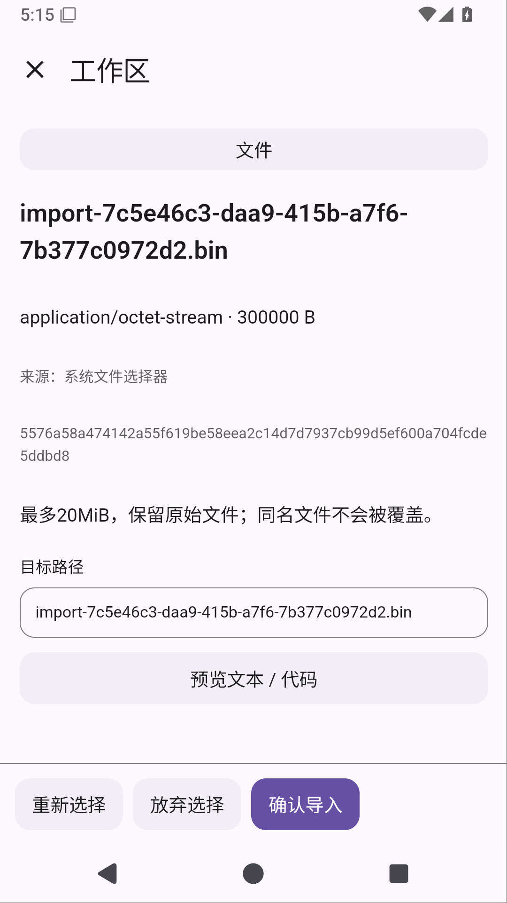
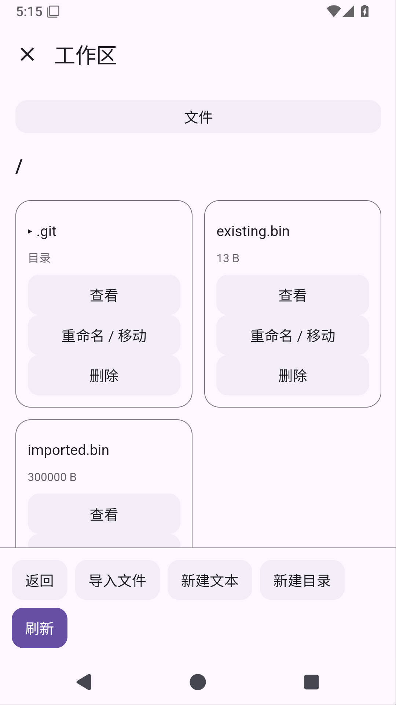
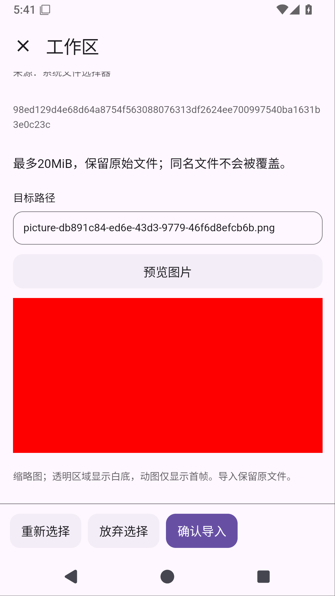

# Solvit 0.34.0：把文件导入工作区

本版新增工作区文件选择、确认导入及文本/图片预览。正式下载和最终验证以不可变标签工作流及公开产物核对为准。

- 在工作区文件页选择手机上的文件，查看名称、类型、大小、来源和目标路径，再确认导入。每个文件最多20MiB，导入保留完整原始字节。
- 文本/代码支持UTF-8内容预览；最多读取256KiB并显示前8192字符，截断明确提示。二进制不被误当文本。
- PNG、JPEG、WebP、GIF可按需查看缩略图，最长边640像素，透明图白底、JPEG方向按EXIF处理；动图只预览首帧。预览不改变原文件，确认导入仍写入完整原图。
- 同名文件显示冲突，可返回改名再确认，不自动覆盖。取消选择或确认不会创建文件；关闭页面释放当前选择。
- 导入后文件树、Git Changes和Shell使用同一份文件。旧版工作区升级保留启用状态、已授权权限和项目规则设置；用户修改过的插件包不自动替换。

用法：聊天绑定工作区 → 文件 → 导入文件 → 选择 → 查看信息/预览 → 调整目标路径 → 确认导入。插件页面由工作区自己的HTML/JS绘制，文件选择、图片解码和原始字节写入由Android宿主管理。

当前边界：导入只新增文件，不支持带版本确认的覆盖；PDF可导入原文件，但工作区PDF正文/原页预览仍待接入（聊天PDF读取已在0.33.1支持）。已有聊天附件直接导入、导入进度/可停止作业及异常退出暂存回收仍待完成；不将这次阶段交付缩小成完整文件导入需求已完成。ARM64真机、真实模型完整工作区任务和实际手指操作系统文件选择器尚未验收。

Linux环境保留PRoot/Ubuntu、Python3.12.3、Node24.21.0/npm11.19.0、Java17与共享工作区能力；环境升级和PTY须继续通过完整正式门禁。屏幕操控暂缓。

## 验证状态

文本候选[38601350681](https://github.com/veryy/Solvit/actions/runs/38601350681)通过483单元和65设备用例，完整报告ZIP CRC/XML及实际导入截图已核对。图片候选485单元和Lint通过，[38606210921](https://github.com/veryy/Solvit/actions/runs/38606210921)完整设备链69用例零失败/错误/跳过；完整报告ZIP CRC/XML及实际图片截图已核对。市场API22私有暂存比较通过，未公开新包。正式标签六项门禁、签名/覆盖升级、APK/源码公开下载核对均待完成。

保留已知诊断历史：曾发生PDF读取设备等待超时，以及此前WebView原生SIGSEGV；后续候选通过不等于原因已修复。原断言和超时保留，PDF失败时增加合成夹具状态和截图诊断。详细证据见[阶段记录](workspace-import-stage.md)。

以下是文本/二进制候选真实API35模拟器截图，使用测试文件；不是图片候选显示证明。

