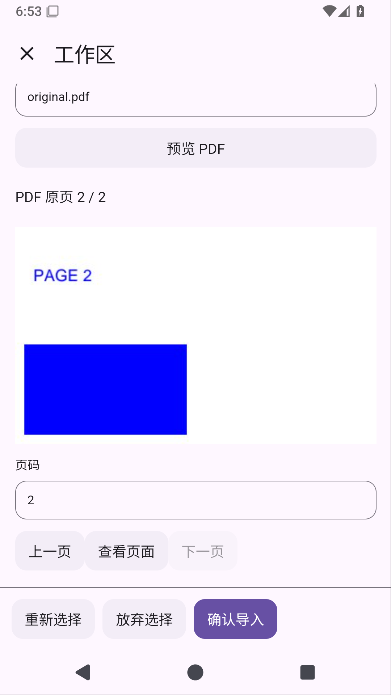

# Solvit 0.35.0：在工作区预览 PDF

本版给工作区加入 PDF 原页和文字预览。发布流程只有在同源标签的完整测试、设备界面、Linux 环境、固定签名和覆盖升级通过后才公开 APK；下载核对结果会记录在下方。

在聊天绑定的工作区文件页选择 PDF，点「预览 PDF」，就能查看原页和当前页文字。可以前后翻页，也可以输入页码；扫描页显示原页，并说明当前页没有可提取文字。预览不会写文件，确认导入才将完整原 PDF 放入 AI、终端与 Git 共用的工作目录。

- 原页按需渲染，最长边640像素；文字最多8192个UTF16单元，超出会提示预览截断。
- 目标路径在翻页、取消选择和返回确认后保留；同名文件仍需要改名，当前不自动覆盖。
- 坏文件、密码保护、撤权和页码越界会明确失败，不伪造空结果或 OCR 文字。
- 旧工作区插件升级保留启用状态、权限和项目规则开关；修改过的包及卸载决定继续保留。
- 界面由工作区自己的 JS/HTML 插件绘制，Android 宿主负责原文件、PDF 解码、授权和写入。工作区插件1.6.0/API23，Git共享页面源码升1.2.2/API20；旧宿主继续获取兼容版本，历史下载不替换。

PDF文字提取与渲染使用现有PDFBox和Android PdfRenderer，不新增库。原文件上限20MiB、最多5000页；预览同步解析/渲染不能保证即时打断，也不是独立进程隔离。扫描页OCR可在聊天PDF读取中使用，工作区预览尚未接OCR。

还需完成已有聊天附件直接导入、带文件版本确认的覆盖、可停止导入作业、异常退出的暂存回收和全局附件容量管理。ARM64真机、真实模型完整开发任务、真实手指操作DocumentsUI、本地stdio MCP与更广泛开发工具兼容性尚未验收。屏幕操控继续暂缓。

## 当前验证

原生检查点bfd43c2的[Android38614115299](https://github.com/veryy/Solvit/actions/runs/38614115299)全部成功，报告ZIP CRC/XML为487单元、74设备，零失败/错误/跳过。包含真实PDF第二页文字/蓝色像素、扫描页、截断、坏文件/密码/撤权与取消清理，以及原聊天PDF/图片回归。

候选7457b74的[Android38616204223](https://github.com/veryy/Solvit/actions/runs/38616204223)build成功；实际下载单元报告核对490/0/0/0，Lint/APK/固定签名门禁成功，HTML设备任务已通过；完整下载UI归档并核对75设备零失败/错误/跳过，实际查看第二页截图正常。[TypeScript38615928135](https://github.com/veryy/Solvit/actions/runs/38615928135)的生成、typecheck、118 SDK/5市场、公网搜索/MCP/Skills检查通过；生成包下载ZIP CRC已核对。API23私有市场检查40历史下载及旧API兼容通过，更新前后公开HTTPS下载都已核对：API1..19目录不变，API20..22仅Git兼容补丁，API22继续workspace1.5.0；40历史下载保持，API23新包与仓库字节一致。服务更新完成后客户端才切换hostApi23，原生执行器仍来自锁定源码。

候选真实页面截图：

正式同源标签门禁与公开APK/源码下载核对随后补充。本记录不代表整个Agent项目或完整文件导入范围完成。

## 正式运行中的产物核对

不可变v0.35.0指向24f05884b052626c12f785015cbf4fe0e24e38ec。[正式38619541924](https://github.com/veryy/Solvit/actions/runs/38619541924)的build/plugins/search/Linux已成功，verify-ui仍运行，release尚未执行。正式unit11922511231完整ZIP CRC/XML为490/0/0/0；实际下载APK11922321520与源码11921107536并核对外层/内层ZIP CRC。APK58107578字节，SHA256 e3c63e7f01fb0aad30db560adda3f6d1127ecc1ce6c3cc15e5d9d22aafe0544b；源码1072569字节，SHA256 dd1d3a3eb2869f51ed50720611058e586df0abe26bc59a0151edb6c756ff76af。固定签名实际日志为f076abf86de542063f8655abf9021cb88b642ab9b664cafc46c0f16b4303bcc3。尚未公开下载比较。

正式插件完整日志核对118 SDK/5市场零失败及公开搜索/MCP/Skills成功；正式Linux完整日志核对原3个Android用例及严格版本门禁，生产Python3.12.3/Node24.21.0/npm11.19.0、Java17检查成功。Linux完整探针归档尚未下载，不声称其ZIP CRC。发布仍等待正式设备报告、截图、覆盖升级及公开APK/源码逐字节比较。

## 正式发布与实际下载核对

0.35.0已公开：[下载APK](https://github.com/veryy/Solvit/releases/download/v0.35.0/solvit-debug.apk) · [Release](https://github.com/veryy/Solvit/releases/tag/v0.35.0) · [成功Actions38619541924](https://github.com/veryy/Solvit/actions/runs/38619541924) · [对应Linux源码与许可](https://github.com/veryy/Solvit/releases/download/v0.35.0/solvit-linux-sources.zip)。不可变标签固定24f05884b052626c12f785015cbf4fe0e24e38ec，应用0.35.0/build69/API23，build/plugins/search/Linux/verify-ui/release六项全部成功。正式unit11922511231与UI11922278392完整ZIP CRC/XML为490单元、75设备，零失败/错误/跳过；真实WorkspacePdfHtmlTest与覆盖升级配置/对话保留用例通过。实际查看正式PDF第二页截图，原页、页码与底部确认完整显示。

公开APK与源码已实际下载，与正式artifact11922321520/11921107536中的文件逐字节相同，外层/内层ZIP CRC通过。APK58107578字节、SHA256 e3c63e7f01fb0aad30db560adda3f6d1127ecc1ce6c3cc15e5d9d22aafe0544b；源码1072569字节、SHA256 dd1d3a3eb2869f51ed50720611058e586df0abe26bc59a0151edb6c756ff76af。固定证书摘要及118 SDK/5市场、生产Linux版本证据见上节；Linux完整35MB探针归档未下载，不声称其CRC。

本节是当前正式状态，前面的候选/运行中记录保留当时状态。完成PDF工作区分页预览阶段，继续完整文件联动；聊天已有附件导入、带版本覆盖、进度取消/异常暂存回收及真机/真实模型任务仍未完成。
