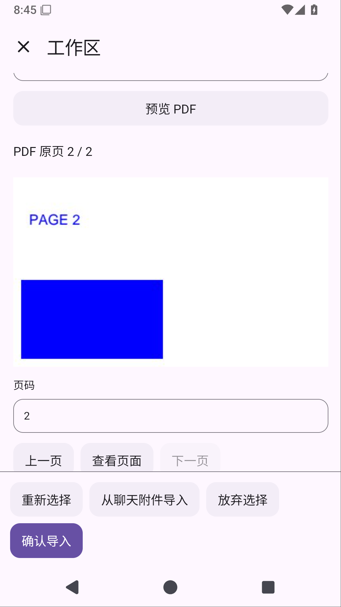

# Solvit 0.36.0：把聊天附件放进工作区

本版把已发送、已保存的聊天附件接到工作区插件页面，不用再从系统选择器找一次文件。

打开当前对话的「工作区 → 文件 → 从聊天附件导入」，选择附件，查看来源消息、名称、类型、大小和完整文件摘要。可以先预览文字、图片或 PDF 原页，填写目标路径，再明确确认导入。单纯选择或预览不会写入工作区；取消保留此前选择，同名文件仍需改名。

- 列表只显示当前对话的用户附件，最新消息在前，每页最多20条，不向插件提供消息正文或私有文件路径。
- 导入完整原文件，PDF 的聊天选页、提取文字和 OCR 不会替换原 PDF。
- 导入后文件管理、Git Changes 和 Shell 使用同一份文件；原聊天附件继续保留。
- 来源删除、内容版本改变、撤权或切换对话会拒绝相关操作。选择和最终导入分别经过原生确认。
- 插件界面仍由 JS/HTML 绘制。工作区1.7.0使用API24；Git共享页面源码升1.2.3/API20。旧包迁移继续保留启用、权限和项目规则设置，不覆盖修改包或已卸载决定。

文件仍以20MiB为上限，文字预览、图像缩略图和PDF分页沿用现有限制。列表分页限制返回的元信息数量，底层ChatStore仍读取该对话历史，尚不是数据库级大历史分页。带版本检查的覆盖、可停止导入作业、异常退出的暂存回收及全局附件配额继续在计划中；这版不代表完整文件联动范围已经完成。

Linux环境保留无需root的Ubuntu、Python/venv、Node24/npm和Java17；新增[上手指南](linux-environment.md)。ARM64真机、真实模型自主任务、真实手指操作系统文件选择器及本地stdio MCP尚未验收。屏幕操控继续暂缓。

同时修复工作区子目录与分页页面打不开的问题：导入、新文件、新目录放到列表上方，底部保留返回、刷新、上级目录和分页；Git 文件管理继续保留 Changes 入口。

## 发布前验证

候选24562e8的[Android38633177162](https://github.com/veryy/Solvit/actions/runs/38633177162)完成499单元测试、Lint、APK和固定签名检查。实际报告ZIP CRC/XML核对；原目录HTML场景和保存附件PDF→Git/Shell联动通过。整轮76设备中另有1个聊天交互用例失败于Compose测试线程读取布局，尚不能称整轮通过。

修正测试读取方式，保留原10秒键盘位置及角色、授权、队列编辑/中断、新聊天断言。[独立38636197152](https://github.com/veryy/Solvit/actions/runs/38636197152)复用同一生产APK，完整聊天交互连续5次全部通过，首失败停止策略未触发；归档11928930382完整ZIP CRC及五份结果已核对。正式标签仍需完整页面门禁通过。

[TypeScript38632968075](https://github.com/veryy/Solvit/actions/runs/38632968075)为121 SDK/5市场零失败，包括先复现后修复的嵌套分页限制；生成归档CRC与APK/市场两份包一致。市场私有before/next验证及更新前后公网HTTPS下载均已核对：42个历史版本原字节保持，API1..19目录不变，API20..23仅兼容Git补丁；新包下载与仓库字节一致。服务器更新完成后客户端接通API24，正式标签仍待全部发布门禁。

本记录当前仍是发布准备；正式同源标签的全部门禁、真实页面截图及公开APK/源码下载核对完成后再追加交付证据。[完整阶段与失败修复记录](chat-attachment-workspace-stage.md)。
