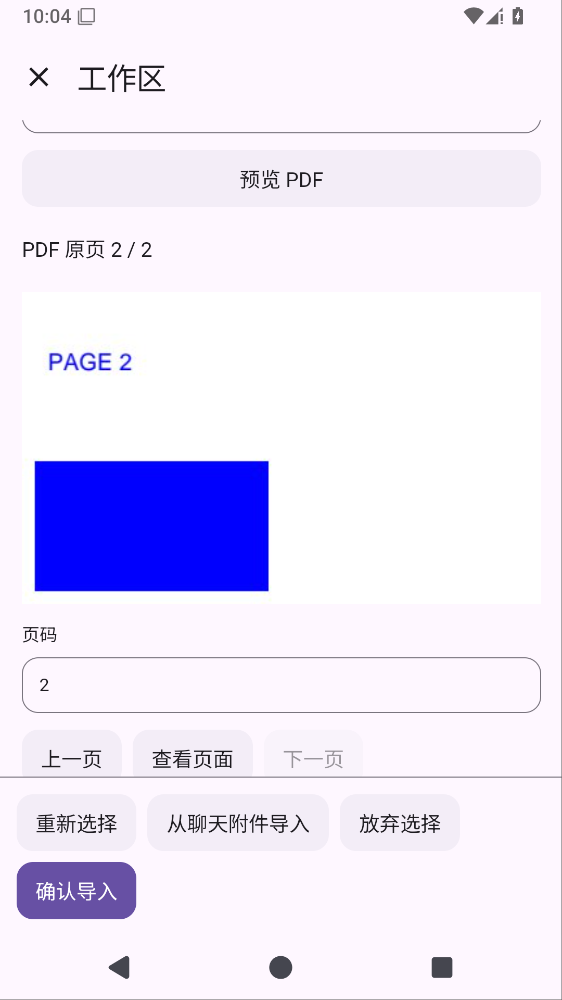
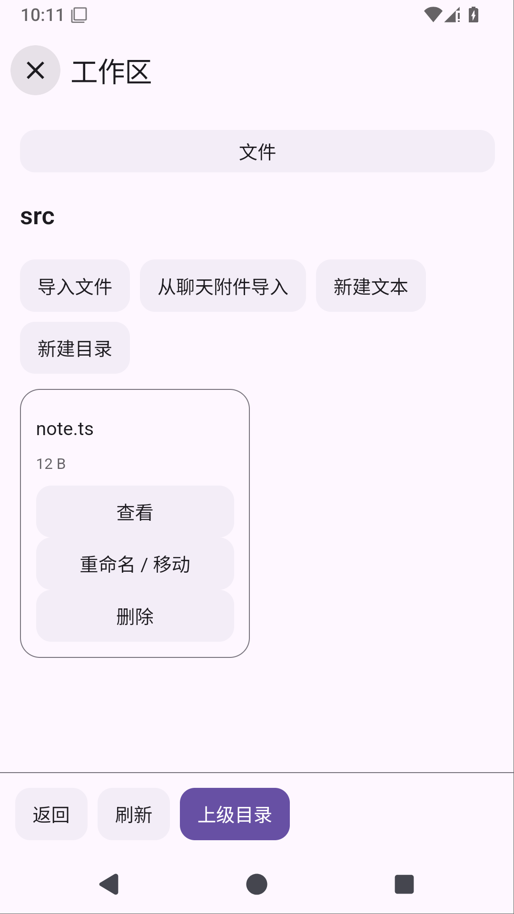

# Solvit 0.36.2：把聊天附件放进工作区

本版把已发送、已保存的聊天附件接到工作区插件页面，不用再从系统选择器找一次文件。

打开当前对话的「工作区 → 文件 → 从聊天附件导入」，选择附件，查看来源消息、名称、类型、大小和完整文件摘要。可以先预览文字、图片或 PDF 原页，填写目标路径，再明确确认导入。单纯选择或预览不会写入工作区；取消保留此前选择，同名文件仍需改名。

- 列表只显示当前对话的用户附件，最新消息在前，每页最多20条，不向插件提供消息正文或私有文件路径。
- 导入完整原文件，PDF 的聊天选页、提取文字和 OCR 不会替换原 PDF。
- 导入后文件管理、Git Changes 和 Shell 使用同一份文件；原聊天附件继续保留。
- 来源删除、内容版本改变、撤权或切换对话会拒绝相关操作。选择和最终导入分别经过原生确认。
- 插件界面仍由 JS/HTML 绘制。工作区1.7.0使用API24；Git共享页面源码升1.2.3/API20。旧包迁移继续保留启用、权限和项目规则设置，不覆盖修改包或已卸载决定。

文件仍以20MiB为上限，文字预览、图像缩略图和PDF分页沿用现有限制。列表分页限制返回的元信息数量，底层ChatStore仍读取该对话历史，尚不是数据库级大历史分页。带版本检查的覆盖、可停止导入作业、异常退出的暂存回收及全局附件配额继续在计划中；这版不代表完整文件联动范围已经完成。

Linux环境保留无需root的Ubuntu、Python/venv、Node24/npm和Java17；新增[上手指南](linux-environment.md)。ARM64真机、真实模型自主任务、真实手指操作系统文件选择器及本地stdio MCP尚未验收。屏幕操控继续暂缓。

同时修复工作区子目录与分页页面打不开的问题：导入、新文件、新目录放到列表上方，底部保留返回、刷新、上级目录和分页；Git 文件管理继续保留 Changes 入口。

本版还修复联网阅读偶尔拿到空正文的问题：网页已加载但动态正文未出现时，有界等待后再读取；一直没有正文会明确失败，继续沿用匿名访问和原超时、取消与资源释放约束。

0.36.0未通过搜索门禁，0.36.1未通过语言设备测试门禁，均没有发布APK。本版保留其不可变标签，修复后重新运行完整发布检查。后续功能仍包括带版本覆盖、导入进度取消/回收、真实模型与真机任务，本版不代表这些均已完成。

## 发布前验证

候选已实际核对499单元测试及完整78设备报告；78设备中唯一语言测试线程/滚动同步问题随后修复。原目录、新附件PDF→Git/Shell、聊天交互和三项WebView均通过。语言修复后的独立38642905885复用同一生产APK，五次完整语言切换/Activity重建全部通过；1596字节归档11930883327完整ZIP CRC及五份结果已核对。聊天权限/队列/角色同源独立38636197152也为五次完整场景通过。

动态正文回归先失败后修复，真实WebView38638144639为3/2/0/0、38638678933为3/0/0/0；外网搜索原三查询及受控区域回退38638678882成功。插件121 SDK/5市场及公开搜索/MCP/Skills通过。API24市场更新前后公网HTTPS已核对24目录和42个历史版本，历史原字节不变，新包与仓库一致，客户端再接API24。

Linux正式0.36.1同源运行实际执行Python3.12.3、Node24.21.0/npm11.19.0与Java17，3个Android用例及严格版本门禁通过；完整35MB探针归档未下载，不声称其CRC。

当前为0.36.2发布准备；同源标签的完整门禁、截图及公开APK/源码实际下载比较仍待完成。所有编译/测试均由GitHub Actions远程执行。[完整附件阶段](chat-attachment-workspace-stage.md) · [网页正文诊断](search-release-diagnosis.md)。

## 正式运行

不可变v0.36.2指向fd66fc14dc2209c5260e78a0ef6e75689b86aa08，[正式Actions38643634909](https://github.com/veryy/Solvit/actions/runs/38643634909)正在执行。正式插件与搜索已成功；11931741138完整ZIP CRC/JSON确认原三查询及区域来源正文通过。正式源码11930783822已下载，外层/内层ZIP CRC通过，内部1072569字节、SHA256 f1fe3412825eedd538bf4d75d653f1ca143c651c9518969771b6fc7f1362a633。Android/Linux设备及公开APK下载比较仍待完成，尚未发布。

正式build116125032359成功；11930759518（375784字节）完整ZIP CRC/XML为499单元、零失败/错误/跳过；Lint/APK与固定签名f076abf86de542063f8655abf9021cb88b642ab9b664cafc46c0f16b4303bcc3实际日志通过。正式插件121 SDK/5市场及公开搜索/MCP/Skills通过；Linux116125032758成功，详细版本日志继续核对。页面116127699807仍运行，正式release未执行。

正式Linux完整日志确认原3个Android用例及严格版本门禁，生产Python3.12.3、Node24.21.0/npm11.19.0与Java17成功。完整探针归档未下载，不声称其CRC。APK11930509799已完整下载并核对外层/内层ZIP CRC，内部58122130字节、SHA256 86316d09921953023aa5a75c4941fa96843c6db4e5cb5a78818a6b8eef949031。设备页面与公开下载比较仍待完成。

## 正式发布与实际下载核对

0.36.2已公开：[下载APK](https://github.com/veryy/Solvit/releases/download/v0.36.2/solvit-debug.apk) · [Release](https://github.com/veryy/Solvit/releases/tag/v0.36.2) · [成功Actions38643634909](https://github.com/veryy/Solvit/actions/runs/38643634909) · [Linux源码与许可](https://github.com/veryy/Solvit/releases/download/v0.36.2/solvit-linux-sources.zip)。不可变标签固定fd66fc14dc2209c5260e78a0ef6e75689b86aa08，应用0.36.2/build72/API24；build/plugins/search/Linux/verify-ui/release六项全部成功。正式unit11930759518与UI11932102571（5658158字节）均完整下载核对ZIP CRC/XML：499单元、78设备，零失败/错误/跳过。

真实保存附件PDF→HTML第二页及蓝色像素→完整原文件→Git untracked→Shell摘要/退出码→原附件保留通过；原大文件输入/保存/冲突/目录任务通过，聊天权限/队列/角色与外观通过，英语/日语切换与Activity重建通过，原及延迟/永久空正文WebView三项通过。固定签名和原0.7.0覆盖升级保留加密配置/对话用例通过。实际查看下列正式PDF原页与目录操作栏截图，内容、分页与确认、目录与底部导航正常。

公开APK与源码已实际下载，与正式artifact11930509799/11930783822内部文件逐字节相同，外层/内层及公开ZIP CRC通过。APK58122130字节、SHA256 86316d09921953023aa5a75c4941fa96843c6db4e5cb5a78818a6b8eef949031；源码1072569字节、SHA256 f1fe3412825eedd538bf4d75d653f1ca143c651c9518969771b6fc7f1362a633。固定证书及正式121 SDK/5市场、搜索/MCP/Skills、生产Linux版本证据见上节。完整Linux探针归档未下载，不声称其CRC。GitHub简介已补中英文Linux/插件工作区说明，首页链接到Release，中英文README更新当前版本与附件入口。

此节为当前正式状态，保留前面候选记录。已完成保存附件导入工作区阶段；继续带版本覆盖、导入进度取消/暂存回收与配额。ARM64真机、真实模型完整任务、真实GitHub账号插件写入和本地stdio MCP仍待验收；屏幕操控继续暂缓。
