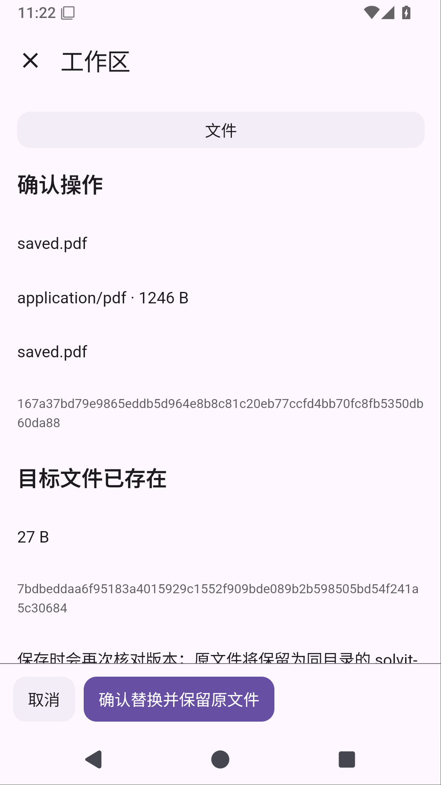
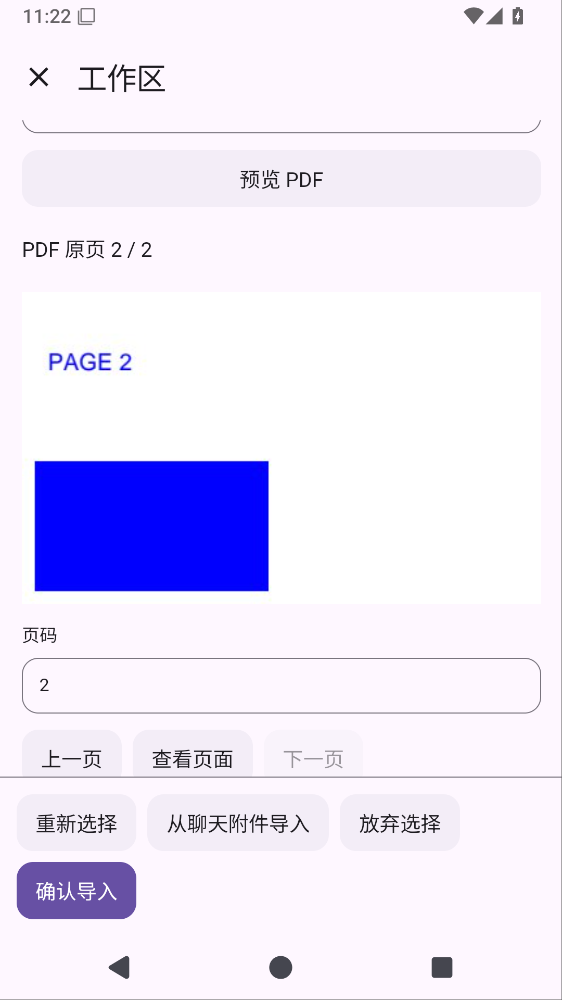

# Solvit 0.37.0：导入前审阅，再确认替换

[下载 APK](https://github.com/veryy/Solvit/releases/download/v0.37.0/solvit-debug.apk) · [版本页面](https://github.com/veryy/Solvit/releases/tag/v0.37.0) · [成功 Actions](https://github.com/veryy/Solvit/actions/runs/38652505308) · [源码提交](https://github.com/veryy/Solvit/commit/20d2d20aec4350cd06ea9367f74d5cf2402effa3)

聊天附件或系统文件导入工作区时，同名文件可以先审阅，再确认替换。页面显示已有文件的大小和完整 SHA256；提交时重新核对，Shell 在审阅后改过文件就会拒绝替换，保留所选附件以便重新审阅。没有同名文件时仍按原始字节新建。

替换后，旧文件保留在同目录的 `solvit-backup-UUID`，页面显示备份路径。可以在文件管理、Git 和终端里检查原文件，然后手动删除。修复了自动文件树刷新清掉导入完成与备份提示的问题。

取消、授权失效或提交失败会尝试恢复旧名字；如果 Shell 抢先创建了同名文件，则两份都保留，并提示恢复位置。该协议不锁住 Shell 或外部进程，旧名字移走至新文件发布之间存在短暂空窗，不承诺文件系统 CAS。源文件与已有目标均限制20MiB，拒绝目录、符号链接和内部路径。备份不会自动清理；导入进度/取消、异常暂存回收与配额仍在后续路线中。

工作区插件1.8.0/API25，Git插件1.2.4/API20。升级保留项目规则设置和授权，用户修改的插件及卸载选择不覆盖。旧插件的只新建导入接口保留原语义；API1..19市场目录不变，API20..24保持兼容，44个历史版本的公开下载保持原字节。新两包的市场下载与APK内置包一致。

无需 root 的 Ubuntu/Python/Node/Java 环境继续包含在本版中。打开「工作区 → Linux」安装，再新建 Ubuntu Shell；AI 命令、终端和文件管理使用同一目录。[Linux 上手指南](linux-environment.md)

## 实际验证

不可变标签 `v0.37.0` 固定在 `20d2d20aec4350cd06ea9367f74d5cf2402effa3`，应用0.37.0/build73/API25。正式38652505308的构建、插件、搜索、Linux、界面和发布六项任务全部成功。所有编译与测试均在GitHub Actions远程执行。

- 实际下载单元报告11935118103与设备报告11935029739，完整ZIP CRC/XML核对：508单元、78设备，零失败、错误或跳过。设备包含真实QuickJS/HTML聊天PDF原页、取消替换、Shell修改后拒绝、重新审阅后成功替换、备份内容及同目录Git/Shell断言，原有系统文件导入与覆盖升级保留配置/聊天也通过。
- 正式日志确认122 SDK、5市场及线上搜索/MCP/Skills通过。搜索证据11934982658完整ZIP CRC/JSON确认原三查询和注入主搜索失败后的区域来源正文。插件源码与包一致性门禁通过；未下载正式插件归档，不声称其ZIP CRC已核对。
- Lint、APK和固定证书 `f076abf86de542063f8655abf9021cb88b642ab9b664cafc46c0f16b4303bcc3` 通过。生产Linux三个Android用例及严格版本门禁成功：Python3.12.3、Node24.21.0/npm11.19.0、Java17。完整Linux探针归档未下载，不声称其CRC。
- 公开APK和Linux源码已实际下载，与正式11935212297/11935311752内部文件逐字节相同；外层、内层及公开ZIP CRC均通过。APK为58134154字节，SHA256 `6be66ae03d0ee0f0eb7a155482027c347abb6ef420c93b468063e1c1add75989`；[Linux源码与许可](https://github.com/veryy/Solvit/releases/download/v0.37.0/solvit-linux-sources.zip)为1072569字节，SHA256 `7d20dee4829225264efdf3de7e20d5ed07440b8bf2375d1ed06a364635e76821`。

上图是实际模拟器截图，说明文字可滚动，底部取消/确认按钮固定。成功后的备份提示、原文件内容和Git/Shell断言由同一设备场景验证，截图不是完成状态。

ARM64真机、真实模型完整任务、真实系统文件选择器手指操作、本地stdio MCP仍待验收；屏幕操控暂缓。同签名覆盖更新保留数据，卸载会删除配置、聊天和Linux环境。完整诊断与发布过程见[阶段记录](workspace-import-replacement-stage.md)，后续范围见[产品路线](product-roadmap.md)。
