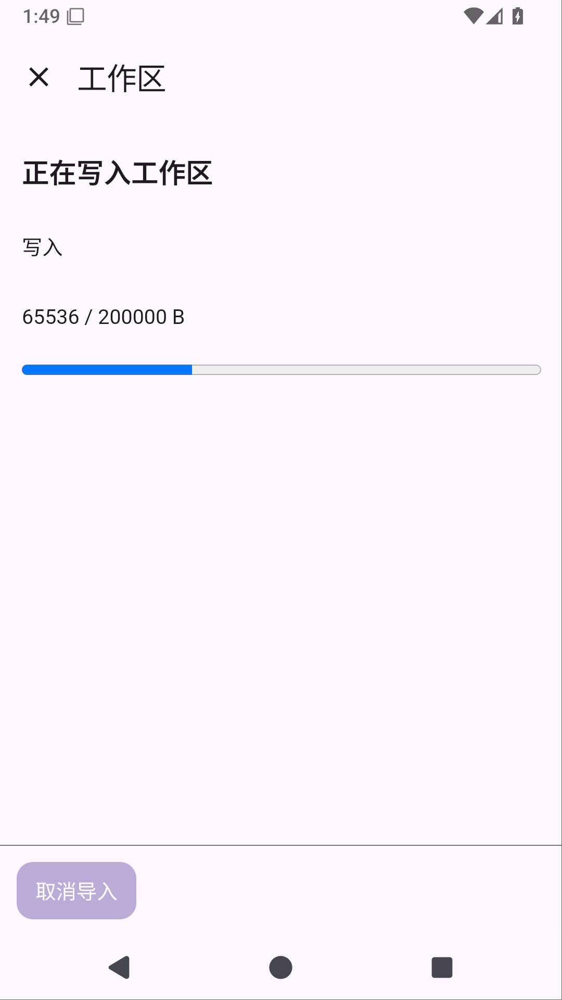
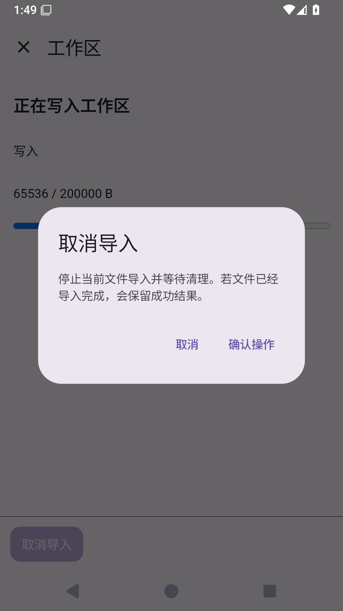

# Solvit 0.38.0：导入进度、取消和暂存清理

[下载 APK](https://github.com/veryy/Solvit/releases/download/v0.38.0/solvit-debug.apk) · [版本页面](https://github.com/veryy/Solvit/releases/tag/v0.38.0) · [成功 Actions](https://github.com/veryy/Solvit/actions/runs/38666274917) · [源码提交](https://github.com/veryy/Solvit/commit/ec07c856515f35fa05b8058c6dcf3cfc18da57c9)

0.38.0 / build74 新增实际导入进度、取消和有来源记录的暂存清理，并修复后台轮询导致原生确认框消失的问题。

在工作区确认导入后，插件页面显示实际写入字节和准备、写入、同步、校验、发布阶段，并可请求取消。字节达到100%不等于已完成；最终以任务结果为准。取消完成前等待清理，之后仍保留选择，重新审阅即可重试。已发布的完整文件遇到晚取消仍显示成功。

替换中取消会恢复原文件。若Shell抢先创建同名文件，保留双方，并明确显示原文件备份路径，避免把未恢复的情况只显示成普通取消。关闭页面会取消并等待任务清理，不转为后台长期导入。

原生操作确认期间暂停插件HTML的后台刷新，避免进度轮询换页使确认框突然消失。确认仍绑定用户看到的那一次操作；页面变化后不会沿用旧授权。

启动时异步回收已登记工作区内有宿主记录且文件身份仍匹配的孤立`.solvit-import-*.partial`普通文件，保护本进程仍在使用的暂存。不跟随符号链接、不进入.git，也不删除正常文件或solvit-backup原文件备份；仅名称相似、未登记的文件不会删除。每工作区单次扫描限制20000条宿主记录；这不是全局容量配额。

系统强杀恰好发生在旧文件移走后时，原文件备份保留，跨进程自动恢复原名字仍需后续事务日志和进程死亡验收。同步磁盘和原生调用不能保证瞬时打断。系统选择器读取阶段不包含在工作区写入进度内。

市场已发布工作区插件1.9.0/API26、Git1.2.5/API20；旧API25宿主继续选择工作区1.8.0。公开HTTPS已逐项核对26个目录、46个历史下载及新包字节。升级保留项目规则与授权，修改过的插件和卸载选择不覆盖。Linux开发环境继续保留，见[Python/Node/Java指南](linux-environment.md)。

验证过程见[完整阶段记录](workspace-import-transfer-stage.md)，正式构建和下载入口见上方。ARM64真机、真实模型完整任务、真实系统picker手指操作和本地stdio MCP尚未验收。屏幕操控暂缓，容量管理、跨进程事务恢复、Git克隆中断恢复和真实GitHub账号插件写入继续保留在路线中。

候选首次完整设备执行曾遇到系统WebView124原生崩溃；同源完整重跑、15次工作区重建及15次插件场景复验没有再现，根因尚未确定。保留原失败日志与后续结果，不将重跑成功称为崩溃已修复。

## 实际验证

不可变标签 `v0.38.0` 固定在 `ec07c856515f35fa05b8058c6dcf3cfc18da57c9`，应用0.38.0/build74/API26。正式38666274917的构建、界面、插件、搜索、Linux和发布六项任务全部成功，所有编译与测试均在GitHub Actions执行。

- 完整下载单元11941431662、界面11943306295，ZIP CRC/XML核对523单元、79应用/Web/终端设备用例，零失败、错误或跳过。包括实际HTML导入65536/200000字节、取消确认跨轮询保持、取消恢复原文件、重试替换、新备份及同目录Shell摘要、Android登记暂存清理、未知同名文件保留。覆盖升级保留配置与聊天也通过。
- Linux11942310986完整ZIP CRC/XML确认3个独立Android用例，零失败、错误或跳过；设备实际记录Python3.12.3、Node24.21.0/npm11.19.0、OpenJDK17.0.20.1，以及工作区与PTY执行。ARM64仅编译，不冒充真机验收。
- 正式日志123 SDK、5市场及线上MCP/Skills通过。插件11942040100完整CRC及15个市场包/10个内置包字节一致核对；搜索11942330081完整CRC/JSON确认三查询与注入主来源失败后的区域结果、来源正文。最终模型回答引用仍未验收。
- Lint、APK与固定签名 `f076abf86de542063f8655abf9021cb88b642ab9b664cafc46c0f16b4303bcc3` 通过。公开APK/源码已从Release下载，与正式11941386692/11942220229内部文件逐字节相同；外层/内层及公开ZIP CRC通过。APK为58156634字节，SHA256 `8f259936112f3dfb75f905abff03cfece80bcfeb15c3da8226f8081f71d7a361`；[Linux源码与许可](https://github.com/veryy/Solvit/releases/download/v0.38.0/solvit-linux-sources.zip)为1072569字节，SHA256 `0a8791649814e888060a595dea30bad1ef4458c105704fe32fe907ee84080fdd`。

上图来自正式模拟器。系统强杀的完整事务恢复、容量/备份管理、真实模型任务、真机及stdio MCP仍未完成；[完整后续范围](product-roadmap.md)保持。覆盖升级保留数据，卸载会删除配置、聊天和Linux环境。

0.7.0起使用固定签名；0.6.0及之前的APK证书不同，不能直接覆盖，请先保存旧配置。
