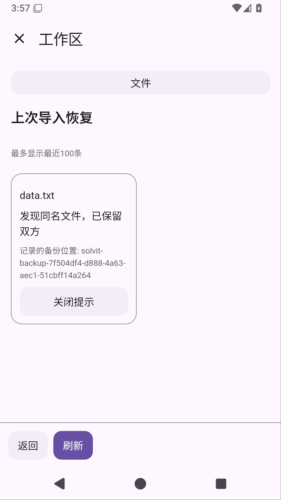

# Solvit 0.39.0

[下载 APK](https://github.com/veryy/Solvit/releases/download/v0.39.0/solvit-debug.apk) · [Release](https://github.com/veryy/Solvit/releases/tag/v0.39.0) · [成功构建](https://github.com/veryy/Solvit/actions/runs/38677820508) · [发布提交](https://github.com/veryy/Solvit/commit/ea97c5c04503de33e40b31b3f93c03d7fa78afad)

这次补文件导入在应用被系统结束后的恢复。替换前记录原文件与备份身份；重新启动后，能恢复的原文件放回原路径，已发布的文件保留，并发Shell写入不覆盖。工作区插件显示「上次导入恢复」，点开查看具体路径和结果；关闭提示会保留文件和备份。

API27工作区1.10.0用JS页面展示恢复结果，Git共享页面更新到1.2.6/API20。旧工作区1.9.0和Git1.2.5仍保留原始下载。仅迁移原样内置包，保留插件设置、权限、禁用状态、用户修改与卸载选择。

Python、Node.js/npm、Java与免Root Linux工作区继续包含在应用中。打开「工作区 → Linux」安装Ubuntu，再创建Ubuntu Shell；详见[安装指南](linux-environment.md)。PRoot使用Android内核和应用身份，不授予额外系统权限。

## 实际验证

固定标签v0.39.0指向 `ea97c5c04503de33e40b31b3f93c03d7fa78afad`，应用0.39.0/build75。正式38677820508的构建、界面、插件、搜索、Linux和发布六项任务全部成功；编译测试均在GitHub Actions执行。

- 完整下载单元11946951360、界面11947228722并核对ZIP CRC/JUnit XML：537单元、79常规设备（app65/Web3/终端11），失败/错误/跳过均为0。覆盖安装保留配置和聊天通过。
- 另外五种真实Android外部force-stop场景全部通过：PREPARING、PUBLISHING、COMMITTED、并发同名、已提交后删除新目标。每场确认prepare没有正常结束、原PID存在后消失、独立重启verify成功；核对实际文件、备份、Shell及插件HTML，关闭提示保留文件。这5场单独计数，不混入79项。
- Linux11947136085完整CRC/XML确认3项独立Android用例通过：实际Python3.12.3、Node24.21.0/npm11.19.0、OpenJDK17.0.20.1，以及共享目录和PTY执行。ARM64仍需真机验证。
- 正式插件125 SDK、5市场、在线HTTPS MCP/Skills通过；11947660095完整CRC及15市场/10内置包与仓库逐字节一致。搜索11947260454完整CRC/JSON确认三查询、注入主来源失败后的区域搜索和来源正文。最终真实模型回答质量尚未验收。
- 市场公开HTTPS逐项核对27目录、48历史包和2新包的字节数/SHA256，旧宿主继续选择兼容工作区版本。[可复查的市场摘要](evidence/0.39.0/market.json)。
- Lint、APK与固定签名 `f076abf86de542063f8655abf9021cb88b642ab9b664cafc46c0f16b4303bcc3` 通过。公开APK与11946821452内部APK逐字节相同，外层及APK ZIP CRC通过：58176802字节，SHA256 `f7321c4334d9de24a63f134c1df6ea966e42cc5019df04434a8b31fb424180ad`。
- [Linux源码与许可](https://github.com/veryy/Solvit/releases/download/v0.39.0/solvit-linux-sources.zip)与11947225661内部文件相同，外层/内层/公开ZIP CRC通过：1072569字节，SHA256 `8cd129ce8fb3ad25e99cfc97cfd1c9dd6effcea111c59e37de9528558bcbf8f3`。

两项候选界面失败分别定位到历史列表滚动位置和IME抬升后的旧触摸坐标；修正测试动作后，同一生产APK的8轮×2项诊断、候选完整回归和正式回归均通过。保留原失败证据，[完整阶段记录](workspace-import-recovery-stage.md)。此前0.38候选的WebView原生崩溃根因仍未确定，不将本轮通过称为已修复。

恢复日志面向进程死亡，不承诺断电/存储损坏恢复或任意Shell写入下的文件系统CAS。容量和备份管理、Git克隆中断恢复、真实模型完整任务、真实GitHub账号插件写入、ARM64真机及stdio MCP仍待完成，屏幕操控暂缓。草稿和等待队列仍不支持重启恢复。

0.7.0起使用固定签名；同签名覆盖更新保留数据，卸载会删除配置、聊天和Linux环境。0.6.0及之前证书不同，不能直接覆盖。
