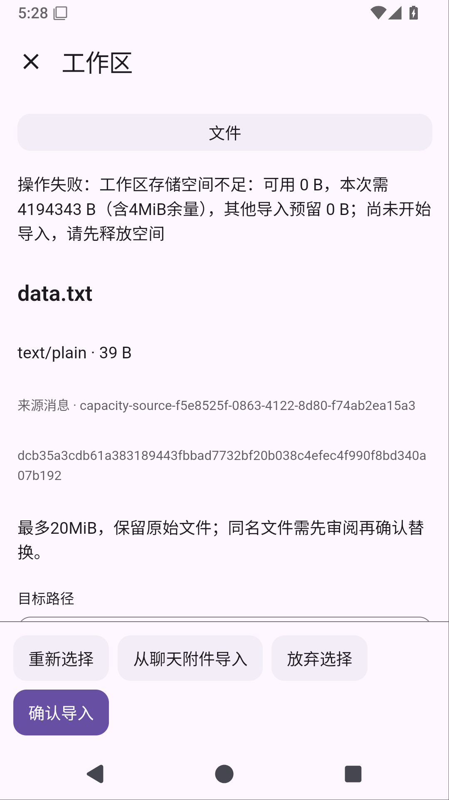

# Solvit 0.39.1

这次先补工作区导入的空间检查。手机空间不足时，在创建暂存或移走旧文件前停止，页面给出可用、需要和其他导入预留的字节数。释放空间后可以保留原选择、重新审阅再确认，不需要重新选附件。原文件及备份不会为了腾空间被自动删除。

检查要求完整新文件大小加4MiB余量；同一存储卷正在进行的导入保守计入，任务成功、失败和取消后释放预留。这只是导入前的空间观察，不是磁盘预分配或配额；其他应用和Shell仍可能在之后用掉空间。实际写入失败继续使用0.39.0的取消/持久恢复机制。

工作区仍使用API27插件页面，旧插件包和下载字节不变。本轮没有新增备份管理页面，也没有自动清理文件。备份来源登记、占用查看和人工确认管理继续推进。[完整阶段记录](workspace-capacity-stage.md)

Python/venv、Node.js/npm、Java17及免Root Ubuntu环境继续包含在应用中，见[环境指南](linux-environment.md)。ARM64真机、真实模型完整任务、真实GitHub账号写入和stdio MCP仍未验收，屏幕操控暂缓。

正常同签名覆盖更新保留配置、聊天和Linux环境；卸载会清除应用数据。0.7.0以前版本证书不同，不能保证覆盖安装。

## 正式发布与验证

[下载 APK](https://github.com/veryy/Solvit/releases/download/v0.39.1/solvit-debug.apk) · [成功 Actions](https://github.com/veryy/Solvit/actions/runs/38685306367) · [发布提交](https://github.com/veryy/Solvit/commit/a62ebdb2901e72043bca047e4688283c30702160)

0.39.1/build76，六项正式任务全部成功。已实际下载完整报告并核对ZIP CRC/JUnit XML：

- 542项单元、80项常规Android设备（app66/Web3/终端11），失败/错误/跳过均0；0.7.0覆盖升级保留配置和聊天通过。
- 另核对五种真实外部force-stop与独立重启恢复，不混入80项。新增低空间页面用例确认原文件不变、原附件选择保留，恢复空间后重新审阅/确认，经真实JNI发布并核对Shell哈希。
- Linux完整报告确认3项独立Android实测通过：Python3.12.3、Node24.21.0/npm11.19.0、Java17.0.20.1、共享目录和PTY。ARM64仍需真机验证。
- 插件125SDK/5市场、在线HTTPS MCP/Skills通过；15市场/10内置包与仓库字节一致。公网搜索三查询、主来源失败回退与来源正文通过，真实模型最终回答仍未验收。
- Lint、APK与固定签名 `f076abf86de542063f8655abf9021cb88b642ab9b664cafc46c0f16b4303bcc3` 通过。

公开APK已实际下载，与正式产物逐字节一致且ZIP CRC通过：58180970字节，SHA256 `19c69b9b70daf609f999794ce89c626236e1cd7d4b38d97f88068b1d5774b321`。

[Linux源码与许可](https://github.com/veryy/Solvit/releases/download/v0.39.1/solvit-linux-sources.zip)同样实际下载并核对正式产物，ZIP CRC通过：1072569字节，SHA256 `a3120dded236d00d807b9f39cb91f0108f70c4835c7a7a91db634ba0a97f7f55`。

低空间用例只注入容量观察，不填满模拟器磁盘，不能称为真实ENOSPC系统调用测试。此前候选的getFileStore权限异常已通过同一Android导入/恢复路径验证修复。[完整阶段记录](workspace-capacity-stage.md)
