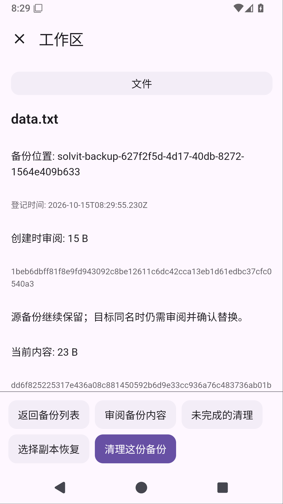
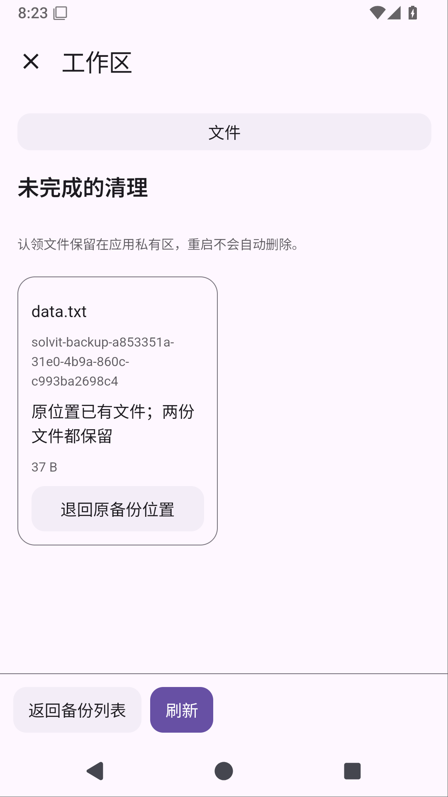

# Solvit 0.40.0

这次补上工作区的导入备份管理。打开「工作区 → 文件 → 导入备份」，可以查看备份的来源、当前状态、逻辑长度与可用空间观察。详情区分创建时的摘要与当前内容摘要；Shell 改过内容后需要重新审阅，不能沿用旧确认。

想取回文件，可以审阅后选择备份副本，再确认导入位置。同名目标仍需单独审阅，替换时为它另留备份；源备份不会因复制恢复而删除。要清理备份，则先审阅当前内容，再确认不可撤销的删除，当前目标文件保留。

清理前先保存意图，再以不覆盖的原子移动把文件暂存到工作区外，并核对实际文件身份和摘要。取消或中断后保留已执行事实：「清理中断记录」允许手动退回，遇到同名文件时保留双方。删除之后、完成确认之前进程被杀，页面会显示结果未确认；只允许关闭清理和来源记录，不自动重试删除，也不冒称先前删除已成功。

占用是已登记文件的逻辑长度观察，不是磁盘块数或删除后保证释放的空间。旧版未登记的备份不按文件名自动认领；损坏、缺失或无法读取的记录明确提示。文件操作没有锁住已有 Shell 描述符和硬链接，本阶段面向进程结束，不承诺断电、磁盘损坏或任意并发写下的自动恢复。

工作区插件升为1.11.0/API28，Git共享文件页面升为1.2.7/API20；历史包保留，旧版应用按宿主版本取得兼容包。JS/HTML提供业务页面，原生宿主负责授权、一次性确认、文件身份、持久记录与取消。[阶段记录](workspace-backup-management-stage.md)

无需 root 的 Ubuntu、Python/venv、Node.js/npm 和 Java17 继续包含在应用中，安装步骤见[环境指南](linux-environment.md)。正常同签名覆盖更新保留配置、聊天和Linux环境；卸载会删除应用数据。ARM64真机、真实模型完整项目任务、真实GitHub账号写入及stdio MCP仍待验收，屏幕操控暂缓。

## 正式发布与验证

[下载 APK](https://github.com/veryy/Solvit/releases/download/v0.40.0/solvit-debug.apk) · [成功 Actions](https://github.com/veryy/Solvit/actions/runs/38703876728) · [发布提交](https://github.com/veryy/Solvit/commit/3941b927e51b5c199daeac60e0d74d969db259c3) · [APK 产物](https://github.com/veryy/Solvit/actions/runs/38703876728/artifacts/11957981753)

0.40.0/build77，六项正式任务全部成功。完整报告已实际下载并核对ZIP CRC/JUnit XML：

- 570项单元、82项常规Android设备（app68/Web3/终端11），失败/错误/跳过均0；0.7.0覆盖升级保留配置和聊天通过。
- 另核对原五种导入与新增四种清理的真实外部force-stop：准备未正常结束、杀前PID存在、杀后为空、新进程逐场验证成功，不混入82项。原生JNI认领/退回/删除、授权撤销，以及HTML审阅失效→复制恢复→取消再确认清理实际通过，目标和其他备份保留。
- Linux完整报告3项独立Android实测、9项运行时单元通过；Python3.12.3、Node24.21.0/npm11.19.0、Java17.0.20.1、venv、共享目录及PTY通过。ARM64程序包含在APK，ARM64真机仍未验收。
- 插件130SDK/5市场、在线HTTPS MCP/Skills通过；15市场包/10实际APK内置包与正式生成包逐字节一致。公网搜索三查询、主来源失败回退与正文读取通过；真实模型最终回答未验收。
- API28市场已上线并从公网核对28组目录、50个历史包及2个新包的字节数/摘要；旧版本包不覆盖。
- Lint、APK与固定签名 `f076abf86de542063f8655abf9021cb88b642ab9b664cafc46c0f16b4303bcc3` 通过。

公开APK已实际下载，与正式产物逐字节一致且ZIP CRC通过：58592754字节，SHA256 `d521cb5740ebd7b4406791adc5e9d6ede99a8b5be27edf4e5c95974028075b39`。

[Linux源码与许可](https://github.com/veryy/Solvit/releases/download/v0.40.0/solvit-linux-sources.zip)同样实际下载并与正式产物逐字节核对，ZIP CRC通过：1072569字节，SHA256 `281f6c4a7353e36efd8a1b46892acf4861222b73e376ab5db036b4d0d3b1e807`。

原候选偶发工作区入口超时在独立8轮诊断、后续候选和正式套件中未再复现，根因仍未确定，不能声称已修复。断电、任意外部写和硬链接/打开描述符不在本阶段恢复承诺内。[完整阶段记录](workspace-backup-management-stage.md)
