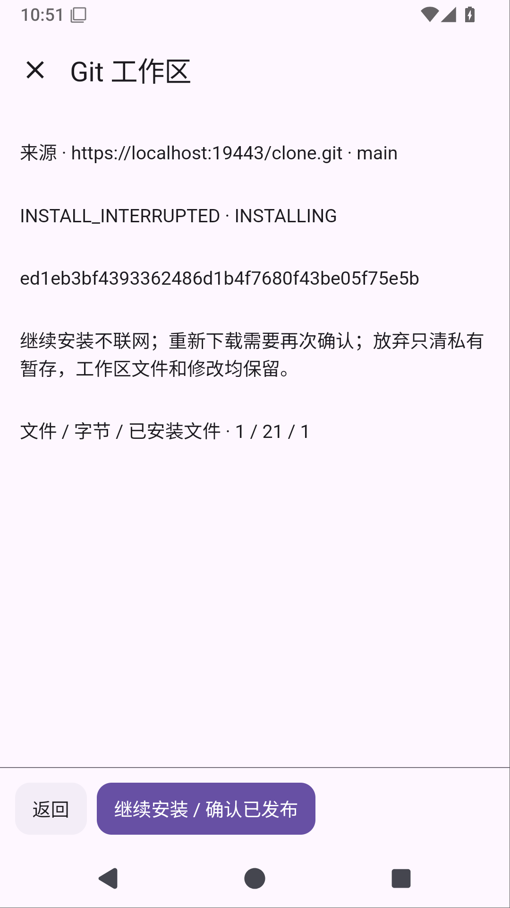
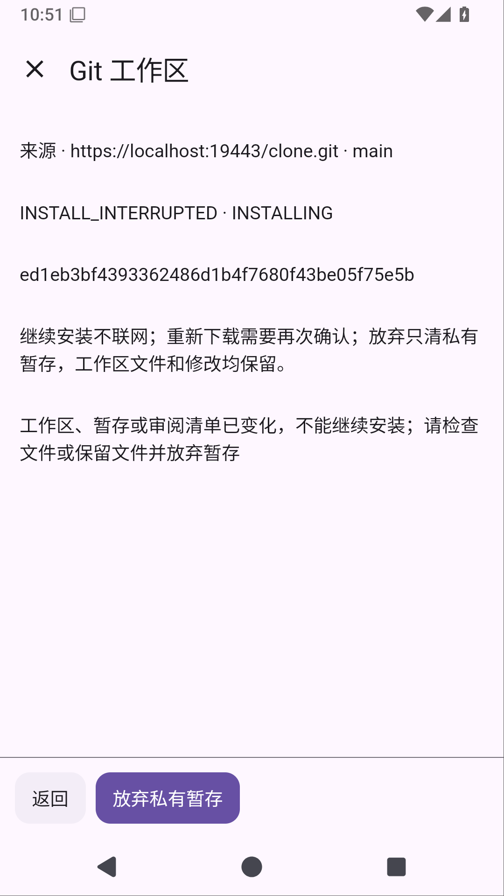

# Solvit 0.41.0

这次处理 Git 克隆被系统结束后卡在半成品目录的问题。打开原对话的 Git 页面，点「查看中断记录」，先审阅来源、分支和已保存的阶段，再选择继续安装、重新下载或放弃私有暂存。

下载尚未完成，需要确认后重新联网；完整文件已下载时可以离线继续。遇到 Shell 新增、修改、删除或替换文件，继续操作会拒绝冲突，保留文件供检查。放弃只删除登记的私有暂存，工作区内已发布的文件保留。仓库已经发布后，只确认并清理记录，不重置之后的编辑。

工作区根目录和原有 Shell 绑定保持，启动与查看页面不会自动下载或重新执行。完整文件及 `.git` 通过不覆盖目标的原子移动发布；Android 禁止应用创建硬链接，未采用依赖硬链接的方案。

Git 插件升为1.3.1/API29。旧版应用继续取得原始兼容包，用户修改过的插件不会自动覆盖。插件 HTML/JS 提供审阅页面，原生宿主处理授权、一次性确认、持久事实与文件身份。

无需 root 的 Ubuntu、Python/venv、Node.js/npm 和 Java17 继续包含在应用中，见[安装指南](linux-environment.md)。同签名覆盖升级保留配置、聊天、工作区和Linux环境；卸载会删除应用数据。

此机制面向进程结束，不承诺断电或任意并发写下的自动恢复。既有 Shell 描述符不会被锁住。ARM64真机、真实模型完整任务、真实GitHub账号写入及本地stdio MCP仍待验收；屏幕操控暂缓。[阶段记录](workspace-git-recovery-stage.md)

## 正式发布与验证

[下载 APK](https://github.com/veryy/Solvit/releases/download/v0.41.0/solvit-debug.apk) · [成功 Actions](https://github.com/veryy/Solvit/actions/runs/38721701886) · [发布提交](https://github.com/veryy/Solvit/commit/1a7267d8108b5f76b5a3ddcb845f86e0539b694c) · [APK 产物](https://github.com/veryy/Solvit/actions/runs/38721701886/artifacts/11967151530)

0.41.0/build78，六项正式任务全部成功。已完整下载报告，核对归档CRC和实际JUnit XML：

- 586项单元、82项常规Android设备（app68/Web3/终端11），失败/错误/跳过均0；0.7.0覆盖升级保留配置和聊天通过。
- 另有15场独立外部强杀：5导入、4备份清理、6克隆。逐场核对准备未正常结束、杀前PID存在、杀后为空、新进程验证通过；六种克隆窗口为下载、文件发布、Shell冲突、Git元数据发布、完成记录与私有清理。实际插件HTML审阅、取消确认、继续/重新下载/放弃、根inode及Shell文件保留通过。
- Linux独立Android实测3项、运行时单元9项通过。实际Python3.12.3、Node24.21.0/npm11.19.0、Java17.0.20.1、venv、共享目录与PTY通过，测试平台为API35 x86_64；ARM64程序包含在APK，ARM64真机仍待验证。
- 133 SDK/5市场、在线HTTPS MCP/Skills与公开搜索来源/正文/主引擎故障回退通过。15市场包、10实际APK内置包与正式生成包逐字节一致；真实模型最终回答及完整任务未验收。
- API29/Git1.3.1市场已部署并从公网核对29组目录、53个历史包及新Git包的完整字节/摘要；API1..28目录保持一致，Git1.2.7及1.3.0原始字节保留。升级合同保留授权、配置、自定义代码和卸载状态。
- Lint、APK和固定签名 `f076abf86de542063f8655abf9021cb88b642ab9b664cafc46c0f16b4303bcc3` 通过。

公开APK已实际下载，与正式产物逐字节一致且ZIP CRC通过：58652582字节，SHA256 `f06c6af5a4b85586ad18e970894b3de665feebeb9b8f898cd76f938cd40eb94e`。

[Linux源码与许可](https://github.com/veryy/Solvit/releases/download/v0.41.0/solvit-linux-sources.zip)同样实际下载并与正式产物逐字节核对，ZIP CRC通过：1072569字节，SHA256 `5277ab16d6cc8613a712d97a94e3bff97e8ca994b419d7483c08809e1bb9a93c`。

此前候选的路径别名、Android禁止硬链接、微小清单过度内存分配和未验证统计问题均保留在阶段记录中。进程结束恢复不等于断电、任意并发写或私有文件被任意改写下的恢复承诺。
