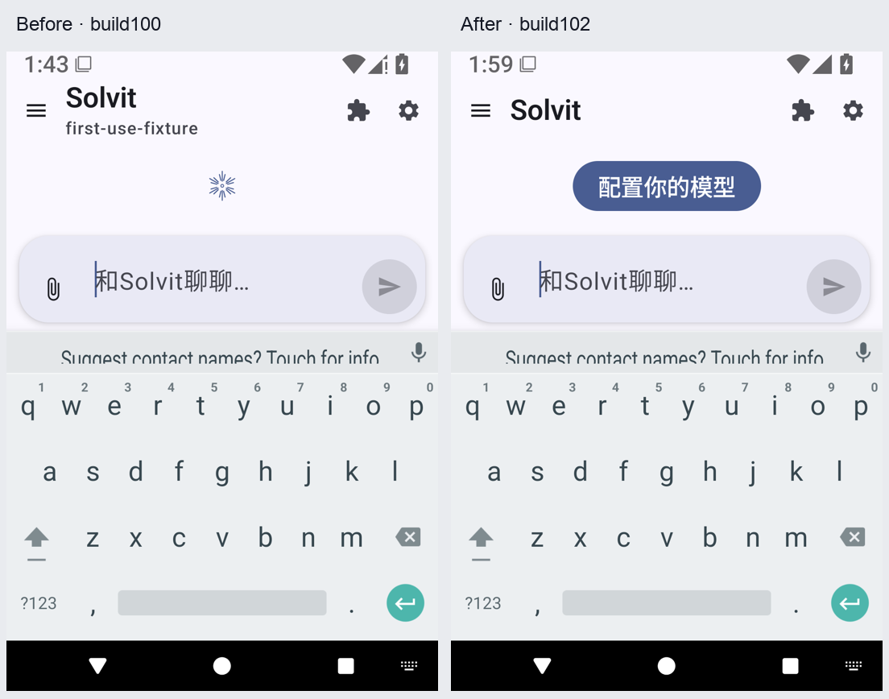
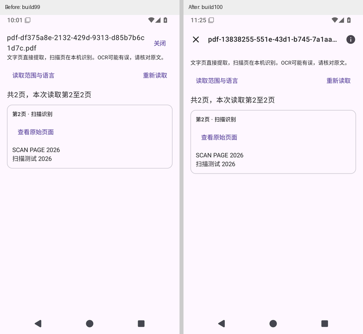
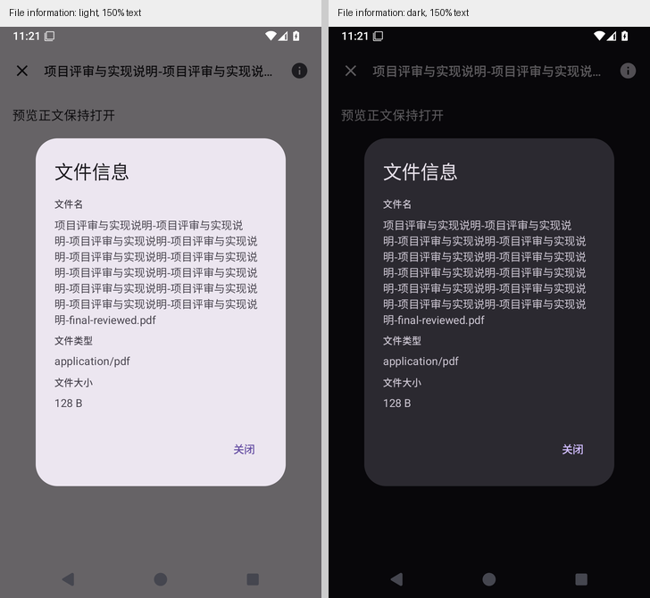

# Solvit 0.43.10/build102（已验证候选）

本轮整理首次聊天的操作顺序，保留 build100 的附件预览、草稿和终端改进。

- 未保存模型配置时，标题仅显示当前角色，避免把默认模型名显示成已配置状态。
- 首次配置是主操作。小屏、150% 字号和键盘打开时优先保留按钮，装饰内容随可用空间收起，仍可滚动。
- 从聊天空态点配置，直接打开已有模型编辑器；取消不保存，保存成功后返回聊天。设置内的多模型管理列表继续保留。

## build102 下载与验证

[下载 solvit-debug-apk 候选产物](https://github.com/veryy/Solvit/actions/runs/39087633712/artifacts/12121219616)，GitHub 可能要求登录。包名 `dev.solvit.app`，版本 0.43.10/build102，59668363 字节；沿用固定签名，可覆盖同签名旧版。请直接覆盖更新，卸载会删除本地数据。

APK SHA-256：`2b83a2e75a3db8a504696f6550a16897e87f024bda60028d43318a910f2c5006`。

[完整 Android Actions](https://github.com/veryy/Solvit/actions/runs/39087633712)对应生产源码 [7e0fcdd8](https://github.com/veryy/Solvit/commit/7e0fcdd8c9218bdc088fa336cdbabf8638bc3ba5)：628 单元、Lint、119 常规模拟器用例（App90/Web3/terminal26）、15 场独立进程中断恢复，以及覆盖升级、150% 完整聊天、实际 stdio 宿主强杀及子进程清理均通过。已核对原始 XML、runner/PID、产物大小/摘要/ZIP CRC、APK 版本和固定签名、14 份内置及兼容包资产和六语言资源。

[首次配置同 APK 定向检查](https://github.com/veryy/Solvit/actions/runs/39088228174)下载上述实际产物执行两轮，每轮均为 `OK (2 tests)`，覆盖未保存/保存/重建、真实小屏/字号/IME、直接编辑、取消和保存返回。四张实际截图已逐一查看。完整 UI 流程使用同生产源码远程构建，不能据此宣称其重建 APK 与下载产物逐字节相同。

[对应 Linux 源码产物](https://github.com/veryy/Solvit/actions/runs/39087633712/artifacts/12121192648)：内层 ZIP 1072711 字节，SHA-256 `101b4f92ed456cacb2115cdd4eee95c8700fa1a76fb89191c1ee644510875404`；本轮没有修改 Linux 实现，也不新增兼容性结论。

[阶段说明与原版失败证据](chat-first-use-stage.md)。原 build100 上的两项实际失败保留；build101 的主题候选未通过实际导航对比验收，留在独立分支，不包含在 build102，版本号因此跳过101。

本版是候选，正式发布仍为0.43.9；公开市场部署及严格 live 发布门禁尚未完成。本轮使用测试配置验证操作状态，没有请求真实模型；真实模型任务、ARM64 真机、完整路线和系统导航栏的深色对比问题继续保留。

## build100 历史交付

### Solvit 0.43.10/build100（已验证候选）

这版继续整理附件预览，保留build99的会话草稿、输入同步和终端标签改进。

- 图片、文本和PDF统一使用顶部工具栏：左侧关闭，右侧文件信息，长文件名在标题里只显示一行。
- 完整文件名、文件类型和大小可以在文件信息中查看和选择复制。内容较长可滚动，关闭按钮保持独立；系统返回先关闭信息，继续保留预览。
- 沿用原图片、文本、PDF/OCR与选页服务；附件发送、失败重试、编辑分支和历史数据继续保留。新标签补齐六种语言。

### build100 下载与验证

[下载solvit-debug-apk候选产物](https://github.com/veryy/Solvit/actions/runs/39077647058/artifacts/12117538662)，GitHub可能要求登录。包名dev.solvit.app，版本0.43.10/build100，59665075字节，固定签名不变，可覆盖同签名旧版。卸载会删除本地数据，请直接覆盖更新。

APK SHA-256：`ff32b837baa3160c6e50add6d4e865b99898aacab5023ed628a0c5699c5cd7b1`。

[完整Android Actions](https://github.com/veryy/Solvit/actions/runs/39077647058)对应源码[2afc3da5](https://github.com/veryy/Solvit/commit/2afc3da5ef2bc97b7095e2526d7d189e93ef87b3)，通过628单元、Lint、117常规模拟器用例（App88/Web3/terminal26）及15场独立进程中断恢复。原始XML、runner/PID、覆盖升级、150%聊天、stdio实际宿主强杀，以及产物摘要/CRC、固定签名、14份内置及兼容包资产和语言资源均已核对。

[共享预览导航定向检查](https://github.com/veryy/Solvit/actions/runs/39075712947)完成两轮，每轮均覆盖浅色/深色、150%字体、单行标题、按钮几何、完整文件名、滚动字段、真实系统返回和关闭。该任务复用首次构建的同生产APK；最终APK与其逐字节一致。定向用例使用可控元数据和正文占位，只验证共享导航；实际图片/文本字节与HTTP、PDF/OCR/选页/重试/分支由完整流程验证。截图是实际模拟器画面。

[对应Linux源码产物](https://github.com/veryy/Solvit/actions/runs/39077647058/artifacts/12118115180)：内层ZIP 1072711字节，SHA-256 `2720b579ad117784859fbe5eaf3a6cc1c966415254e780ea5c572fb638063c0a`；本轮未修改Linux实现。

[MCP同包定向检查](https://github.com/veryy/Solvit/actions/runs/39077648784)也完成两轮，保留真实触摸、取消后两条记录、确认后只剩一条和加密配置检查。前次完整流程在测试第二次删除时未等待异步原生确认而失败；只补齐与第一次相同的有界等待，生产APK未改，最终全套重新执行通过。失败原始报告仍保留，不因重跑成功抹去。

首轮定向因测试API默认整段匹配“128”而在实际“128 B”上失败，修正substring参数后验证；没有改生产大小显示来迁就断言。原始失败与首次完整任务被新流程替代的记录保留在[阶段说明](attachment-preview-polish-stage.md)。此前偶发PDF请求0、附件导入与Compose销毁的根因仍未证明，本轮不宣称根治。

正式Release仍0.43.9；公开市场部署与严格live包一致性门禁尚未完成，本版仍为独立候选。真机、真实模型与任务质量、真实账号写入、ARM64及更广泛第三方兼容未验收；本轮重新核对仓库尚无真实模型任务凭据。未运行本地Android/TS构建或测试。

[build99原说明](https://github.com/veryy/Solvit/blob/ef000573ae3438ab4e68240290cb4c44b4c7091d/docs/release-0.43.10.md) · [完整后续路线](agent-direction.md)
