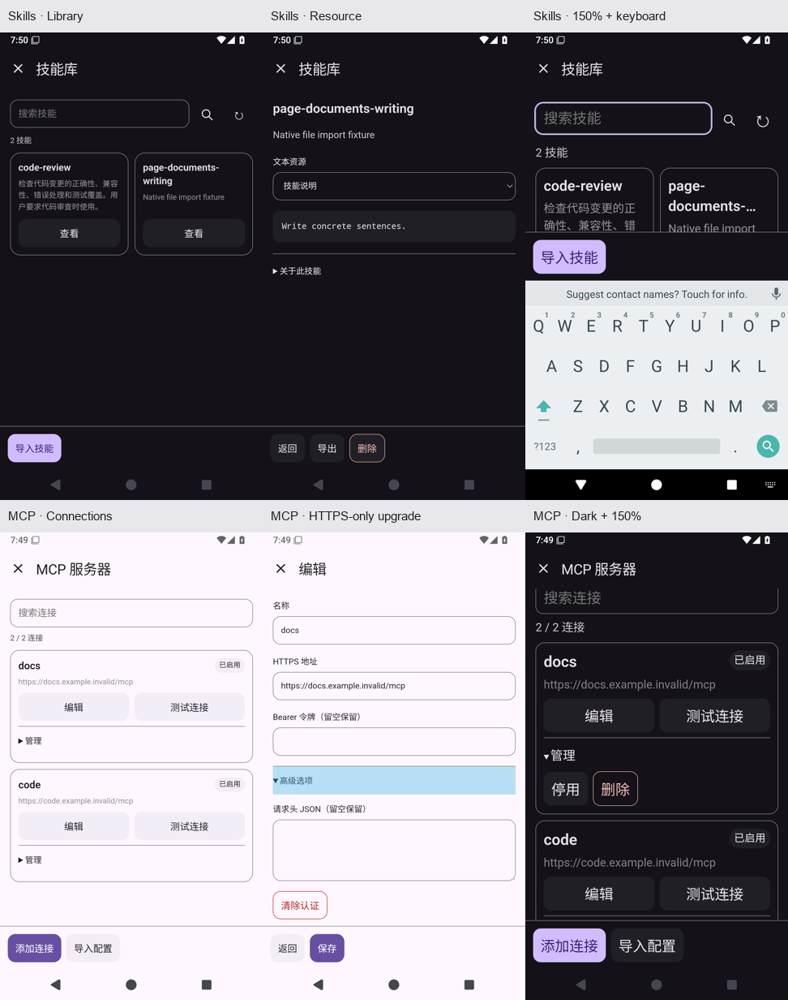

# Solvit 0.43.10（已验证候选，尚未正式发布）

这轮整理 Skills、MCP 插件自己的 HTML/JS 页面，并修复升级和终端结束状态的两个问题。

- Skills 的搜索、清空与刷新集中在一行，卡片保留两列；无匹配结果有独立提示。正文资源单独阅读，返回保留搜索和阅读位置。
- MCP 连接可按名称、地址筛选。编辑、测试留在外层，启停、删除收到管理区；传输方式明确，高级参数按需展开，原生确认、认证留空保留、多连接与加密存储继续保留。
- 旧权限 Skills/MCP 也能获得同一套新版页面，保留只读/HTTPS 能力、数据与授权。原始1.1.1包下载保持不变；添加工作区或本地执行能力仍需明确更新和授权，修改包与卸载选择保留。
- 修复 PTY 输出先结束、子进程尚未退出时丢失退出码的问题。可取消地等待真实进程结果，切换 Shell 后继续显示实际退出码。



## 已完成的远程验证

[完整 Android Actions](https://github.com/veryy/Solvit/actions/runs/39013850707) 对代码2056b5fe成功：625项单元、Lint、固定签名、112项常规模拟器用例（App83/Web3/terminal26）、15场进程中断恢复、覆盖升级、1.5倍字体完整聊天、实际stdio宿主/监督/工作/后代进程清理。原始XML、runner结果、真实前后PID、APK及UI产物的SHA/CRC均已核对，必需回归无缺失，无failure/error/skip。

[终端独立回归](https://github.com/veryy/Solvit/actions/runs/39013928562)通过96次自然exit7及结束/关闭场景；修复前相同用例[第2次即失败](https://github.com/veryy/Solvit/actions/runs/39013515600)。[插件验证](https://github.com/veryy/Solvit/actions/runs/39010939662)通过SDK147、market7和源包一致性，随后插件源/包字节未改。Linux独立run39007867317的3项真实Ubuntu设备测试及原始产物已核对，其后Linux/proot实现未改；这不替代正式标签的全部检查。

0.43.10/build93沿用原固定签名，可覆盖安装。已下载的`solvit-debug-apk`产物12094555586中APK为59646927字节，SHA-256：

```text
b48df5e7c0687699d42a7bb665ff949addada87f2cef67471404d5d3cca676d0
```

## 正式发布尚缺的步骤

2026-10-17实际查询：正式Release仍为0.43.9，线上Skills/MCP仍为1.2.0。服务器SSH batch登录返回Permission denied；六个文件的市场更新包及精确校验值已准备，尚未部署。同步后须让严格live Skills校验及正式标签检查通过，才发布0.43.10；未降低或跳过该门禁。

真机、真实模型回答质量、实际账号任务、ARM64和更广泛第三方服务兼容尚未验收。[阶段记录](skills-mcp-ui-polish-stage.md)保存本轮发现、失败和修复过程；完整路线见[后续方向](agent-direction.md)。
