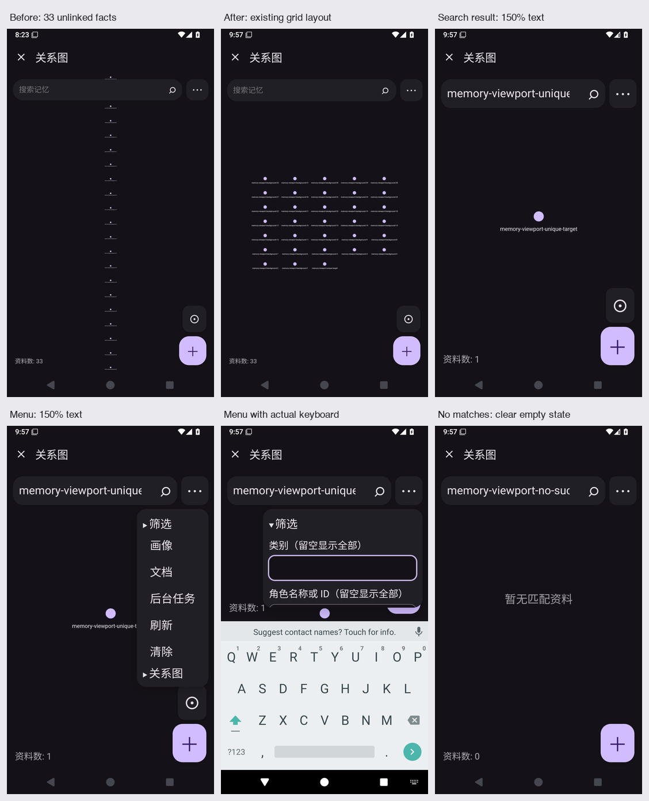

# Solvit 0.43.10/build94（已验证候选，尚未正式发布）

这版继续打磨插件页面的实际操作。除了前一轮Skills/MCP页面与终端修复，这次把记忆关系图里“搜到了却看不见”的问题修掉了。

- 搜索结果变化时重新定位；打开详情再返回，保留原查询和视野。无匹配时清掉旧节点，并隐藏没有作用的定位按钮。
- 无关系的记忆使用现有网格布局，避免逐条挤成过长竖列；有关联的图继续原有布局，保留缩放和拖动。
- 150%文字下的定位、新建按钮分开排列；更多菜单根据实际页面和搜索条尺寸摆放，键盘弹出后保持可滚动。
- 记忆插件1.4.3沿用原权限和数据格式；旧官方1.4.2的事实、授权与启用状态升级通过回归，旧包下载保留。



## 当前候选的远程验证与下载

[完整Android Actions](https://github.com/veryy/Solvit/actions/runs/39021588635)验证源码[986700d6](https://github.com/veryy/Solvit/commit/986700d60a674252d4750876e25ca386369f8fb8)：626项单元、Lint、固定签名、113项常规模拟器用例（App84/Web3/terminal26）、15场独立进程中断恢复通过。覆盖升级、完整大字聊天、真实键盘和stdio四进程清理；已核对原始XML/runner/PID、产物摘要/CRC和实际截图，没有用测试数量代替界面审阅。[TypeScript检查](https://github.com/veryy/Solvit/actions/runs/39021588562)和[市场检查](https://github.com/veryy/Solvit/actions/runs/39021588589)通过。

[下载solvit-debug-apk候选产物](https://github.com/veryy/Solvit/actions/runs/39021588635/artifacts/12097142103)（GitHub可能需要登录）。实际包名dev.solvit.app、版本0.43.10/build94，59647287字节；签名沿用原版，可覆盖同签名旧版。APK SHA-256：

```text
ad33ce97ca876bda184b0569c474b01d8b489fea6df9b73c1f1498f6c5ca32a9
```

[Linux源码产物](https://github.com/veryy/Solvit/actions/runs/39021588635/artifacts/12097440688)内层ZIP为1072711字节，SHA256 3e9e1f005b5d8198fa169aa6fdb9857f49f95c5ec338196512971985e10b7757。本次没有改Linux实现；分支构建未执行仅正式标签触发的Linux/搜索/插件独立任务，不将此前结果冒充这次正式门禁。

## 正式发布尚缺的步骤

2026-10-17实际查询：正式Release仍0.43.9，线上记忆1.4.1、Skills/MCP1.2.0。09:44:12Z服务器SSH batch登录返回Permission denied（exit255）；9个文件的市场同步包已准备、未部署。需恢复有效部署连接、保留历史包同步，再通过原有严格live Skills校验和正式标签检查，才发布0.43.10；没有降低门禁或移动历史标签。

真机、真实模型回答质量、实际账号任务、ARM64、更多第三方服务兼容，以及更大规模关联图谱和长标签可读性仍需验证。[本轮阶段记录](memory-search-viewport-stage.md)保存红测、两次截图发现问题和最终验证；[前一轮记录](skills-mcp-ui-polish-stage.md)保留Skills/MCP与终端修复证据；完整路线见[后续方向](agent-direction.md)。

## 前一轮候选记录


这轮整理 Skills、MCP 插件自己的 HTML/JS 页面，并修复升级和终端结束状态的两个问题。

- Skills 的搜索、清空与刷新集中在一行，卡片保留两列；无匹配结果有独立提示。正文资源单独阅读，返回保留搜索和阅读位置。
- MCP 连接可按名称、地址筛选。编辑、测试留在外层，启停、删除收到管理区；传输方式明确，高级参数按需展开，原生确认、认证留空保留、多连接与加密存储继续保留。
- 旧权限 Skills/MCP 也能获得同一套新版页面，保留只读/HTTPS 能力、数据与授权。原始1.1.1包下载保持不变；添加工作区或本地执行能力仍需明确更新和授权，修改包与卸载选择保留。
- 修复 PTY 输出先结束、子进程尚未退出时丢失退出码的问题。可取消地等待真实进程结果，切换 Shell 后继续显示实际退出码。


## build93前序验证（历史记录）

[完整 Android Actions](https://github.com/veryy/Solvit/actions/runs/39013850707) 对代码2056b5fe成功：625项单元、Lint、固定签名、112项常规模拟器用例（App83/Web3/terminal26）、15场进程中断恢复、覆盖升级、1.5倍字体完整聊天、实际stdio宿主/监督/工作/后代进程清理。原始XML、runner结果、真实前后PID、APK及UI产物的SHA/CRC均已核对，必需回归无缺失，无failure/error/skip。

[终端独立回归](https://github.com/veryy/Solvit/actions/runs/39013928562)通过96次自然exit7及结束/关闭场景；修复前相同用例[第2次即失败](https://github.com/veryy/Solvit/actions/runs/39013515600)。[插件验证](https://github.com/veryy/Solvit/actions/runs/39010939662)通过SDK147、market7和源包一致性，当时插件源/包字节未改；本次build94更新记忆包，Skills/MCP包保持该版本。Linux独立run39007867317的3项真实Ubuntu设备测试及原始产物已核对，其后Linux/proot实现未改；这不替代正式标签的全部检查。

0.43.10/build93沿用原固定签名，可覆盖安装。已下载的`solvit-debug-apk`产物12094555586中APK为59646927字节，SHA-256：

```text
b48df5e7c0687699d42a7bb665ff949addada87f2cef67471404d5d3cca676d0
```
