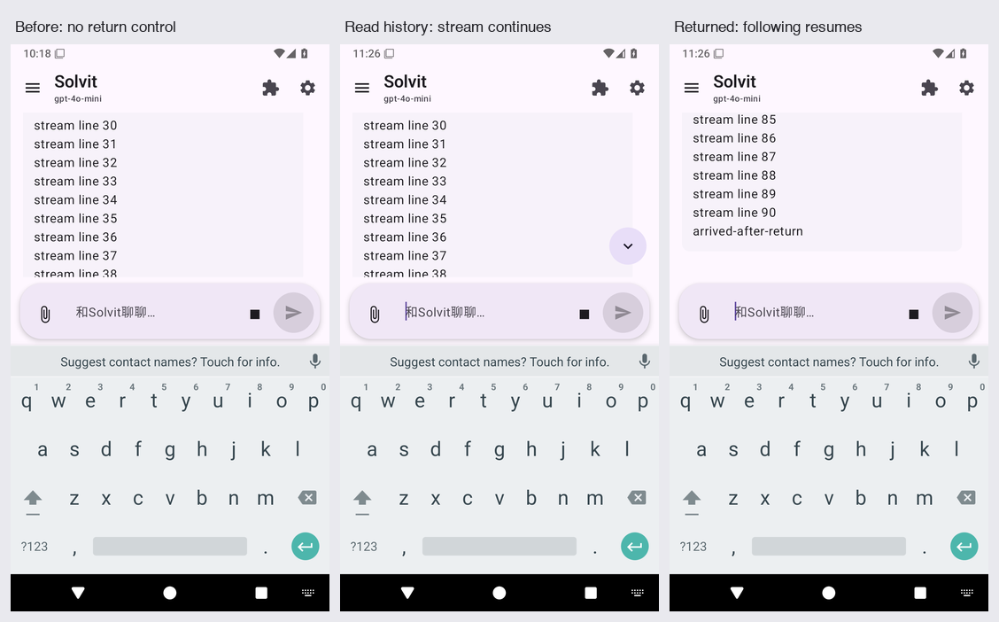

# Solvit 0.43.10/build95（已验证候选，尚未正式发布）

这版继续打磨聊天操作，承接build94的记忆图谱、Skills/MCP插件页面和终端修复。

- 向上翻历史时，右下角出现“回到最新消息”按钮；新回复继续接收，不会自动拉回底部。
- 点击按钮回到最新回复，继续跟随输出；用手势滑到底部也恢复跟随。按钮只在需要时显示，位于输入框和键盘上方，文案覆盖既有6种语言。
- 修正角色新建回归取到零尺寸按钮后点击(0,0)的测试时序，保留一次实际点击，增加原生新会话、角色和插件白名单继承断言。没有据此宣称真实模型身份质量已验收。



## 远程验证与下载

[完整Android Actions](https://github.com/veryy/Solvit/actions/runs/39027709716)在源码[eb960e3f](https://github.com/veryy/Solvit/commit/eb960e3f9ac768ff571d0958a2a8b8b6e3652530)上成功：626项单元、Lint、固定签名、113项常规模拟器用例（App84/Web3/terminal26）及15场独立进程中断恢复通过。原始XML/runner/PID、摘要/CRC和实际截图已核对，必需角色继承和流式导航用例齐全，无failure/error/skip。此前[角色继承10轮复核](https://github.com/veryy/Solvit/actions/runs/39027110634)还逐轮核对了真实触摸落点与原生角色数据；最终完整任务已移除全部临时探针。

[下载solvit-debug-apk候选产物](https://github.com/veryy/Solvit/actions/runs/39027709716/artifacts/12099262099)（GitHub可能需要登录）。实际包名dev.solvit.app、版本0.43.10/build95，59651083字节，签名沿用原版，可覆盖同签名旧版。APK SHA-256：

```text
4372e6ac4cac7bfc0d3d202e016e075a2893fe04a68230bc327155255ad41110
```

[对应Linux源码产物](https://github.com/veryy/Solvit/actions/runs/39027709716/artifacts/12099236010)内层ZIP为1072711字节，SHA256 f1e78c71967f6fce86c07dc7eee22027b270a160bfece8973af5272d88ad8b8f。本轮未改Linux实现；仅正式标签触发的Linux/搜索/插件独立门禁仍需在正式发布时执行，不把候选回归当作全部正式门禁。

## 正式发布与尚未验收的部分

2026-10-17实际查询：正式Release仍0.43.9，线上记忆1.4.1、Skills/MCP1.2.0。2026-10-17T11:23:42.953107+00:00服务器SSH batch认证被拒绝（exit255）；9文件市场同步包已准备并再次匹配本次源码，尚未部署。需恢复有效连接、保留历史包同步，再通过原有严格live和正式标签检查，才正式发布0.43.10；没有降低门禁或移动历史标签。

真机、真实模型回答质量、实际账号任务、ARM64及更多第三方服务兼容仍未验收。当前截图和设备用例使用可控Provider。

本轮[阶段记录](chat-reading-navigation-stage.md)保留原始红测、两次错误点击诊断、10轮复核和最终完整证据。前轮[记忆记录](memory-search-viewport-stage.md)、[Skills/MCP记录](skills-mcp-ui-polish-stage.md)及[build94原说明](https://github.com/veryy/Solvit/blob/899c4a31ca3d8376b67b9dc60a15b1c0d0977de1/docs/release-0.43.10.md)保留；build94随后主线角色用例失败已在本轮定位并修正测试，不改写历史失败。完整路线见[后续方向](agent-direction.md)。
