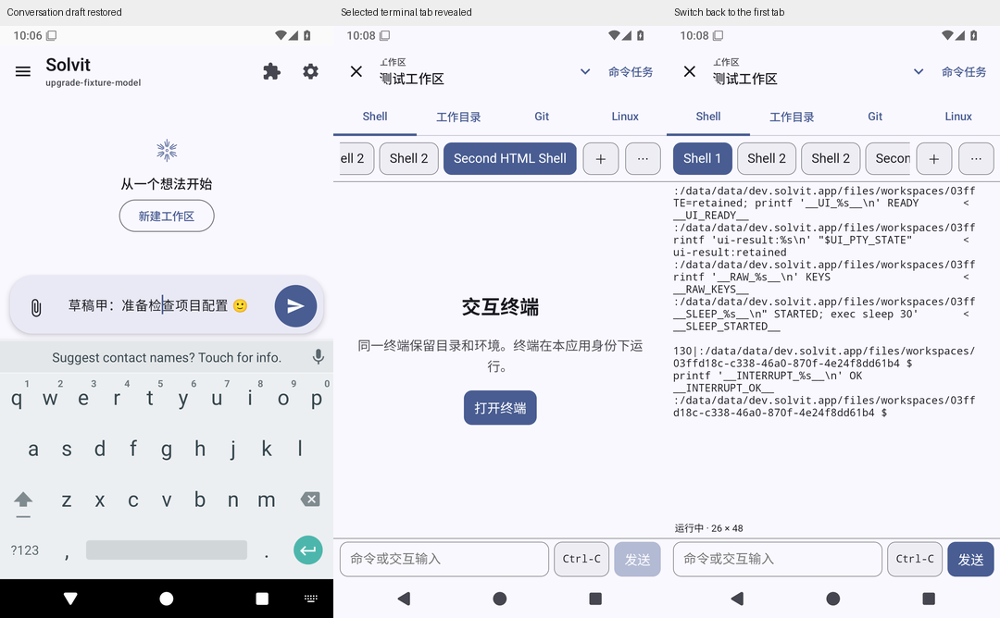

# Solvit 0.43.10/build99（已验证候选）

这版先修日常操作，保留此前聊天搜索、阅读导航、记忆和插件页面的改进。

- **聊天草稿各自保留**：切到其他聊天再回来，文字和光标还在；新建为空，清空或删除一个不会影响其他聊天。Activity重建后恢复，进程退出后仍不保留未发送草稿。
- **输入状态同步**：原生输入框直接读取同一份编辑状态，减少输入法与异步收集的往返。发送、排队或打断被接受才清空；拒绝时保留文字和附件。
- **终端标签更好辨认**：短名称不再被挤成相似的省略号；标签横向滚动，选中后进入可见区域。继续使用真实xterm.js/PTY。终端插件1.1.5保留旧包授权、启停状态和自定义包保护，1.1.4历史包仍可取回。

## 下载

[下载solvit-debug-apk候选产物](https://github.com/veryy/Solvit/actions/runs/39072422869/artifacts/12115930953)，GitHub可能要求登录。包名dev.solvit.app，版本0.43.10/build99，59659895字节，沿用固定签名，可覆盖同签名旧版。请不要先卸载；卸载会删除本地数据。

APK SHA-256：`d3a535fd9efa1a9e6e3d047c16dd1205d56fbc3e696c0d4188605238334e7a3f`。

[对应Linux源码产物](https://github.com/veryy/Solvit/actions/runs/39072422869/artifacts/12116260097)：内层ZIP 1072711字节，SHA-256 `60a77db50f0dd5423db8d24f5ba7b1eacee2e3b3d6f2f81e4f08b447a50f7b94`。本轮未改Linux运行时。

## 实际验证与边界

[完整Android Actions](https://github.com/veryy/Solvit/actions/runs/39072422869)对应源码[ae9dd436](https://github.com/veryy/Solvit/commit/ae9dd43616a23ba9065bf3d063c23ff4e1d5d21d)。普通无探针流程通过628单元、Lint、116常规模拟器用例和15场独立进程中断恢复；覆盖升级、150%聊天字体和stdio宿主实际强杀通过。原始XML、runner/PID、产物大小/摘要/CRC、版本、固定签名、14内置插件和实际截图已核对。

[PDF定向Actions](https://github.com/veryy/Solvit/actions/runs/39072935471)用同一APK完成8轮原真实路径：选页、本地OCR、原图、一次发送、HTTP500结算、输入框及会话草稿清空、重试、重开和编辑分支。没有额外触摸探针、重复点击或直接调用VM发送。它不证明此前偶发请求0问题已根治。

原98候选的额外诊断曾在Compose销毁、PDF发送和附件导入处失败；失败证据保留。原APK对照实际观察到2/8结算后草稿状态残留，但正确的UI断言没有稳定复现；本次采用同步编辑状态并通过上述检查，仍不将输入法、点击或Compose崩溃的根因写成已证明。详见[编辑状态记录](chat-editor-sync-stage.md)、[草稿记录](chat-session-draft-stage.md)、[终端记录](terminal-tabs-stage.md)和[环境诊断](environment-ui-polish-stage.md)。

正式Release仍为0.43.9。公开插件市场部署认证与严格live包一致性门禁尚未完成，因此这是独立候选，没有创建正式标签或降低发布门禁。真机、真实模型回答与任务质量、真实账号写入、ARM64和更广泛第三方兼容仍未验收。未运行本地Android/TS构建或测试。

[build96原说明](https://github.com/veryy/Solvit/blob/ec15899e4864e923ce0ca81b338bc4b03b008a18/docs/release-0.43.10.md) · [完整后续路线](agent-direction.md)
