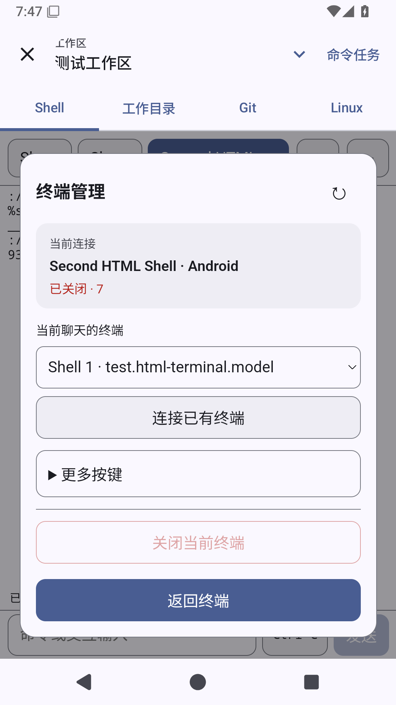

# Skills与MCP页面交互打磨

基线0.43.9已正式发布，本阶段尚未交付。上轮交付属于progress：main为70ceda57、v0.43.9完整Actions39004170518成功，公开APK实际下载与正式产物一致。继续完整UI目标，不将环境页交付视为全部完成。

## 上游依据与边界

2026-10-17 fetch-upstreams.py --verify-only核对全部9个锁定checkout。Operit dbf71916fae9750cfdc9f9a774f5a0fee56633fb的ui/features/packages/screens/SkillConfigScreen.kt:225–281按名称/说明过滤列表，并区分没有技能与没有匹配结果；MCPConfigScreen.kt:315–336将连接列表检索与配置/详情分开，导入另有独立流程。McpConfigImportParserTest.kt及McpServerRegistrationTest.kt覆盖具名服务器及导入处理；未发现对应独立页面交互测试，不将其视作Solvit页面验证。

DSH d743267388641bc76f17c45ce8b4c231aed1d32c的packages/client/ui-skill/src/client/SkillRow.tsx及tests/skill-row.client.spec.tsx体现紧凑摘要、按需展开、键盘可用及失败摘要；ui-settings-shell/tests/apply.client.spec.ts覆盖可用服务与注册/卸载，preset/agent-preset/skills/cordis-plugin-development/references/ui-plugin.md要求继承主题、本地化与资源清理。采用交互原则，适配Solvit现有HTML/JS插件，宿主仍只负责安全桥和生命周期。已读DSH MIT、Operit LGPL3许可证；不复制上游组件、不新增依赖。

## 本轮验收

Skills保留两列紧凑卡片，合并搜索区、将刷新移到搜索旁，导入是明确主要操作；清空搜索与无匹配状态清楚。详情/预览与库列表分层，原资源选择、原始正文、系统文件选择、替换及删除确认保留。MCP支持页面内检索具名连接，编辑/测试在外层，启停/删除按需展开；当前传输方式明确，高级头/环境/目录默认折叠，所有原始表单字段、原生确认、已有认证的留空保留和多连接数据不变。

以真实QuickJS→WebView→宿主与系统触摸验收搜索、清空、卡片操作、详情返回、关闭重开、深色/大字/键盘；保留完整SAF导入/导出、替换保护、加密配置和原生确认用例。现有官方1.2.0精确字节包可保持状态升级；权限扩张版本仍要求显式更新，修改包/卸载选择不恢复。远程生成资源后完整Actions、固定签名APK、公开下载与实际截图核对才算交付。真实模型、账号任务、ARM64及完整路线继续保留。

首轮远程生成39006983050通过；设备39006984782为Skills通过、MCP失败，原始runner为2项/1失败，artifact12091526667（5117728字节，SHA256 e76ba07df90be53921c7e71a61fa47eb0550bb84a906ac07797819a85f52e1fc）摘要、CRC、原始runner/logcat已核对。失败在McpPageUiTest:72的真实过滤检查；之前原双连接布局检查通过。日志含Uncaught TypeError: Cannot read properties of null (reading classList)，随后field-query为null。重排菜单先将删除按钮移入尚未挂载的details，再从document检索同按钮，导致初始化中止；缓存按钮引用并在移动前设置样式，保留原检查和超时。

MCP窗口原有FLAG_SECURE令系统截图为黑色，这是预期保护；实际查看黑图后，新增仅在此用例已重置的虚构连接上截图的测试辅助函数，截图前后断言保护开启，临时清除仅持续一次截图并finally恢复；生产代码不提供关闭入口。截图中的表单均为空认证、列表无令牌。

正式发布仍需线上Skills包同步。旧部署入口/private/tmp/solvit-deploy-browser-market.py及solvit-server-exec.py已不存在；只读SSH因没有已知host key而未连接，未降低校验。GitHub仓库仅配置签名密钥。当前具备源码与远程Android验证能力，继续完成候选及下载产物；恢复部署能力后再过现有live Skills精确字节门禁，不把生成成功写成正式发布。

修正后的远程生成39007681241成功，artifact12091418677（880845字节，SHA256 af30da7c6f6f87af0c72f17c808c872e3a553839005c6631bab24a611ddc8b3c）摘要/CRC核对，仅Skills和MCP两包变化，已导入Android和市场资源。0.43.10/build93为候选，当前正式发布仍为0.43.9。已重新只读取得线上API31目录：两包均为原1.2.0，摘要与本阶段保留的legacy字节一致；需要有权限的部署入口同步新1.2.1后再正式发布。

第二轮页面39007679352成功，原始OK(2 tests)及artifact12092210124（913204字节，SHA256 55c3dbce3806c0bdbb16071787938aacc6d2c3ca4250b11b76efb10b29b39702）摘要/CRC已核对。实际查看Skills库、资源详情及大字键盘图片；MCP四张截图仍为黑色，不能称为已视觉验收。原因是安全页属于独立Dialog窗口，先前测试辅助函数只操作Activity窗口。改为仅此已重置虚构连接的用例操作实际聚焦窗口，截图期间确认原FLAG_SECURE确实关闭、finally恢复原flags并再次确认保护开启；产品及布局、原生确认、测试条件和时限不改。候选完整Android39007863963仍在原提交运行，不因截图观察不足而重启；新捕获定向检查单独核对。

提交资源一致性/SDK145/市场7/公开搜索/HTTPS MCP在39007865691均通过，最后live Skills以Live Skills package differs from committed package失败。线上精确字节门禁保留，此失败是未同步新包的实际证据，不能标为完整发布成功。

实际Dialog捕获39008334929成功，artifact12091514225（1376726字节，SHA256 0a9eaf021e145d6612e6c9a56ea32d9f94fb9461984acdd12cef14db2bcaa410）的摘要/CRC/原始OK(2 tests)已核对；已实际查看MCP列表、HTTPS、stdio高级项和大字管理四图，原生确认与保护恢复断言完整。但大字图仍为浅色，不能据变量dark=true声明深色验收通过。新增实际CSS --surface必须等于原生darkColorScheme().surface的检查，并在恢复浅色后同样检查；这是具体剩余主题风险的验证，尚无产品改动。

## 2026-10-17 覆盖升级回归发现与修复

078ab3f2完整Android run39007863963的构建、625单元测试与签名通过，但完整设备套件失败：SkillsHtmlPageTest在搜索触摸几何检查失败。原始截图证明仍是旧只读1.1.1整行搜索/底部刷新界面，原因是权限扩张回退有意保留旧包。未通过放宽触摸断言、静默授予workspace或让用例强装最新包掩盖问题。

新增只改UI资源的1.1.2兼容包：完整复用不可变1.1.1的执行source与manifest（仅版本变化），Skills仍API11/storage，MCP仍API10/network；新版页面资源与1.2.1共用。restore仅识别原始1.1.1精确哈希并选择兼容UI包，保留授权/启用/数据；原始1.1.1下载保持不可变。MCP页面兼容旧HTTP-only表单，无传输选择器时不会异常，清除认证仍在高级折叠和原生确认中。Skills旧执行源的无匹配文案由页面层本地化。

新增远程SDK兼容合同测试核对不可变哈希、完整source、manifest除version完全一致及两种UI字节一致；原有权限扩张测试仍要求显式安装及fresh consent。完整Skills系统文件用例保留当前已安装版本，旧升级状态必须是storage-only 1.1.2；MCP完整设备流程额外在network-only 1.1.2上打开、编辑、返回并核对原加密连接不变。尚待新资源远程生成和重跑完整Android。

外部发布依赖尚未解决：实际公开市场API31当前仍是1.2.0；常规插件run39007865691通过源包一致性/SDK145/market7/公开搜索/HTTPS MCP，严格live Skills精确字节校验失败。未削弱校验，未发布0.43.10；0.43.9仍是正式最新版。

## 兼容资源远程生成与专项验收

生成run39010583875的build/SDK147通过，market最初发现API19目录排序断言仍假定Skills/MCP为1.1.1。实际服务按版本优先排序，新的1.1.2应排在Git1.1.1之前；保留Git原始版本与精确哈希以及旧1.1.1下载不变，修正声明的预期顺序。ec08a0bd的插件run39010939662与market run39010939790均成功，包含SDK147、market7及生成源包一致性。未将push上不运行的live Skills视作已通过。

生成产物整ZIP SHA/CRC核对后导入，未改其他15个内置包：

| 包 | SHA-256 |
| --- | --- |
| Skills1.2.1 | 3f1c51aee9aaba3c90370ae5d38fb111a1d06585b774a00e2d9e051d964ee7b7 |
| MCP1.2.1 | 1b3f38f7ed589e385d1b2205a316a49c6b7b56ceb8c443b9e78d3f90d8ee4360 |
| Skills1.1.2只读 | 9230b0d8787b76154ddf39494818974dcbe1cd44707c6f6d2a937864fdf3eb50 |
| MCP1.1.2 HTTPS | ae137ef42516b83babc0518cee62169281dfcb520c7339eb22cb59de4042eea9 |

当前源ec08a0bd专项run39011012512原始OK(2 tests)，产物12092637710（1468758字节、SHA5cd8174f8c54f45c631c2eff003680dc4d72e169639aafab0e536fd9ac0701d4）整ZIP SHA/CRC与真实页面截图已核对。MCP测试使用自己生成的虚构连接，临时仅对实际Dialog关闭secure用于截图并立即恢复；生产secure策略未变。主题截图需等待Compose原生颜色动画settle，不能只依赖WebView CSS已更新来证明完整界面主题。实看已完成的深色/150%截图与HTTPS兼容编辑页，未以过渡帧作主题证明。

完整Android run39010939695的build成功，625单元原始XML均无failure/error/skip（含旧只读显式更新授权与原包恢复），Lint成功，签名仍为固定证书；设备阶段尚在执行，本段不代表整条Actions成功。Linux run39007867317的原始产物12091892116已整ZIP SHA/CRC核对，3项真实Ubuntu设备测试均通过，Python3.12.3、Node24.21.0、npm11.19.0；其后无Linux运行时代码改动。

部署能力核对：现有SSH agent无身份，默认SSH batch登录返回Permission denied；没有尝试猜测认证或将认证写入项目。当前准备好完整市场更新归档，但尚未写入服务器。

## 完整回归再次发现PTY结束结算竞态

完整Android39010939695最终失败，前段build成功不能称为整条验证通过。Skills/MCP完整交互用例已完成，旧权限覆盖升级的Skills实际截图确认新界面生效；整套失败在既有ChatLayoutTest.interactiveTerminalUiKeepsEnvironmentAndDisplaysOutput:1248。宿主TerminalSession已active=false却exitCode=null（页面为已关闭·—）；因此“只在页面切换时丢码”的解释不成立。失败快照中的真实PTY退格还导致JUnit XML非法&#8引用；保留原始失败报告，后续仅对测试失败诊断文本去除XML非法控制字符，未修改原始结果使其变绿。

按diagnose先列输出序号去重、旧订阅覆盖、原生退出结果竞态三项假设；实际状态确认第三项。AndroidTerminals在read EOF后仅一次查询NativePty.exitCode（waitpid WNOHANG），子进程尚未reap时返回null；随即发布关闭并finally close掉句柄，结果永久丢失。

上游复核：DSH锁定d7432673的packages/terminal/terminal-bash/src/session.ts:517–522同时等待outputEnded和SubprocessOutcome才发布exited；对应tests/session-buffer.spec.ts读取真实producer.exit与session_exit结算用例。OperitTerminalCore锁定045868988e4091d613cb34b2941057703899b96e的src/main/java/com/ai/assistance/operit/terminal/TerminalManager.kt:491–505在进程结束后读取process.waitFor；读取其LGPL3根许可证，未复制上游实现。Android适配采用协程delay等待非空原生退出码，不持有跨挂起原生锁；关闭、身份撤销和shutdown仍可取消并回收。

独立远程terminal-eof用例先使用文件门控，run39013136354通过但未充分触发自然teardown，未据此宣称消除问题。提取实际自然exit7路径连续96次，run39013515600在第2次（attempt1）明确失败expected7/actualnull，建立失败反馈；保留同一断言和关闭门控场景，修复后再远程验收。设备发布门禁增加实际新回归名称及terminal26下限（常规总112），门禁自身验证也覆盖所有模块的required case，未放宽旧用例或超时。

修复2056b5fe的相同专项run39013928562成功，原始runner耗时8.991秒、OK(1 test)，对应96次自然exit7循环及门控结束/关闭流程。产物12093649415（454449字节、SHAe9c61df7b1894a2931df707994c61fe19ee12a02adecac41115e8c558dd9508b）整ZIP SHA/CRC和原始结果已核对；未改变红测断言、未通过延长等待隐藏失败。完整Android39013850707仍在执行，尚不交付候选。

## 已验证候选（正式发布仍待市场同步）

完整Android39013850707在2056b5fe成功。原始单元XML625例与常规设备XML App83/Web3/terminal26（合112）全无failure/error/skip，所有required回归都在；15场process-death runner与真实before/after PID、覆盖升级、1.5倍完整聊天、实际stdio四层进程强杀回收均已独立核对。UI产物12094651275（11779334字节，SHA00acbac25b166a6349c687660521dd1513b3ce4a82d9c8749bdebcd2e0e008b4）整ZIP SHA/CRC与最终截图已核对。本页六联图已换成本次完整回归的实际截图；终端真实截图确认切换后显示已关闭·7。

APK产物12094555586（ZIP58353221字节，SHAf58e6aa99cb0abbf7ce779de58f4480e240a2f2584fbcd10a7ec1ef5d0846799）下载整包核对后，APK内current与compat的四个包逐字节对照提交，APK本体CRC通过；本体59646927字节，SHAb48df5e7c0687699d42a7bb665ff949addada87f2cef67471404d5d3cca676d0。构建日志证书SHA仍f076abf86de542063f8655abf9021cb88b642ab9b664cafc46c0f16b4303bcc3，Gradle成功。Linux依赖源码内ZIP也检查CRC并与候选一起提供。

2026-10-17最终公开查询再次确认：Release为v0.43.9/415598425，Skills/MCP市场为1.2.0。另备只包含六个包及清单/说明的225621字节市场更新归档（SHAe0f584399fa93cba8890010a1a5de059fa7741b1aa33d544108f4cf43cb2f87a）：先保留旧1.2.0历史，再加入1.1.2兼容包，最后原子更新current1.2.1；不替换服务器配置或删除其他历史。该更新尚未部署，严格live Skills未被减弱。

此状态为已验证候选，不能记作正式Release或全部UI目标完成。真实模型、账号任务、ARM64真机以及完整插件协议/交互路线继续保留。

已保留全部历史并fast-forward推送main至6b33c98f，实际GitHub远端refs/heads/main已查询确认；与已验证APK源2056b5fe相比仅文档/实际截图变化。main推送会自动执行同一工作流；本候选的完整成功验证对应上文39013850707，不把新触发的状态视作已完成。
